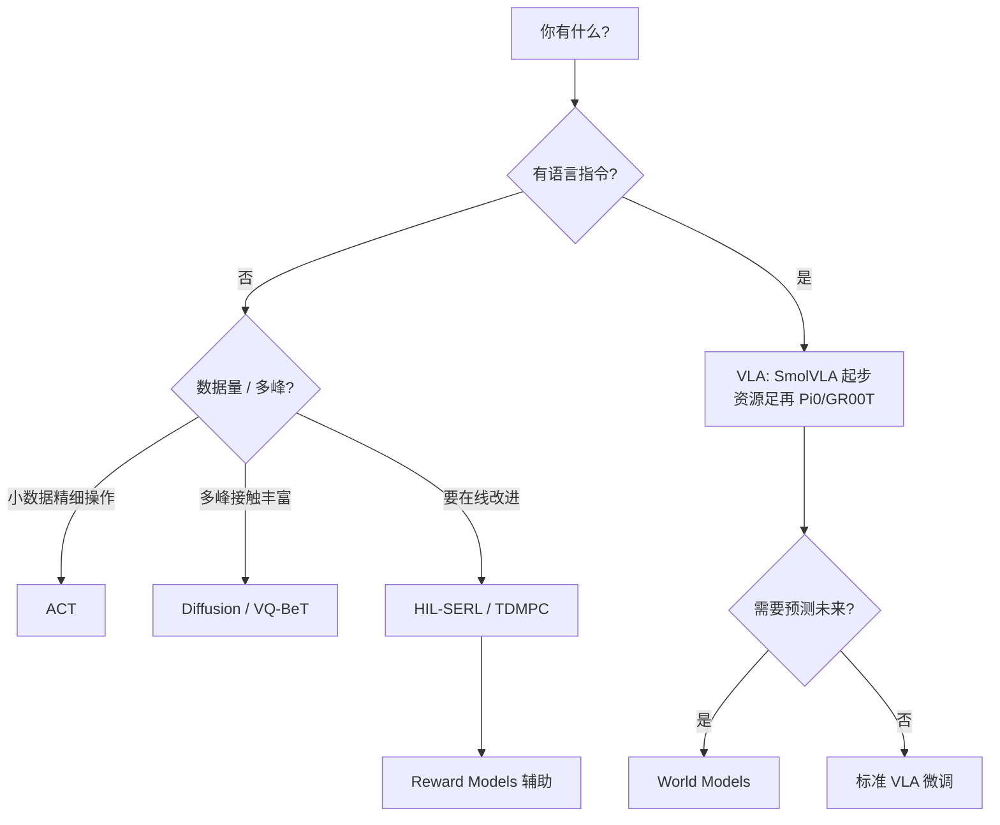

# LeRobot 模型百科（`tutorial/models/`）

对应仓库 README「SoTA Models」表中的全部类别与模型。
模型页分为三种深度：

- **深度指南**：ACT、Diffusion、SmolVLA、π0、π0.5、HIL-SERL（对着源码讲清训练/推理/调优）。VQ-BeT、Multitask DiT 接近这一档，并带字段表与自测。
- **实用指南**：π0-FAST、GR00T、X-VLA、EO-1、MolmoAct2、WALL-OSS、EVO1；World Models 三篇；Reward 三篇。覆盖契约、安装、排错，不重复官方全文。
- **快速导览**：TDMPC 等；**coming soon** 只标明仓库现状（QC-FQL）。

> 信息来源优先级：本仓库 `docs/source/` 与 `src/lerobot/policies/`、
> `src/lerobot/rewards/`、`src/lerobot/rl/` → 原论文/项目页 →
> Hugging Face / Discord / GitHub 公开讨论。
> 标注「coming soon」的条目会诚实说明仓库现状，不会编造未合并实现。

---

## 怎么读

1. 先看本页分类表，选你关心的模型
2. 深度指南按论文 → 实现 → 示例阅读；实用指南用于直接选型和上手；快速导览用于建立定位并跳转官方文档
3. 需要上手训练/评测时，跳回阶段教程：[`../README.md`](../README.md)
4. 官方英文页仍以 `docs/source/*.mdx` 为准（本目录是中文深度学习笔记）

---

## 目录结构

```text
tutorial/models/
├── README.md                          # 本索引
├── imitation-learning/                # 模仿学习
├── reinforcement-learning/            # 强化学习
├── vla/                               # 视觉-语言-动作
├── world-models/                      # 世界模型
└── reward-models/                     # 奖励模型
```

单篇模型文档的维护规范见
[`../_templates/model-page.md`](../_templates/model-page.md)。

---

## Imitation Learning

| 模型 | 文档 | 代码目录 | 官方文档 |
|------|------|----------|----------|
| ACT | [ACT.md](./imitation-learning/ACT.md) | `src/lerobot/policies/act/` | `docs/source/act.mdx` |
| Diffusion | [Diffusion.md](./imitation-learning/Diffusion.md) | `src/lerobot/policies/diffusion/` | `docs/source/policy_diffusion_README.md` |
| VQ-BeT | [VQ-BeT.md](./imitation-learning/VQ-BeT.md) | `src/lerobot/policies/vqbet/` | `docs/source/policy_vqbet_README.md` |
| Multitask DiT | [Multitask-DiT.md](./imitation-learning/Multitask-DiT.md) | `src/lerobot/policies/multi_task_dit/` | `docs/source/multi_task_dit.mdx` |

## Reinforcement Learning

| 模型 | 文档 | 代码/文档 | 深度 |
|------|------|-----------|------|
| HIL-SERL | [HIL-SERL.md](./reinforcement-learning/HIL-SERL.md) | `rl/`、`gaussian_actor/`、`rewards/classifier/` | 深度指南 |
| TDMPC | [TDMPC.md](./reinforcement-learning/TDMPC.md) | `policies/tdmpc/` | 快速导览 |
| QC-FQL | [QC-FQL.md](./reinforcement-learning/QC-FQL.md) | — | **coming soon** |

## VLAs

| 模型 | 文档 | 代码目录 |
|------|------|----------|
| Pi0 | [Pi0.md](./vla/Pi0.md) | `src/lerobot/policies/pi0/` |
| Pi0Fast | [Pi0Fast.md](./vla/Pi0Fast.md) | `src/lerobot/policies/pi0_fast/` |
| Pi0.5 | [Pi05.md](./vla/Pi05.md) | `src/lerobot/policies/pi05/` |
| GR00T N1.7 | [GR00T.md](./vla/GR00T.md) | `src/lerobot/policies/groot/` |
| SmolVLA | [SmolVLA.md](./vla/SmolVLA.md) | `src/lerobot/policies/smolvla/` |
| XVLA | [XVLA.md](./vla/XVLA.md) | `src/lerobot/policies/xvla/` |
| EO-1 | [EO-1.md](./vla/EO-1.md) | `src/lerobot/policies/eo1/` |
| MolmoAct2 | [MolmoAct2.md](./vla/MolmoAct2.md) | `src/lerobot/policies/molmoact2/` |
| WALL-OSS | [WALL-OSS.md](./vla/WALL-OSS.md) | `src/lerobot/policies/wall_x/` |
| EVO1 | [EVO1.md](./vla/EVO1.md) | `src/lerobot/policies/evo1/` |

## World Models

| 模型 | 文档 | 代码目录 |
|------|------|----------|
| VLA-JEPA | [VLA-JEPA.md](./world-models/VLA-JEPA.md) | `src/lerobot/policies/vla_jepa/` |
| LingBot-VA | [LingBot-VA.md](./world-models/LingBot-VA.md) | `src/lerobot/policies/lingbot_va/` |
| FastWAM | [FastWAM.md](./world-models/FastWAM.md) | `src/lerobot/policies/fastwam/` |

## Reward Models

| 模型 | 文档 | 代码目录 | 深度 |
|------|------|----------|------|
| SARM | [SARM.md](./reward-models/SARM.md) | `rewards/sarm/` | 实用指南 |
| TOPReward | [TOPReward.md](./reward-models/TOPReward.md) | `rewards/topreward/` | 实用指南 |
| Robometer | [Robometer.md](./reward-models/Robometer.md) | `rewards/robometer/` | 实用指南 |

选型对照见 [reward-models/README.md](./reward-models/README.md)。实机成功检测用 HIL-SERL 的 `reward_classifier`，不要和这三篇混为一谈。

---

## 选型速查（非常粗）



---

## 社区总入口（全模型通用）

- Discord：https://discord.gg/q8Dzzpym3f（LeRobot 官方）
- GitHub Issues：https://github.com/huggingface/lerobot/issues
- HF Hub Discussions / Blog：https://huggingface.co/lerobot
- 中文资源：README 中「同济子豪兄」飞书教程链接

各模型页的「社区讨论」会指向更具体的 issue / blog / 项目页讨论区。
