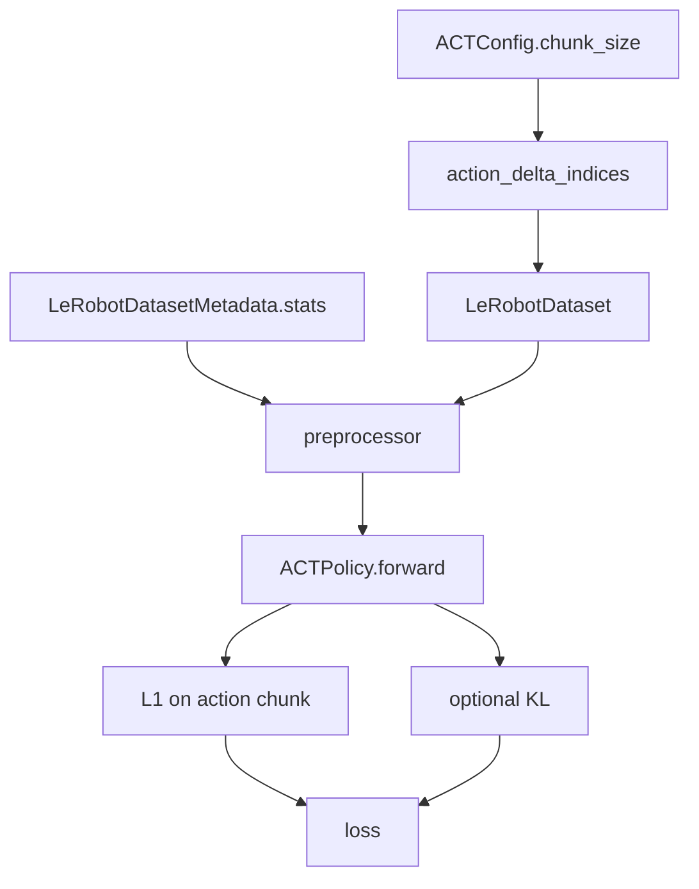
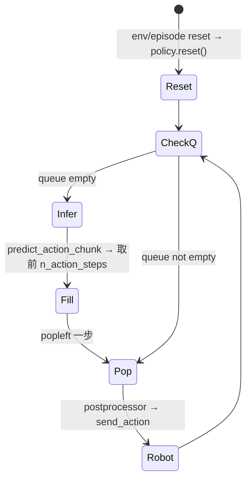
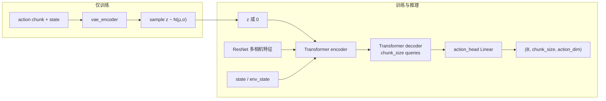

# ACT（Action Chunking with Transformers）深度指南

> 对应仓库：`src/lerobot/policies/act/`
> 官方英文页：`docs/source/act.mdx`
> 阶段课交叉：[`../../stages/04-ACT.md`](../../stages/04-ACT.md)

---

## 1. 概览：什么时候选 ACT？

**ACT** 是 LeRobot 最推荐的入门模仿学习策略：轻量（官方文档量级约 **~80M** 参数）、单卡数小时可训、对 SO-100/101 等低成本臂友好。

| 项 | 内容 |
|----|------|
| 类别 | Imitation Learning |
| 论文 | [Learning Fine-Grained Bimanual Manipulation with Low-Cost Hardware](https://arxiv.org/abs/2304.13705)（RSS 2023） |
| 作者 | Tony Z. Zhao, Vikash Kumar, Sergey Levine, Chelsea Finn |
| 项目页 | https://tonyzhaozh.github.io/aloha/ |
| 原实现 | https://github.com/tonyzhaozh/act |
| 注册名 | `policy.type=act`（`@PreTrainedConfig.register_subclass("act")`） |
| 本仓库代码 | `configuration_act.py` / `modeling_act.py` / `processor_act.py` |
| 示例 | `examples/tutorial/act/` |

**一句话：** 一次预测未来 `chunk_size` 步动作；用队列（或 temporal ensembling）把「段式预测」变成逐步控制。

适合：少量演示、精细接触、想先跑通闭环的人。
不太适合：强多峰且愿付扩散推理成本（可看 Diffusion）、需要语言条件（看 SmolVLA/π0）。

---

## 2. 论文精读（对着代码读）

### 2.1 问题设定

精细操作（开杯盖、插电池、穿线等）需要：

- 毫米级精度 + 接触力协调
- 闭环视觉反馈

传统路径依赖高价臂与精密标定。论文用 **ALOHA** 低成本双手遥操作收集数据，问：

> 端到端模仿学习能否让「不那么准」的硬件学会精细技能？

Behavior Cloning 的两个痛点被点名：

1. **误差复合**：单步策略的小错会把状态推出演示分布。
2. **演示非平稳 / 多风格**：同一任务人类会走不同时空轨迹。

### 2.2 方法：三个关键设计

#### （1）Action Chunking

不预测「下一步一个动作」，而预测长度 \(k\) 的动作序列（chunk）。
有效决策视界变短 → 复合误差减轻；轨迹内部更自洽 → 抖动减少。

在 LeRobot 中：

```171:172:src/lerobot/policies/act/configuration_act.py
    def action_delta_indices(self) -> list:
        return list(range(self.chunk_size))
```

Dataset 会按这些 index（再 `/fps`）取出整段 action 作为监督。

#### （2）CVAE + Transformer

训练时：

- **VAE encoder**（BERT 风格）：吃 `[CLS, (state), action_1..k]`，产出潜变量分布参数 \((\mu, \sigma)\)，采样风格 \(z\)。
- **Transformer encoder + decoder**：在观测（多相机 ResNet 特征、关节状态）与 \(z\) 条件下，用 **chunk_size 个 query** 解码出动作序列。

推理时：

- **丢掉 VAE encoder**，\(z=\mathbf{0}\)（先验均值）→ 给定观测时策略确定。

这直接对应 `ACT.forward` 里 `use_vae and training` 与 `else: latent_sample = zeros` 两分支。

#### （3）Temporal Ensembling（可选）

论文 Algorithm 2：每步都重新预测 chunk，对重叠时间步做指数加权平均，再执行当前步。
原论文常用系数量级 **0.01**（更偏向较旧预测）。
LeRobot 默认 **关闭**（`temporal_ensemble_coeff=None`），走 action queue；开启时强制 `n_action_steps=1`。

### 2.3 论文实验（报告值，复现请自测）

- 多个精细任务，约 **10 分钟**演示数据量级可到 **80–90%** 成功率（以论文表为准）。
- 社区复现时，成功率极度依赖：演示一致性、相机外参、工作空间是否与训练一致。

### 2.4 论文 → LeRobot 字段速查

| 论文概念 | LeRobot 字段 / 符号 |
|----------|---------------------|
| chunk 长度 \(k\) | `chunk_size`（默认 100） |
| 执行多少步再重规划 | `n_action_steps`（默认 100） |
| 是否用 CVAE | `use_vae`（默认 True） |
| KL 权重 | `kl_weight`（默认 10） |
| 潜变量维 | `latent_dim`（默认 32） |
| Temporal ensemble 系数 \(m\) | `temporal_ensemble_coeff`（默认 None） |
| 视觉骨干 | `vision_backbone=resnet18` + ImageNet 预训练 |
| Transformer 隐维 | `dim_model=512` |

**重要实现注记（与原版对齐）：**
`n_decoder_layers` 默认设为 **1**，因为原 ACT 仓库存在「配置写 7 层但实际只用第 1 层」的问题（见配置注释与 [tonyzhaozh/act#25](https://github.com/tonyzhaozh/act/issues/25#issue-2258740521)）。LeRobot 选择匹配原版有效行为，而不是照抄未生效的层数。

---

## 3. 实现地图与两张总图

### 3.1 文件职责

| 文件 | 职责 |
|------|------|
| `configuration_act.py` | 超参、校验、`action_delta_indices`、优化器预设 |
| `modeling_act.py` | `ACTPolicy` 接口 + `ACT` 网络 + `ACTTemporalEnsembler` |
| `processor_act.py` | 调用通用 `make_default_pre_post_processors`（normalize / device） |
| `examples/tutorial/act/*` | 手写最小训练循环 / 实机推理骨架 |

### 3.2 训练数据流



### 3.3 推理控制流（默认 queue 模式）



### 3.4 网络内部（训练时 CVAE）

源码 ASCII 图（`ACT` 类文档字符串）可概括为：



---

## 4. 可运行示例

### 4.1 环境

```bash
uv sync --locked --extra training
# ACT 在 base 安装中即可用，无需单独 act extra（见 docs/source/act.mdx）
```

### 4.2 一步链路验证（推荐先做）

编辑 `examples/tutorial/act/act_training_example.py`：

1. `device` → `cuda` / `mps` / `cpu`
2. **注释掉**三行 `push_to_hub`
3. 保持 `training_steps = 1`

```bash
uv run python examples/tutorial/act/act_training_example.py
```

**预期：** 打印 `step / loss`；`outputs/robot_learning_tutorial/act/` 出现 policy + processor 文件。

脚本在干什么（逻辑顺序）：

```python
meta = LeRobotDatasetMetadata(dataset_id)
features = dataset_to_policy_features(meta.features)
# ACTION → output_features，其余 → input_features
cfg = ACTConfig(input_features=..., output_features=...)
policy = ACTPolicy(cfg)
pre, post = make_pre_post_processors(cfg, dataset_stats=meta.stats)
delta = {"action": [i / fps for i in cfg.action_delta_indices], ...图像键...}
dataset = LeRobotDataset(dataset_id, delta_timestamps=delta)
batch = pre(batch)
loss, _ = policy.forward(batch)
```

### 4.3 正式训练（官方形态）

```bash
uv run lerobot-train \
  --dataset.repo_id=${HF_USER}/your_dataset \
  --policy.type=act \
  --policy.device=cuda \
  --batch_size=8 \
  --steps=100000 \
  --output_dir=outputs/train/act_your_dataset \
  --job_name=act_your_dataset \
  --wandb.enable=true
```

官方 tip（`act.mdx`）：

- 超参先用默认
- 单卡约数小时 / 10 万步量级（视数据与分辨率）
- batch 从 8 起，按显存调

无本地 GPU：可用文档中的 [ACT Colab notebook](https://huggingface.co/docs/lerobot/notebooks#training-act)。

### 4.4 实机 / 评测

- 教程骨架：`examples/tutorial/act/act_using_example.py`（填 port/id，对齐相机 key）
- 官方文档示例使用 `lerobot-rollout`（见 `act.mdx`「Evaluating ACT」）
- **每个 episode 开始调用 `policy.reset()`**，否则 queue / ensembler 状态会脏

视频课：https://www.youtube.com/watch?v=ft73x0LfGpM

---

## 5. 关键代码详解（按阅读顺序）

### 5.1 配置护栏：先读 `__post_init__`

```130:151:src/lerobot/policies/act/configuration_act.py
    def __post_init__(self):
        ...
        if self.temporal_ensemble_coeff is not None and self.n_action_steps > 1:
            raise NotImplementedError(...)
        if self.n_action_steps > self.chunk_size:
            raise ValueError(...)
        if self.n_obs_steps != 1:
            raise ValueError(...)
```

| 约束 | 原因 |
|------|------|
| `n_action_steps ≤ chunk_size` | 执行长度不能超过预测长度 |
| temporal ensemble ⇒ `n_action_steps=1` | 每步都要推理才能融合重叠 chunk |
| `n_obs_steps=1` | 当前实现未做多帧观测历史 |

`validate_features`：至少要有图像 **或** `observation.environment_state`。

### 5.2 Processor：几乎「默认流水线」

```29:50:src/lerobot/policies/act/processor_act.py
def make_act_pre_post_processors(config, dataset_stats=None):
    return make_default_pre_post_processors(config, dataset_stats, normalizer_device=config.device)
```

含义：ACT **没有**特殊 tokenizer；核心是 MEAN_STD 归一化（见 `normalization_mapping`）+ device。
因此「忘了保存/加载 processor」会直接表现为动作尺度错乱。

### 5.3 `ACTPolicy.select_action`：两种推理模式

```101:123:src/lerobot/policies/act/modeling_act.py
    def select_action(self, batch: dict[str, Tensor]) -> Tensor:
        self.eval()
        if self.config.temporal_ensemble_coeff is not None:
            actions = self.predict_action_chunk(batch)
            action = self.temporal_ensembler.update(actions)
            return action

        if len(self._action_queue) == 0:
            actions = self.predict_action_chunk(batch)[:, : self.config.n_action_steps]
            self._action_queue.extend(actions.transpose(0, 1))
        return self._action_queue.popleft()
```

**Queue 模式（默认）**

1. 队列空 → 跑网络得 `(B, chunk_size, A)`
2. 只保留前 `n_action_steps`
3. `transpose(0,1)` 后放进 `deque`，每控一步 `popleft`
4. 队列耗尽再推理 → **推理频率 ≈ 控制频率 / n_action_steps**

**Temporal ensemble 模式**

- 每步都 `predict_action_chunk`
- `ACTTemporalEnsembler.update` 做在线加权平均并吐出当前步
- 推理更贵，但更平滑；多峰任务上社区有争议（见第 6 节）

`predict_action_chunk` 会把各相机键收成 `OBS_IMAGES` 列表再调用 `self.model`。

### 5.4 `ACTPolicy.forward`：训练损失

```137:164:src/lerobot/policies/act/modeling_act.py
        actions_hat, (mu_hat, log_sigma_x2_hat) = self.model(batch)

        abs_err = F.l1_loss(batch[ACTION], actions_hat, reduction="none")
        valid_mask = ~batch["action_is_pad"].unsqueeze(-1)
        num_valid = valid_mask.sum() * abs_err.shape[-1]
        l1_loss = (abs_err * valid_mask).sum() / num_valid.clamp_min(1)
        ...
        if self.config.use_vae and log_sigma_x2_hat is not None:
            mean_kld = (
                (-0.5 * (1 + log_sigma_x2_hat - mu_hat.pow(2) - (log_sigma_x2_hat).exp())).sum(-1).mean()
            )
            loss = l1_loss + mean_kld * self.config.kl_weight
        else:
            loss = l1_loss
```

要点：

- 监督是 **整段 chunk 的 L1**，不是单步。
- `action_is_pad` 屏蔽 episode 越界假 GT。
- KL：\(D_{KL}(q(z)\| \mathcal{N}(0,I))\)，实现用 `log_sigma_x2`（\(2\log\sigma\)）以匹配原版。
- 日志字典含 `l1_loss` / `kld_loss`，调 `kl_weight` 时盯这两条曲线。

### 5.5 `ACT.forward`：潜变量从哪来？

**训练 + use_vae：**

1. 拼 VAE 输入：`[CLS, state?, action_1..k]`
2. `key_padding_mask` 合并 `action_is_pad`
3. CLS 输出 → `μ` 与 `log_sigma_x2`
4. 重参数：`z = μ + σ * ε`

**推理或关闭 VAE：**

```python
latent_sample = zeros(batch, latent_dim)  # z = 0
```

然后 Transformer encoder 的 token 序列为：

`[z_proj, state?, env_state?, 展平后的多相机特征图像素...]`

Decoder 侧：

- `decoder_pos_embed`：`nn.Embedding(chunk_size, dim_model)`（DETR 风格 object queries）
- 输入零向量 + 位置编码 → cross-attend encoder 输出
- `action_head: Linear(dim_model → action_dim)` 得到每步动作

### 5.6 Temporal Ensembler：权重直觉

```171:180:src/lerobot/policies/act/modeling_act.py
        # wᵢ = exp(-coeff * i)，再归一化
        # coeff=0 → 均匀
        # coeff>0 → 更信较旧预测
        # coeff<0 → 更信较新预测
        # 原 ACT 常用 0.01
```

实现用**在线**更新，不必缓存全部历史 chunk（见 `update` 方法）。

### 5.7 优化器：骨干可单独学习率

`get_optim_params` 把 `model.backbone.*` 与其余参数分组，`optimizer_lr_backbone` 可单独设（配置里默认与 `optimizer_lr` 同为 `1e-5`）。

---

## 6. 社区优秀讨论（可核对链接）

> 只列公开、可点开的讨论；结论以你的实验为准。

### 6.1 Temporal ensembling 的「翻车与修复」

| 链接 | 内容 |
|------|------|
| [PR #186](https://github.com/huggingface/lerobot/pull/186) | 首次合入 temporal ensembling；作者评论：多峰 + 单观测步时，ensemble 可能在模式间「搅和」，不一定涨点 |
| [PR #319](https://github.com/huggingface/lerobot/pull/319) | **Fix ACT temporal ensembling**：改回论文 Algorithm 2 的指数权重；表格显示 `m=0.01` 明显好于错误实现；并提醒 Discord 上旧字段 `temporal_ensemble_momentum` 不兼容 |

实践建议：

- 默认先 **关掉** ensemble，用 queue + 调 `n_action_steps`
- 要开：设 `temporal_ensemble_coeff=0.01` 且 `n_action_steps=1`
- 任务明显多峰时，优先怀疑 ensemble 在伤害模式选择（与 PR #186 评论一致）

### 6.2 原版 decoder 层数 bug

- [tonyzhaozh/act#25](https://github.com/tonyzhaozh/act/issues/25#issue-2258740521)
- LeRobot 用 `n_decoder_layers=1` **有意对齐**「原版实际生效行为」

### 6.3 入门生态讨论入口

- 官方视频课（文档内嵌）：https://www.youtube.com/watch?v=ft73x0LfGpM
- ALOHA 项目页视频/任务说明：https://tonyzhaozh.github.io/aloha/
- Discord：https://discord.gg/q8Dzzpym3f（SO 臂 + ACT 是最高频新手组合）
- Issues 关键词：`ACT`、`chunk_size`、`temporal_ensemble`、`action_is_pad`、相机 key

### 6.4 社区高频真实问题（主题级）

1. **训练 OK、实机飘**：相机名/分辨率/安装位与数据集不一致（不是「ACT 学不会」）。
2. **只存了权重**：缺 preprocessor → 动作尺度爆炸或龟速。
3. **开了 ensemble 却报错**：忘了把 `n_action_steps` 改成 1。
4. **loss 很低但不会做**：演示里有大量停顿/抖动，或评测时未 `reset()`。

---

## 7. 运行时调优手册

### 7.1 旋钮表

| 旋钮 | 偏小 | 偏大 | 建议起点 |
|------|------|------|----------|
| `chunk_size` | 短视、抖 | 难学、显存↑ | 100（默认） |
| `n_action_steps` | 推理太勤（延迟↑） | 开环太久（偏航） | 先 =`chunk_size`；不稳再降到 50/25 |
| `temporal_ensemble_coeff` | — | 每步推理；多峰可能有害 | 默认 None；尝试 0.01 |
| `kl_weight` | 风格正则弱 | 重建变差 | 10；看 `kld_loss` vs `l1_loss` |
| `use_vae` | 变成纯回归 chunk | — | 默认 True；消融可关 |
| `batch_size` | 噪声大 | OOM | 8 |
| `optimizer_lr` / backbone lr | 学太慢 | 不稳 | `1e-5` |
| 图像分辨率 | 细节不够 | 显存/IO 爆 | 与采集时一致，勿随意放大 |

### 7.2 症状 → 排查

| 症状 | 先查 |
|------|------|
| NaN / 爆炸梯度 | 归一化 stats、学习率、MPS 上图像路径（源码对 MPS 有注释提醒） |
| 动作幅度离谱 | 是否加载 postprocessor；训练/部署 stats 是否同一数据集 |
| 周期性「顿一下」 | queue 耗尽触发推理；增大 `n_action_steps` 或异步推理 |
| 平滑但反应慢 | ensemble 过重或 `n_action_steps` 过大 |
| 仿真可、实机崩 | 相机契约、标定、控制频率 vs 训练 fps |

### 7.3 设备

| 设备 | 建议 |
|------|------|
| CUDA | 正式训练首选 |
| MPS | 可跑通链路；注意部分算子与数值，batch 先小 |
| CPU | 仅验证 forward，不适合认真训练 |

---

## 8. 对照：ACT vs 常见替代

| 维度 | ACT | Diffusion Policy |
|------|-----|------------------|
| 动作生成 | 一次回归 chunk（+CVAE） | 多步去噪 |
| 观测历史 | 单步（当前实现） | `n_obs_steps` 常 ≥2 |
| 推理成本 | 每 `n_action_steps` 一次前向 | × `num_inference_steps` |
| 多峰 | 靠 VAE 潜变量，有限 | 通常更强 |
| 入门成本 | **最低** | 中等 |

下一步对照阅读：[`./Diffusion.md`](./Diffusion.md)

---

## 9. 自学清单（建议按天）

1. **Day 1**：跑通迷你训练；画出 queue 时序（假设 `n_action_steps=4`）。
2. **Day 2**：精读 `ACT.forward` 的 z 分支与 encoder token 列表；对照论文 Figure。
3. **Day 3**：在 notebook / 日志里盯 `l1_loss` 与 `kld_loss`；试 `kl_weight∈{1,10,20}`。
4. **Day 4**：实机或仿真 eval；专门制造「相机 key 错误」看失败模式。
5. **Day 5**：阅读 PR #319 表格；决定你的任务是否值得开 temporal ensemble。

---

## 10. 延伸阅读

- 论文：https://arxiv.org/abs/2304.13705 · PDF：https://arxiv.org/pdf/2304.13705
- 官方文档：`docs/source/act.mdx`
- 阶段教程第 4 课：[`../../stages/04-ACT.md`](../../stages/04-ACT.md)
- 数据窗基础：[`../../stages/02-数据集.md`](../../stages/02-数据集.md)
- Processor：[`../../stages/03-Processor.md`](../../stages/03-Processor.md)
- 模型百科首页：[`../README.md`](../README.md)
