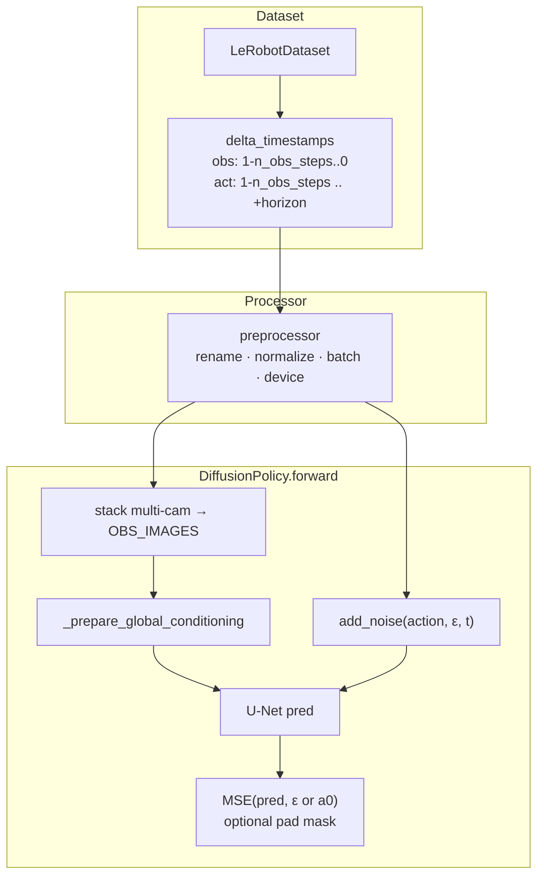
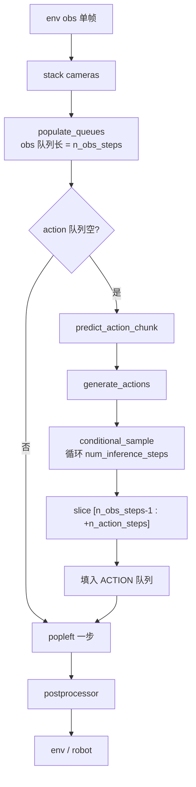
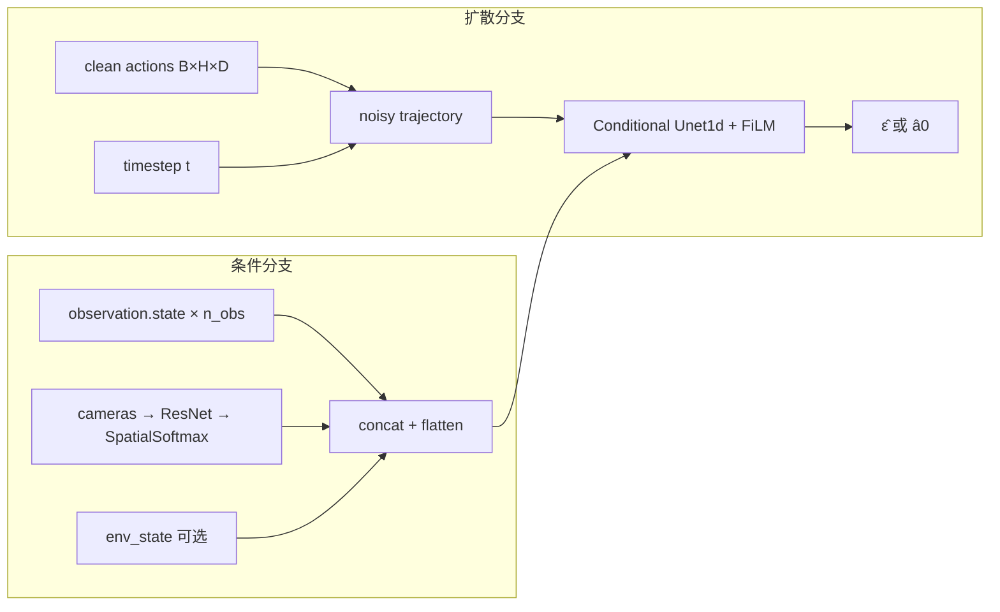

# Diffusion Policy 深度指南

> 对应仓库：`src/lerobot/policies/diffusion/`
> 官方英文页：`docs/source/policy_diffusion_README.md`
> 阶段课交叉：[`../../stages/05-Diffusion.md`](../../stages/05-Diffusion.md)
> 对照 ACT：[`ACT.md`](./ACT.md)

---

## 1. 概览：什么时候选 Diffusion？

**Diffusion Policy** 把策略建模为**条件动作扩散**：从高斯噪声迭代去噪，生成一整段动作轨迹。天然适合**多峰**演示（同一观测下人类会走多条合理轨迹），是 LeRobot 里与 ACT 并列的「经典模仿学习」第二选择。

| 项 | 内容 |
|----|------|
| 类别 | Imitation Learning |
| 论文 | [Diffusion Policy: Visuomotor Policy Learning via Action Diffusion](https://arxiv.org/abs/2303.04137)（RSS 2023 / IJRR 2024） |
| 作者（IJRR） | Cheng Chi, Zhenjia Xu, Siyuan Feng, Eric Cousineau, Yilun Du, Benjamin Burchfiel, Russ Tedrake, Shuran Song |
| 项目页 | https://diffusion-policy.cs.columbia.edu/ |
| 原实现 | https://github.com/real-stanford/diffusion_policy |
| 注册名 | `policy.type=diffusion`（`@PreTrainedConfig.register_subclass("diffusion")`） |
| 本仓库代码 | `configuration_diffusion.py` / `modeling_diffusion.py` / `processor_diffusion.py` |
| 示例 | `examples/tutorial/diffusion/` |
| 依赖 | `diffusers`（`uv sync --extra diffusion` 或按报错装） |

**一句话：** 观测（含历史）作条件 → U-Net 去噪出 `horizon` 长动作 → 只执行前 `n_action_steps` 步再重规划（receding horizon）。

适合：接触丰富、多解法抓取、演示风格发散、愿意付一点推理延迟。
不太适合：要极低延迟闭环、数据极少且单峰（先试 ACT）、需要语言指令（看 SmolVLA / π 系列）。

---

## 2. 论文精读（对着代码读）

### 2.1 问题设定

视觉运动策略（visuomotor policy）常见两条路：

1. **显式回归**（MSE / L1 到演示动作）→ 多峰时被「平均」成无效中间动作。
2. **隐式能量 / 分类离散化** → 高维连续动作上难训或不稳。

论文主张：在**动作空间**上做 DDPM 式生成，把观测当作条件，既表达多模态，又直接输出高维连续轨迹。

### 2.2 方法：三个关键设计

#### （1）Action-space diffusion（不是图像扩散）

前向：干净动作轨迹 \(a_{0:T}\) 加噪到 \(a_t\)。
反向：网络在条件 \(o\) 下预测噪声（或 \(a_0\)），scheduler 一步步还原。

LeRobot 默认：

- `prediction_type="epsilon"`（预测噪声）
- `noise_scheduler_type="DDPM"`，`num_train_timesteps=100`
- 推理步数 `num_inference_steps`：未设置时等于训练步数（**实机务必改小或换 DDIM**）

#### （2）Receding-horizon control

一次生成长度为 `horizon` 的轨迹，但只执行 `n_action_steps`，再根据新观测重规划。
这与 MPC 思想一致：长视野规划 + 短执行，兼顾一致性与闭环修正。

源码对时间轴写得很清楚（`select_action` 文档字符串）：

```
legend: o = n_obs_steps, h = horizon, a = n_action_steps

| 时间轴段 | 观测用于条件 | 动作被生成 | 动作被执行 |
|----------|--------------|------------|------------|
| 过去 o 步 | YES          | YES        | 前 o-1 步 NO；当前步起 YES |
| 未来     | NO           | YES        | 仅前 a 步 YES |
```

硬约束：

\[
\texttt{n\_action\_steps} \le \texttt{horizon} - \texttt{n\_obs\_steps} + 1
\]

注意：名字叫 `horizon`，但时间原点是「第一帧历史观测」，不是「当前时刻」——`n_obs_steps>1` 时尤其容易搞混。

#### （3）视觉条件 + 1D Temporal U-Net

论文有 CNN 与 Transformer 变体；**LeRobot 默认路径是 Conditional 1D U-Net**（`DiffusionConditionalUnet1d`）+ ResNet18 视觉编码 + Spatial Softmax keypoints，用 **FiLM** 把全局条件（状态/图像特征/扩散步）注入 U-Net。

`global_cond` 维度 ≈
`(state_dim [+ env_state] [+ rgb_feat × cameras]) × n_obs_steps`，再 flatten 成 `(B, D)`。

### 2.3 实验与结论（以论文报告为准）

- 多套操作基准上相对强 BC 基线平均约 **+46.9%**（论文数字）。
- 社区共识：多峰 / 接触任务常强于朴素回归；**延迟 ∝ `num_inference_steps` × U-Net 前向**。

### 2.4 论文概念 → LeRobot 字段

| 论文 / 原实现概念 | LeRobot 字段 / 代码 |
|------------------|---------------------|
| Observation history | `n_obs_steps`（默认 2） |
| Action prediction horizon | `horizon`（默认 **64**；旧文档/示例常写 16，以当前 `DiffusionConfig` 为准） |
| Execute steps / open-loop steps | `n_action_steps`（默认 32） |
| Drop last frames（避免末端 padding） | `drop_n_last_frames`（默认 7；注释：`horizon - n_action_steps - n_obs_steps + 1`） |
| DDPM / DDIM | `noise_scheduler_type` |
| Denoising iterations at test | `num_inference_steps` |
| Predict ε vs x₀ | `prediction_type` ∈ {`epsilon`, `sample`} |
| U-Net channel stages | `down_dims`（默认 `(512,1024,2048)`） |
| FiLM scale | `use_film_scale_modulation` |
| Vision | `vision_backbone`, `spatial_softmax_num_keypoints`, `use_separate_rgb_encoder_per_camera` |
| Action / state 归一化 | `normalization_mapping`：VISUAL→MEAN_STD，STATE/ACTION→**MIN_MAX**（与 ACT 常不同） |

---

## 3. LeRobot 实现地图

### 3.1 目录与职责

```
src/lerobot/policies/diffusion/
  configuration_diffusion.py  # 时间几何、scheduler、U-Net、校验
  modeling_diffusion.py       # DiffusionPolicy + DiffusionModel + U-Net/Encoder
  processor_diffusion.py      # → make_default_pre_post_processors
```

| 类 / 函数 | 职责 |
|-----------|------|
| `DiffusionConfig` | 注册 `"diffusion"`；校验 ResNet / scheduler / **horizon % 2^len(down_dims)==0** |
| `DiffusionPolicy` | `reset` 队列、`select_action` / `predict_action_chunk`、`forward`→loss |
| `DiffusionModel` | `conditional_sample`、`compute_loss`、`generate_actions`、条件编码 |
| `DiffusionRgbEncoder` | ResNet + SpatialSoftmax → 关键点特征 |
| `DiffusionConditionalUnet1d` | 1D 时序去噪骨干 |
| `make_diffusion_pre_post_processors` | 默认 normalize / batch / device 流水线 |

### 3.2 训练数据流



### 3.3 推理控制流（双队列）



### 3.4 与平台其它层

- **Dataset**：`observation_delta_indices` / `action_delta_indices` 驱动切片；训练时常配合 `drop_n_last_frames`。
- **Processor**：扩散没有 ACT 那种特殊 VAE 路径，走默认 pre/post。
- **Train/Eval**：`lerobot-train --policy.type=diffusion` / `lerobot-eval`；episode 边界必须 `policy.reset()` 清队列。

---

## 4. 示例：如何跑起来

### 4.1 最小脚本（推荐先跑）

```bash
# 需要 diffusion extra（提供 diffusers）
uv sync --extra diffusion   # 或按本机已有环境调整

uv run python examples/tutorial/diffusion/diffusion_training_example.py
# 脚本里默认 device=mps；无 Apple GPU 改成 cuda/cpu
# 若示例末尾 push_to_hub，学习阶段先注释掉
```

脚本关键模式（与 ACT 教程同构）：

1. `dataset_to_policy_features` → 填 `input_features` / `output_features`
2. `DiffusionConfig(...)` + `DiffusionPolicy`
3. `make_pre_post_processors`
4. 用 `cfg.observation_delta_indices` / `action_delta_indices` 建 `delta_timestamps`
5. 训练循环：`preprocessor(batch)` → `policy.forward` → backward

### 4.2 CLI 训练

```bash
uv run lerobot-train \
  --policy.type=diffusion \
  --dataset.repo_id=lerobot/pusht \
  --batch_size=8 \
  --steps=20000
```

实机推理前建议显式设：

```bash
--policy.noise_scheduler_type=DDIM \
--policy.num_inference_steps=10
```

### 4.3 时间几何自检（默认 2 / 64 / 32）

```python
n_obs_steps, horizon, n_action_steps = 2, 64, 32
assert n_action_steps <= horizon - n_obs_steps + 1  # 32 <= 63 ✓

down_dims = (512, 1024, 2048)
assert horizon % (2 ** len(down_dims)) == 0  # 64 % 8 == 0 ✓
```

改 `horizon=16` 时：`16 % 8 == 0` 仍合法，但要把 `n_action_steps`、`drop_n_last_frames` 一起改，别只改一个。

---

## 5. 关键代码详解

### 5.1 Config：时间索引与 U-Net 整除约束

```python
# configuration_diffusion.py（概念对应）
n_obs_steps: int = 2
horizon: int = 64
n_action_steps: int = 32
drop_n_last_frames: int = 7  # = horizon - n_action_steps - n_obs_steps + 1
```

```251:256:src/lerobot/policies/diffusion/configuration_diffusion.py
    def observation_delta_indices(self) -> list:
        return list(range(1 - self.n_obs_steps, 1))

    def action_delta_indices(self) -> list:
        return list(range(1 - self.n_obs_steps, 1 - self.n_obs_steps + self.horizon))
```

含义（`n_obs_steps=2`, `horizon=64`）：

- 观测：`[-1, 0]`（上一帧 + 当前）
- 动作：从 `-1` 起连续 64 步（覆盖「历史对齐段 + 未来」）

U-Net 每级时序下采样 ×2：

```206:213:src/lerobot/policies/diffusion/configuration_diffusion.py
        downsampling_factor = 2 ** len(self.down_dims)
        if self.horizon % downsampling_factor != 0:
            raise ValueError(
                "The horizon should be an integer multiple of the downsampling factor (which is determined "
                f"by `len(down_dims)`). Got {self.horizon=} and {self.down_dims=}"
            )
```

**坑：** `horizon=50` + 默认三级 `down_dims` → 直接 `ValueError`。改 horizon 或缩短 `down_dims`。

### 5.2 `select_action`：观测队列 + 动作队列

```125:161:src/lerobot/policies/diffusion/modeling_diffusion.py
    def select_action(self, batch: dict[str, Tensor], noise: Tensor | None = None) -> Tensor:
        ...
        self._queues = populate_queues(self._queues, batch)

        if len(self._queues[ACTION]) == 0:
            actions = self.predict_action_chunk(batch, noise=noise)
            self._queues[ACTION].extend(actions.transpose(0, 1))

        action = self._queues[ACTION].popleft()
        return action
```

要点：

1. 多相机先 `stack` 成 `OBS_IMAGES`，再入队。
2. 动作队列耗尽才触发一次昂贵的 `conditional_sample`。
3. 平均「每环境步」成本 ≈ `num_inference_steps / n_action_steps` 次 U-Net（忽略编码）。
4. `noise=` 可注入固定噪声，便于复现 / 调试。

`reset()` 在 `env.reset()` 时调用，清空 state/image/action 队列；忘了会导致跨 episode 污染。

### 5.3 `generate_actions`：去噪整段，再切执行窗

```308:333:src/lerobot/policies/diffusion/modeling_diffusion.py
    def generate_actions(self, batch: dict[str, Tensor], noise: Tensor | None = None) -> Tensor:
        ...
        global_cond = self._prepare_global_conditioning(batch)
        actions = self.conditional_sample(batch_size, global_cond=global_cond, noise=noise)

        start = n_obs_steps - 1
        end = start + self.config.n_action_steps
        actions = actions[:, start:end]
        return actions
```

对默认 `n_obs_steps=2`：丢掉与「最老观测」对齐的那一步生成动作，从「当前观测」对齐的位置起取 `n_action_steps` 步——与文档表一致。

### 5.4 `conditional_sample`：推理成本中心

```234:268:src/lerobot/policies/diffusion/modeling_diffusion.py
    def conditional_sample(...):
        sample = noise or torch.randn(batch, horizon, action_dim)
        self.noise_scheduler.set_timesteps(self.num_inference_steps)
        for t in self.noise_scheduler.timesteps:
            model_output = self.unet(sample, t, global_cond=global_cond)
            sample = self.noise_scheduler.step(model_output, t, sample, ...).prev_sample
        return sample
```

| 旋钮 | 效果 |
|------|------|
| `num_inference_steps` ↓ | 更快，质量可能降 |
| `DDPM` → `DDIM` | 通常更少步仍可用 |
| `compile_model=True` | 小 batch 重复推理可加速（首次编译慢） |
| `clip_sample` + MIN_MAX 动作 | 动作需落在 `[-clip_sample_range, +clip_sample_range]`（默认 1.0） |

### 5.5 `compute_loss`：训练路径（与推理不同）

```335:400:src/lerobot/policies/diffusion/modeling_diffusion.py
    def compute_loss(self, batch):
        global_cond = self._prepare_global_conditioning(batch)
        trajectory = batch[ACTION]
        eps = torch.randn_like(trajectory)
        timesteps = torch.randint(0, num_train_timesteps, (B,))
        noisy = self.noise_scheduler.add_noise(trajectory, eps, timesteps)
        pred = self.unet(noisy, timesteps, global_cond=global_cond)
        target = eps if prediction_type == "epsilon" else trajectory
        loss = MSE(pred, target)  # 可选按 action_is_pad mask
```

训练是**单步噪声预测**，不是 unroll 完整反向过程——所以训练吞吐远高于「每 step 100 次去噪」的朴素想法。

`do_mask_loss_for_padding` 默认 **False**（对齐原实现）；若轨迹末端 copy-pad 严重，可打开并用 `action_is_pad`。

### 5.6 Processor

`processor_diffusion.py` 直接委托 `make_default_pre_post_processors`：rename → normalize（按 `normalization_mapping`）→ batch → device；输出侧 unnormalize。
**STATE/ACTION 用 MIN_MAX** 时，务必保证 `clip_sample_range` 与归一化后范围一致，否则推理裁剪会砍掉合法动作。

### 5.7 网络内部（读图用）



---

## 6. 社区优秀讨论

> 只列可公开核对的入口；楼层内容会变，以链接内最新讨论为准。不编造引用。

| 主题 | 入口 | 你会学到 |
|------|------|----------|
| 论文与视频 | [项目页](https://diffusion-policy.cs.columbia.edu/) | 多模态动机、receding horizon 直觉 |
| 原实现 | [real-stanford/diffusion_policy](https://github.com/real-stanford/diffusion_policy) | 与 LeRobot 字段对照时的「上游真相」 |
| 时间几何 / 配置 | 搜 Issues：`horizon`、`n_obs_steps`、`diffusion` | 队列、`delta_timestamps` 对不齐时的典型症状 |
| 推理太慢 | 搜：`num_inference_steps`、`DDIM` | 实机部署的第一步几乎总是减步数 |
| U-Net 形状错误 | 搜：`downsampling` / `horizon` ValueError | `horizon % 2^len(down_dims)==0` |
| 概念读物（第三方） | [Embodied Book · Diffusion Policy](https://embodiedbook.apartsin.com/) | 教材向串联（非官方） |

通用：

- Discord：https://discord.gg/q8Dzzpym3f
- Issues：https://github.com/huggingface/lerobot/issues
- HF Papers：https://huggingface.co/papers/2303.04137

---

## 7. 调优与常见坑

### 7.1 按症状

| 症状 | 可能原因 | 建议 |
|------|----------|------|
| 控制频率跟不上 | `num_inference_steps` 太大 / 仍用满步 DDPM | `DDIM` + `num_inference_steps=8~16`；增大 `n_action_steps` |
| Config `__post_init__` 炸 | `horizon` 不能被下采样因子整除 | `horizon ∈ {16,32,64,128…}` 或减少 `down_dims` 级数 |
| 训练/推理动作幅度怪 | MIN_MAX + `clip_sample` | 查 stats；确认 postprocessor；必要时调 `clip_sample_range` |
| OOM | 多相机 × `n_obs_steps` × 大 U-Net | 降 `batch_size`、分辨率、`down_dims`；开 `gradient_checkpointing` |
| 不如 ACT | 任务本就单峰 / 数据少 | 先 ACT；或确认演示是否真有多模态 |
| 跨 episode 乱动 | 忘记 `policy.reset()` | 每个 `env.reset()` 清队列 |
| 末端动作糊 | padding 监督污染 | 调 `drop_n_last_frames`；试 `do_mask_loss_for_padding=True` |
| 多相机不收敛 | 共享 encoder 欠拟合 | 默认已是 `use_separate_rgb_encoder_per_camera=True`，别随手关掉 |

### 7.2 推荐默认起点（桌面臂 / PushT 量级）

| 旋钮 | 起点 | 备注 |
|------|------|------|
| `n_obs_steps` | 2 | 与论文常见设置一致 |
| `horizon` | 64（仓库默认）或 16（更轻） | 改时联动 `n_action_steps` / `drop_n_last_frames` |
| `n_action_steps` | `horizon // 2` | 越大越省推理次数，闭环越「开环」 |
| 训练步扩散 | `num_train_timesteps=100` | 一般别先动 |
| 推理 | DDIM + 10 steps | 实机第一优化 |
| `optimizer_lr` | `1e-4` | 配置预设 |
| batch | 8~64（显存定） | 图像分辨率优先砍 |

### 7.3 ACT vs Diffusion（选型速查）

| 维度 | ACT | Diffusion |
|------|-----|-----------|
| 多峰表达 | CVAE（有限） | 扩散（更强） |
| 推理成本 | 单次前向 | × `num_inference_steps` |
| 时间结构 | `chunk_size` / `n_action_steps` | `n_obs_steps` / `horizon` / `n_action_steps` |
| 归一化常见 | 常 MEAN_STD 等 | STATE/ACTION 默认 **MIN_MAX** |
| 入门友好 | 更佳 | 多一个 scheduler 心智负担 |
| 依赖 | 无 diffusers | 需要 `diffusers` |

---

## 8. 五日精读清单（可选）

| 天 | 任务 | 产出 |
|----|------|------|
| D1 | 读论文 Intro + Method；对照 §2.4 表 | 能口述「为何不回归」 |
| D2 | 跑通 `diffusion_training_example.py` 数 step | loss 曲线截图 |
| D3 | 精读 `select_action` + 手算 o/h/a 表 | 自己画一张时间轴 |
| D4 | 只改 DDIM + `num_inference_steps`，比延迟 | 延迟表 |
| D5 | 与 ACT 同数据短训对比 | 三行结论写入笔记 |

---

## 9. 延伸阅读

- arXiv：https://arxiv.org/abs/2303.04137
- 阶段教程第 5 课：[`../../stages/05-Diffusion.md`](../../stages/05-Diffusion.md)
- ACT 对照：[`ACT.md`](./ACT.md)
- 返回模型总目录：[`../README.md`](../README.md)
- 阶段主线：[`../../README.md`](../../README.md)

---

### 自测（10 条）

| # | 输入 / 问题 | 预期 |
|---|-------------|------|
| 1 | `horizon=50`, 默认 `down_dims` 三级 | `__post_init__` ValueError |
| 2 | `n_obs=2,h=16,a=16` | 违反 `a <= h-n_obs+1`（16 ≰ 15），行为未定义/逻辑错误 |
| 3 | `num_inference_steps=None` | 推理步数 = `num_train_timesteps`（默认 100） |
| 4 | 改用 DDIM + 10 steps | 延迟显著下降（同硬件） |
| 5 | 忘记 `reset()` 换 episode | 观测/动作队列串台，动作异常 |
| 6 | `prediction_type=epsilon` | loss 目标是噪声 ε |
| 7 | `do_mask_loss_for_padding=True` 且无 `action_is_pad` | 训练报错 |
| 8 | 默认 `observation_delta_indices` | `[-1, 0]` |
| 9 | `generate_actions` 切片起点 | `n_obs_steps - 1` |
| 10 | STATE 归一化 MIN_MAX + `clip_sample_range=1` | 归一化后动作应在约 [-1,1] |
