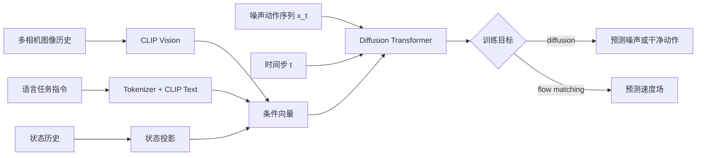

# Multitask DiT：语言条件的多任务动作生成

Multitask DiT 是一个约 4.5 亿参数量级的视觉—语言条件动作策略：CLIP 视觉编码器提取相机信息，CLIP 文本编码器表示任务指令，Diffusion Transformer（DiT）生成 action chunk。当前 LeRobot 实现可在同一架构下选择 diffusion 或 flow matching 两种目标。

| 项目 | 内容 |
|---|---|
| 注册名 | `multi_task_dit` |
| 参考论文 | [A Careful Examination of Large Behavior Models for Multitask Dexterous Manipulation](https://arxiv.org/abs/2507.05331) |
| 解析文章 | [Dissecting and Open-Sourcing Multitask Diffusion Transformer Policy](https://brysonkjones.substack.com/p/dissecting-and-open-sourcing-multitask-diffusion-transformer-policy) |
| LeRobot 实现 | `src/lerobot/policies/multi_task_dit/` |
| 仓库内官方指南 | `docs/source/multi_task_dit.mdx` |

> 这是资源需求较高的多任务策略。若你还没有一个稳定的单任务基线，先跑 [`ACT.md`](./ACT.md) 或 [`Diffusion.md`](./Diffusion.md)，通常更容易区分数据问题和模型问题。

---

## 1. 它解决什么问题

普通单任务策略常把“做什么”隐含在数据集或 checkpoint 中。Multitask DiT 将任务文本显式编码，使同一套视觉、状态和动作模型可以学习多个技能：



适合它的前提：

- 数据确实包含多个任务，并有稳定、可区分的语言描述；
- 每个任务的数据量和质量足以学习；
- 需要共享视觉表示，而不是维护很多完全独立的策略；
- 有能力承担 CLIP 编码器与 DiT 的训练、推理成本。

它不会自动解决任务分布不平衡，也不会从缺失的任务文字中推断训练意图。

---

## 2. 语言条件的数据契约

`processor_multi_task_dit.py` 在默认预处理流水线中插入 `TokenizerProcessorStep`：

```text
rename observations
→ add batch dimension
→ tokenize language task
→ move to device
→ normalize
```

默认 tokenizer 是 `openai/clip-vit-base-patch16`，最大长度 77，右侧 padding，并启用截断。模型读取 tokenizer 产生的 language token 和 attention mask；文本编码器权重冻结，但其投影层可学习。

训练前至少抽查这些问题：

- 每个 episode 是否真的有任务文本；
- 同一任务的表述是否一致，还是出现无意义漂移；
- 相似任务的文字能否区分目标物、动作和位置；
- 长指令是否被 77 token 截断；
- 各任务 episode 数量是否严重失衡。

“拿起杯子”和“拿起红杯子”可能对人足够清楚，但当场景里有多个相似物体时，模型还需要视觉上可辨认的证据。文字不能补救相机看不到目标的问题。

---

## 3. Diffusion 还是 Flow Matching

两者共享观察编码器和 DiT，只替换训练目标与采样过程。

| 维度 | Diffusion | Flow Matching |
|---|---|---|
| 配置 | `objective=diffusion` | `objective=flow_matching` |
| 学习目标 | 噪声 `epsilon` 或干净 `sample` | 从噪声到数据的速度场 |
| 推理 | DDPM/DDIM scheduler 逐步去噪 | Euler 或 RK4 积分 ODE |
| 默认步数 | 100 个训练时间步；推理默认同数 | 100 个积分步 |
| 首个基线 | 推荐 | 在相同数据划分上做对照 |

### Diffusion 路径

`DiffusionObjective.compute_loss()` 给干净动作加噪，随机采样时间步，然后让 DiT 预测噪声或干净动作。推理从高斯噪声开始，按 scheduler 反复更新。

若闭环推理太慢，可用 DDIM 并减少推理步数，例如：

```bash
--policy.noise_scheduler_type=DDIM \
--policy.num_inference_steps=10
```

降低步数是速度—质量折中，必须重新测成功率和动作平滑度。

### Flow Matching 路径

`FlowMatchingObjective.compute_loss()` 在噪声和真实动作之间采样路径点，让 DiT 预测速度。默认使用 beta 时间采样；推理用 Euler 积分。RK4 每个积分区间要多次求模型，通常更准也更慢。

```bash
--policy.objective=flow_matching \
--policy.timestep_sampling_strategy=beta \
--policy.num_integration_steps=100 \
--policy.integration_method=euler
```

不要在首次实验中同时切换目标、模型规模和数据增强，否则结果无法归因。

---

## 4. 时间窗口与 action queue

默认值：

```text
n_obs_steps = 2
horizon = 32
n_action_steps = 24
```

对应源码索引：

```text
observation_delta_indices = [-1, 0]
action_delta_indices      = [-1, 0, 1, ..., 30]
drop_n_last_frames        = 7
```

模型生成长度为 `horizon` 的动作序列。`_generate_actions()` 从索引 `n_obs_steps - 1` 开始，截取 `n_action_steps` 个动作，所以默认执行生成序列的第 1 到第 24 项。`select_action()` 将这 24 项压入队列，逐帧弹出；队列空时重新生成。

`drop_n_last_frames` 默认按下式自动计算：

\[
horizon - n\_action\_steps - n\_obs\_steps + 1
\]

因此修改三个时间参数后，应检查其结果非负且符合数据边界。直觉上：

- 增大 `n_action_steps`：推理频率下降、动作更连贯，但纠错变慢；
- 减小 `n_action_steps`：更频繁观察和重规划，但推理负担增大；
- 增大 `horizon`：学习更长轨迹结构，也会增加序列计算与数据需求；
- 增大 `n_obs_steps`：提供更多时序信息，但多相机视觉历史很吃显存。

---

## 5. 安装与基线训练

### 5.1 安装专用依赖

此策略依赖 `transformers` 和 `diffusers`：

```bash
uv sync --locked --extra multi_task_dit --extra training
```

首次使用 CLIP 权重需要能够从 Hugging Face 下载或提前缓存模型。

### 5.2 建立 diffusion 基线

```bash
uv run lerobot-train \
  --policy.type=multi_task_dit \
  --policy.objective=diffusion \
  --policy.device=cuda \
  --dataset.repo_id=<HF_USER/MULTITASK_DATASET> \
  --output_dir=outputs/train/multitask_dit_diffusion \
  --steps=30000 \
  --batch_size=32
```

`30000` 来自仓库官方指南对单任务实验的起步建议，`32` 是保守示例。官方指南提到硬件允许时更大的 batch（192–320）可能有益，但它不是运行要求，也不应在显存不足时照搬。

默认模型配置包括：

| 组件 | 默认值 |
|---|---|
| DiT | hidden 512、6 层、8 heads、dropout 0.1 |
| 位置编码 | RoPE 开启，绝对位置编码关闭 |
| 视觉 | CLIP ViT-B/16，裁剪为 224×224 |
| 文本 | CLIP ViT-B/16，最大 77 tokens |
| 优化器 | Adam，主体学习率 `2e-5` |
| 视觉编码器 | 主体学习率的 `0.1` 倍 |
| 归一化 | visual `MEAN_STD`，state/action `MIN_MAX` |

### 5.3 在同一基线上比较 flow matching

保留数据、seed、模型规模、训练步数和评测协议，只改目标相关参数：

```bash
uv run lerobot-train \
  --policy.type=multi_task_dit \
  --policy.objective=flow_matching \
  --policy.timestep_sampling_strategy=beta \
  --policy.integration_method=euler \
  --policy.num_integration_steps=100 \
  --policy.device=cuda \
  --dataset.repo_id=<HF_USER/MULTITASK_DATASET> \
  --output_dir=outputs/train/multitask_dit_flow \
  --steps=30000 \
  --batch_size=32
```

### 5.4 恢复训练

```bash
uv run lerobot-train \
  --config_path=outputs/train/multitask_dit_diffusion/checkpoints/last/pretrained_model \
  --resume=true
```

保存的 checkpoint 已包含模型配置，恢复时不要再混入另一套 objective 参数。

---

## 6. 源码阅读地图

1. `configuration_multi_task_dit.py`：目标选择、时间窗口、CLIP 与 DiT 参数；
2. `processor_multi_task_dit.py`：语言 token 化和归一化顺序；
3. `ObservationEncoder.encode()`：多相机、状态和文本如何形成条件；
4. `DiffusionTransformer.forward()`：动作 token、时间嵌入和条件注入；
5. `DiffusionObjective` / `FlowMatchingObjective`：训练目标和采样；
6. `MultiTaskDiTPolicy.select_action()`：观察/action 队列。

实现层面要特别注意：

- 支持多个相机，但所有图像 feature 必须具有相同 shape；
- `use_separate_rgb_encoder_per_camera=False` 时相机共享视觉编码器；
- `get_optim_params()` 把视觉编码器单独分组，其学习率是 `optimizer_lr × vision_encoder_lr_multiplier`；
- crop 大于 resize 后的图像时，配置会警告并禁用 crop；
- `hidden_dim` 必须能被 `num_heads` 整除；
- policy 的 `reset()` 必须在 episode 边界调用，否则 action queue 会串 episode。

---

## 7. 调优顺序

### 第一步：先证明条件有效

用两个视觉上和文字上都容易区分的任务建立小型多任务基线。对固定图像分别输入不同指令，观察 rollout 是否真的改变。若不改变，先查任务字段与 tokenizer，不要立即放大模型。

### 第二步：处理任务分布

按任务统计 episode、帧数、成功示范比例和动作范围。训练集总体很大，不代表每个任务都有足够覆盖。评测也应按任务分别报告成功率，避免平均值掩盖失败任务。

### 第三步：调时间与推理

先固定训练目标，扫描 `n_action_steps`；若 diffusion 推理延迟过高，再比较 DDIM 和 `num_inference_steps`。Flow matching 则扫描积分步数，并单独比较 Euler/RK4 的耗时。

### 第四步：最后调容量

显存不足优先减 batch、图像尺寸或历史长度。减少 `num_layers` / `hidden_dim` 会直接改变模型容量，应作为有记录的模型对照，而不是临时救火参数。

---

## 8. 常见失败模式

| 现象 | 可能原因 | 优先动作 |
|---|---|---|
| 完全忽略指令 | 任务文本缺失、token 未进入 batch、任务分布偏斜 | 抽样 processor 输出；按任务统计数据 |
| 相似任务互相混淆 | 描述不够具体或视觉证据不足 | 重写指令；检查目标物可见性；增加该任务数据 |
| 机器人停着不动 | 示范中等待帧过多、action 归一化或数据不足 | 看动作直方图和原始 episode；移除无意义停顿 |
| loss 下降但 rollout 差 | action chunk 开环太长或评测指令分布漂移 | 缩短 `n_action_steps`；统一训练/评测表述 |
| CUDA OOM | 多相机 × 历史 × CLIP × DiT | 先减 batch，再减图像/历史，最后减模型 |
| diffusion 太慢 | 推理步数多 | 尝试 DDIM + 较少步数并重测质量 |
| flow matching 太慢 | 积分步数多或使用 RK4 | 减步数或用 Euler |
| crop 未生效 | crop 大于 resize 后尺寸 | 查看 warning，修正两组 shape |

官方指南报告的 LIBERO 平均结果属于特定数据、配置与评测协议，只可作为复现参考，不能替代你自己的分任务评测。

---

## 9. 最小验收清单

- [ ] 已安装 `multi_task_dit` extra；
- [ ] 每个 episode 有可核对的语言任务；
- [ ] tokenizer 输出和 attention mask 存在；
- [ ] 多相机 shape 一致；
- [ ] `horizon`、`n_obs_steps`、`n_action_steps` 组合合法；
- [ ] diffusion 与 flow matching 实验一次只改变目标相关变量；
- [ ] episode 开始时调用 `reset()`；
- [ ] 按任务报告成功率、延迟与显存，而不只看总体 loss。

## 10. 论文 / 配置字段对照

| 概念 | LeRobot |
|------|---------|
| 注册名 | `multi_task_dit` |
| extra | `multi_task_dit` |
| 目标 | `objective=diffusion` 或 `flow_matching` |
| 时间窗 | `n_obs_steps=2`，`horizon=32`，`n_action_steps=24` |
| 文本 | CLIP tokenizer，最长 77 |
| 视觉 | CLIP ViT-B/16，224；可多相机但 shape 必须相同 |
| 加速 diffusion 推理 | `DDIM` + `num_inference_steps` |

## 11. 社区入口

- 参考论文：[arXiv 2507.05331](https://arxiv.org/abs/2507.05331)  
- 解析：[Dissecting Multitask DiT](https://brysonkjones.substack.com/p/dissecting-and-open-sourcing-multitask-diffusion-transformer-policy)  
- 官方指南：`docs/source/multi_task_dit.mdx`  
- Issues：搜 `multi_task_dit` / `objective` / tokenizer  
- [Boston Dynamics LBM](https://bostondynamics.com/blog/large-behavior-models-atlas-find-new-footing/)（背景，非本实现文档）

## 12. 自测

| # | 问题 | 预期 |
|---|------|------|
| 1 | 无 `task` 列？ | 条件无效，策略像单任务 BC |
| 2 | 一次改 objective 和 hidden_dim？ | 无法归因；禁止 |
| 3 | 执行切片起点？ | `n_obs_steps - 1` |
| 4 | `drop_n_last_frames` 公式？ | `horizon - n_action_steps - n_obs_steps + 1` |
| 5 | 视觉编码器 lr？ | `optimizer_lr × vision_encoder_lr_multiplier`（默认 0.1） |
| 6 | extra 名？ | `multi_task_dit` |

对照：[VQ-BeT](./VQ-BeT.md) · [Diffusion](./Diffusion.md) · [SmolVLA](../vla/SmolVLA.md)

返回：[模仿学习目录](./README.md) · [阶段主线](../../README.md)
