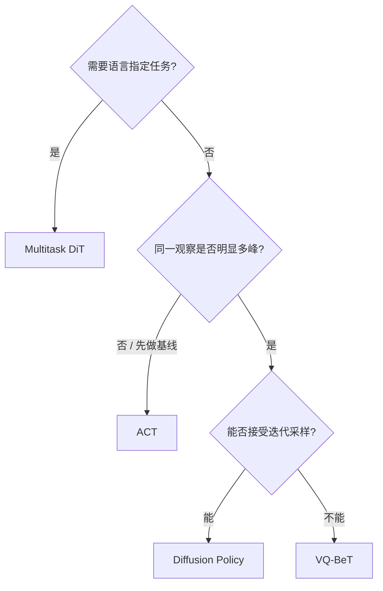

# Imitation Learning 模型

本目录把四条模仿学习路线放到同一套问题里比较：怎样表示多峰动作、一次执行多少步、是否需要语言条件，以及训练和推理成本落在哪里。

| 模型 | 核心表示 | 语言条件 | 当前教程 |
|---|---|---:|---|
| [ACT](./ACT.md) | CVAE + action chunk | 否 | 深度指南 |
| [Diffusion Policy](./Diffusion.md) | 迭代去噪生成连续动作 | 否 | 深度指南 |
| [VQ-BeT](./VQ-BeT.md) | 离散码 + 连续 offset | 否 | 深度指南（两阶段 RVQ + 自测） |
| [Multitask DiT](./Multitask-DiT.md) | CLIP 条件的 DiT；diffusion / flow matching | 是 | 深度指南（语言契约 + 自测） |

## 怎么选

| 你的首要约束 | 建议起点 | 原因 |
|---|---|---|
| 小数据、精细操作、先建立可靠基线 | ACT | 路径成熟，chunk 与 KL 较容易诊断 |
| 单任务但动作明显多峰 | Diffusion Policy | 直接建模连续多峰动作分布 |
| 多峰且控制环在意生成延迟 | VQ-BeT | 离散码一次生成，但需先学好码本 |
| 多任务且必须由语言区分技能 | Multitask DiT | 文本与视觉共同作为动作生成条件 |
| 多相机且想用 VQ-BeT | 先换模型或改实现 | 当前 VQ-BeT 校验只允许一个图像 feature |

## 推荐阅读顺序

1. 先读 [ACT](./ACT.md)，建立 action chunk、processor 和闭环队列的共同概念；
2. 读 [Diffusion Policy](./Diffusion.md)，理解连续生成式策略；
3. 读 [VQ-BeT](./VQ-BeT.md)，比较离散潜动作与 diffusion；
4. 最后读 [Multitask DiT](./Multitask-DiT.md)，把语言条件和两种生成目标加入系统。

上手训练、记录数据和评测请回到[阶段主线](../../README.md)；返回[模型总目录](../README.md)。
