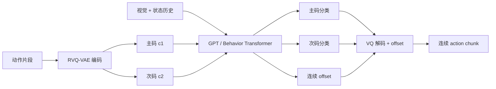

# VQ-BeT：用离散潜动作表达多峰行为

VQ-BeT（Vector-Quantized Behavior Transformer）先用残差向量量化器把连续动作片段压缩成离散码，再让 Transformer 根据视觉和状态历史预测“动作码 + 连续偏移”。它适合动作存在多种合理解、又希望推理比迭代去噪更直接的模仿学习任务。

| 项目 | 内容 |
|---|---|
| 注册名 | `vqbet` |
| 论文 | [Behavior Generation with Latent Actions](https://arxiv.org/abs/2403.03181)，ICML 2024 Spotlight |
| 项目页 | [sjlee.cc/vq-bet](https://sjlee.cc/vq-bet/) |
| 官方实现 | [jayLEE0301/vq_bet_official](https://github.com/jayLEE0301/vq_bet_official) |
| LeRobot 实现 | `src/lerobot/policies/vqbet/` |
| 仓库内官方说明 | `docs/source/policy_vqbet_README.md` |

> 先决条件：已经理解 [`ACT.md`](./ACT.md) 中的 action chunk，以及 [`Diffusion.md`](./Diffusion.md) 中“多峰动作分布”的含义。

---

## 1. 什么时候选 VQ-BeT

优先考虑 VQ-BeT，当你的数据里同一观察可能对应多条合理轨迹，例如从物体左侧或右侧绕行、抓取后选择不同放置路径，同时控制环又不适合执行很多轮去噪。

暂时不要把它作为首个基线，如果：

- 数据量很小，尚不能稳定学出动作码本；
- 使用多相机输入——当前 LeRobot 配置明确要求**恰好一个**图像 feature；
- 只想先验证数据管线，此时 ACT 通常更容易排错；
- 不准备让训练跨过完整的 RVQ 预训练阶段。

VQ-BeT 与另外两种常见路线的核心差别是：

| 模型 | 多峰表示 | 一次生成 | 训练关键点 |
|---|---|---:|---|
| ACT | CVAE 潜变量 | 是 | chunk 与 KL 权重 |
| Diffusion Policy | 连续噪声到动作 | 否，迭代去噪 | scheduler 与推理步数 |
| VQ-BeT | 离散码 + 连续偏移 | 是 | 码本覆盖和两阶段切换 |

论文报告了相对其 Diffusion 基线约 5 倍的推理加速；这是论文实验设定下的结果，不应直接当作你自己的硬件结论。

---

## 2. 方法：为什么既要离散码，也要连续偏移

设动作片段为 \(a\)。两层残差 VQ-VAE 先把它编码为两个离散索引：

\[
(c_1, c_2) = Q(E(a)), \qquad \hat a = D(e_{c_1} + e_{c_2})
\]

Transformer 接收观察历史，预测主码、次码以及 offset。离散码负责选择行为模式，offset 修正量化后丢失的细节。因此它不是把电机控制完全变成分类，而是“先选模式，再恢复连续动作”。



LeRobot 固定使用两层 residual VQ。默认每层有 16 个 embedding，因此理论上有 \(16^2=256\) 种码组合；实际使用多少要看训练日志里的覆盖指标。

---

## 3. LeRobot 的两阶段训练

`VQBeTPolicy.forward()` 不是从第一步就训练完整策略，而是由 `discretized` buffer 控制两个阶段。

### 阶段 A：只学习动作词表

训练前 `discretized=False`。`VQBeTHead.discretize()` 对动作序列构造滑动 chunk，只优化 RVQ-VAE，并返回：

- `n_different_codes`：当前 batch 用到的码数量；两层 RVQ、默认每层 16 个码时，上限是 32；
- `n_different_combinations`：当前 batch 出现的码组合数，上限是 256；
- `recon_l1_error`：动作经量化和解码后的 L1 重建误差。

默认 `n_vqvae_training_steps=20000`。达到该步数后，代码冻结 VQ 层并把 `discretized` 设为真。

### 阶段 B：学习观察到潜动作的映射

第二阶段训练视觉编码器、GPT、码分类头和 offset 头。总损失包含主码分类、次码分类与 offset L1：

\[
L = w_1L_{code1} + w_2L_{code2} + w_oL_{offset}
\]

默认权重分别为 `5.0`、`0.5`、`10000.0`。绝对数值不能跨分量直接比较；应同时观察总损失、各项损失以及真实 rollout。

> 如果训练在第 20000 步前结束，你只得到动作量化器，不会得到可根据观察选动作的完整策略。

---

## 4. 时间窗口：三个参数不要混为一谈

默认配置：

```text
n_obs_steps = 5
n_action_pred_token = 3
action_chunk_size = 5
```

源码生成的索引为：

```text
observation_delta_indices = [-4, -3, -2, -1, 0]
action_delta_indices      = [-4, -3, -2, -1, 0, 1, 2, 3, 4, 5, 6]
```

为什么动作索引包含历史？每个预测 token 表示长度为 `action_chunk_size` 的滑动动作片段；为给当前及未来 token 提供目标，数据窗口需要覆盖历史到未来的一段连续序列。

推理时 `predict_action_chunk()` 只返回前 `action_chunk_size` 个动作。`select_action()` 把它们放入队列，逐步弹出；队列耗尽后才重新运行模型。

调参时遵循：

- `n_obs_steps` 增大：历史更长，但视觉/GPT 输入和显存增加；
- `action_chunk_size` 增大：重规划变少，动作更连贯但反馈响应更慢；
- `n_action_pred_token` 增大：监督未来 token 更多，但目标窗口和学习难度增加。

---

## 5. 从安装到训练

### 5.1 准备环境

按仓库约定安装基础和训练依赖：

```bash
uv sync --locked --extra training
```

VQ-BeT 没有独立 optional extra。当前实现需要 `observation.state`、一个且仅一个图像输入以及 `action`。如果数据集有多个相机，先明确选择一个相机，而不是假设策略会自动融合。

### 5.2 跑一个完整基线

```bash
uv run lerobot-train \
  --policy.type=vqbet \
  --dataset.repo_id=<HF_USER/DATASET> \
  --output_dir=outputs/train/vqbet_baseline \
  --steps=50000 \
  --batch_size=64
```

`50000` 和 `64` 是便于说明的起点，不是通用最优值。关键约束是 `steps` 必须显著大于 `n_vqvae_training_steps`，给第二阶段留下足够训练预算。

若数据集图像小于默认 `84×84`，需要调小裁剪或关闭裁剪：

```bash
--policy.crop_shape=null
```

恢复训练时传 checkpoint 中的 `pretrained_model` 目录，以保存的配置为准：

```bash
uv run lerobot-train \
  --config_path=outputs/train/vqbet_baseline/checkpoints/last/pretrained_model \
  --resume=true
```

### 5.3 训练期间检查什么

| 阶段 | 必看信号 | 异常含义 |
|---|---|---|
| RVQ | `recon_l1_error` 下降 | 不降常见于动作尺度、数据或学习率问题 |
| RVQ | code / combination 覆盖 | 长期极低可能是码本塌缩 |
| 策略 | 第二阶段损失出现 | 未出现说明训练尚未完成 RVQ 阶段 |
| 推理 | 不再出现未离散化警告 | 出现说明 checkpoint 不是完整策略 |
| rollout | 成功率与动作连贯性 | 离线 loss 不能代替闭环评测 |

---

## 6. 源码阅读地图

建议按这个顺序阅读：

1. `configuration_vqbet.py`：注册名、时间索引、特征校验；
2. `processor_vqbet.py`：默认归一化与设备搬运；
3. `modeling_vqbet.py` 的 `VQBeTPolicy.forward()`：两阶段分支；
4. `VQBeTHead.discretize()`：阶段切换；
5. `VQBeTHead.forward()`：分类头、offset 与损失；
6. `vqbet_utils.py`：残差 VQ-VAE 与 GPT 辅助模块。

几个实现细节值得专门记住：

- 视觉骨干默认是 ImageNet 预训练 ResNet-18，接 Spatial Softmax；
- visual 默认 `IDENTITY`，state/action 默认 `MIN_MAX`；
- `get_optim_params()` 给 RVQ-VAE 和主体提供不同参数组；默认学习率分别为 `1e-3` 与 `1e-4`；
- scheduler 也知道 RVQ 阶段长度，不要只改训练步数而忽略阶段配置；
- `bet_softmax_temperature=0.1` 控制 rollout 时码采样的尖锐程度；
- `sequentially_select=False` 表示默认同时选择两层码，而不是先主码再条件选择次码。

---

## 7. 调优顺序与故障定位

建议一次只改一组变量：

1. 先保证单相机 feature、动作维度和裁剪合法；
2. 保持默认模型容量，确认 RVQ 重建和覆盖正常；
3. 跑过阶段切换，建立完整训练基线；
4. 再调整 chunk、温度或码本；
5. 最后才扩大 GPT。

| 现象 | 优先检查 | 可尝试动作 |
|---|---|---|
| 报错要求 only one image | 输入包含多个图像 feature | 只选择一个相机，或改用支持多相机的策略 |
| 裁剪报错 | `crop_shape` 大于原图 | 调小裁剪或设为 `null` |
| code 覆盖长期接近 1 | 动作分布单一、归一化异常或塌缩 | 看分任务动作统计；再试码本大小、VQ 学习率 |
| 重建好但策略差 | 第二阶段预算不足或观察条件弱 | 延长总训练；核对状态/图像时序 |
| 推理提示 VQ 未训练完 | checkpoint 位于阶段 A | 从完整 checkpoint 评测 |
| 动作过于僵硬 | chunk 太长或量化过粗 | 缩短 chunk；检查 offset loss 与码本覆盖 |
| 动作抖动 | chunk 太短或重规划过频 | 增大 chunk，并检查采样温度 |

不要同时放大 `vqvae_n_embed` 和 `n_action_pred_token`。前者扩大离散组合空间，后者增加需预测的 token，问题会很难定位。

---

## 8. 最小验收清单

- [ ] `policy.type=vqbet` 能解析；
- [ ] 数据恰好有一个图像 feature；
- [ ] 总步数大于 RVQ 训练步数；
- [ ] `recon_l1_error` 有下降趋势；
- [ ] 码与码组合没有明显塌缩；
- [ ] checkpoint 已进入第二阶段；
- [ ] `reset()` 在每个新 episode 调用；
- [ ] 用真实 rollout 成功率而非训练 loss 做最终判断。

## 9. 论文 / 配置字段对照

| 概念 | LeRobot |
|------|---------|
| 注册名 | `vqbet` |
| RVQ 层数 | 固定 2；`vqvae_n_embed` 默认每层 16 |
| RVQ 预训练步数 | `n_vqvae_training_steps=20000` |
| 观察历史 | `n_obs_steps=5` |
| 预测 token 数 | `n_action_pred_token=3` |
| 执行 chunk | `action_chunk_size=5` |
| 码采样温度 | `bet_softmax_temperature=0.1` |
| 同时选两层码 | `sequentially_select=False` |
| 图像约束 | **恰好一个** visual feature |

## 10. 社区入口

- 论文：https://arxiv.org/abs/2403.03181  
- 项目：https://sjlee.cc/vq-bet/  
- 官方实现：https://github.com/jayLEE0301/vq_bet_official  
- 仓库说明：`docs/source/policy_vqbet_README.md`  
- Issues：搜 `vqbet` / `n_vqvae` / `only one image`

## 11. 自测

| # | 问题 | 预期 |
|---|------|------|
| 1 | 总步数 = 20000？ | 只有量化器，没有完整策略 |
| 2 | 两个相机？ | 当前实现会校验失败 |
| 3 | 第二阶段才出现的损失？ | 码分类 + offset |
| 4 | `select_action` 队列空时？ | 再跑模型，只取 `action_chunk_size` |
| 5 | visual 默认归一化？ | `IDENTITY` |
| 6 | RVQ 与主体默认 lr？ | `1e-3` vs `1e-4` |

对照：[ACT](./ACT.md) · [Diffusion](./Diffusion.md) · [Multitask-DiT](./Multitask-DiT.md)

返回：[模仿学习目录](./README.md) · [阶段主线](../../README.md)
