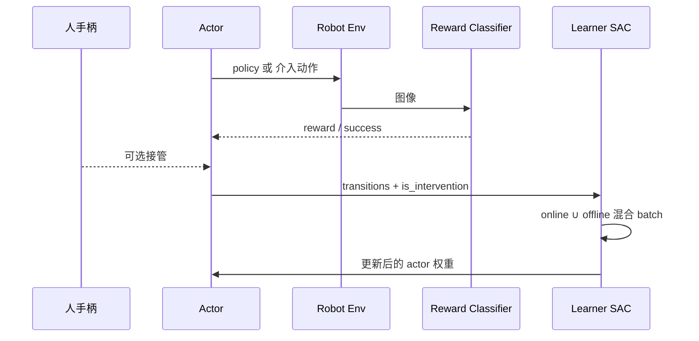
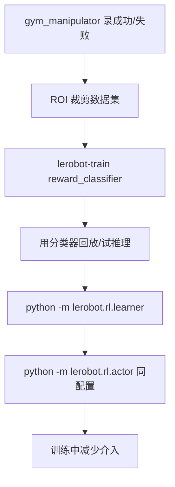

# HIL-SERL 深度指南

> 对应仓库：`src/lerobot/rl/` · `policies/gaussian_actor/` · `rewards/classifier/`  
> 官方英文工作流：`docs/source/hilserl.mdx` · 仿真：`docs/source/hilserl_sim.mdx`  
> 阶段课交叉：[`../../stages/08-RL与真实机器人.md`](../../stages/08-RL与真实机器人.md)  
> 对照 IL：[`../imitation-learning/ACT.md`](../imitation-learning/ACT.md)  
> 对照奖励模型：[`../reward-models/README.md`](../reward-models/README.md)

---

## 1. 概览：什么时候选 HIL-SERL？

**HIL-SERL**（Human-in-the-Loop Sample-Efficient RL）把少量人类演示、**视觉成功分类器**、以及训练中的**实时介入**拼成一套实机 RL。论文报告可在约 **1–2.5 小时**内把灵巧操作训到高成功率。LeRobot 实现走 **Actor / Learner 双进程**，算法是 **SAC**，策略是 **`gaussian_actor`**，不要用 `lerobot-train --policy.type=act` 那条 IL 主链硬套。

| 项 | 内容 |
|----|------|
| 类别 | Reinforcement Learning（人在回路、实机） |
| 论文 | [Precise and Dexterous Robotic Manipulation via Human-in-the-Loop Reinforcement Learning](https://arxiv.org/abs/2410.21845)（2024） |
| 作者 | Jianlan Luo, Charles Xu, Jeffrey Wu, Sergey Levine |
| 项目 / 原实现 | https://hil-serl.github.io/ · https://github.com/rail-berkeley/hil-serl |
| 策略注册名 | `policy.type=gaussian_actor` |
| 算法注册名 | `algorithm.type=sac` |
| 奖励分类器 | `reward_model.type=reward_classifier` |
| 依赖 | `uv sync --extra hilserl` |
| 入口 | `python -m lerobot.rl.learner` + `python -m lerobot.rl.actor` |

**一句话：** 人先录成功/失败镜头 → 训视觉分类器当奖励 → Actor 在真机上跑 SAC 策略，人随时接管 → Learner 用「在线经验 + 介入数据」更新，再把权重推回 Actor。

适合：5–10 秒短任务、能安全限位、愿意在训练时盯着机器人。  
不适合：长视界整理房间、没有急停/工作空间、想离线 BC 就交差（先 ACT）、没有 GPU。

---

## 2. 论文精读（对着代码读）

### 2.1 问题

纯实机 RL：样本贵、奖励难写、探索会撞桌。  
纯模仿：很难超过演示，失败分布覆盖不足。

### 2.2 三个关键设计

1. **演示 + 视觉奖励分类器**  
   少量成功/失败 episode 训二分类器；在线时对当前画面打分，超过阈值给 `success_reward`。  
   LeRobot：`rewards/classifier/`，环境侧 `RewardClassifierProcessorStep`。

2. **Actor–Learner + 人介入**  
   Actor 只交互、发 transition；Learner 做梯度。人手柄/空格接管时，这些步进 **offline buffer**（示范），其余进 **online buffer**。更新时两边各采一半再拼接——教程脚本把这称为 HIL-SERL 的关键机制。

3. **安全与数据效率**  
   EE/关节限位、ROI 裁剪、episode 时限。官方建议任务在 **5–10 秒**内完成。

### 2.3 实验结论（以论文为准）

多种灵巧操作接近完美成功率；相对纯 IL / 先前 RL，论文报告约 2× 成功率、1.8× 速度量级改进。以论文表为准，不要当成你自己硬件上的承诺。

### 2.4 论文概念 → LeRobot

| 论文 / 工作流 | LeRobot |
|---------------|---------|
| 视觉成功检测 | `reward_classifier` + `success_threshold` / `success_reward` |
| 分布式 actor/learner | `python -m lerobot.rl.actor` / `learner` |
| SAC | `SACAlgorithm` / `algorithm.type=sac` |
| 高斯策略 | `GaussianActorConfig`（tanh 对角高斯） |
| 人介入 | `InterventionActionProcessorStep`；`complementary_info.is_intervention` |
| 在线 / 离线混合 | `mixer=online_offline`，`online_ratio`（默认 0.5）；示例里各采 `batch_size//2` |
| ROI 裁剪 | `ImagePreprocessingConfig.crop_params_dict` + `crop_dataset_roi.py` |
| 工作空间 | `InverseKinematicsConfig.end_effector_bounds` |
| 通信 | gRPC（`ActorLearnerConfig.learner_host/port`）或线程队列 |

---

## 3. LeRobot 实现地图

### 3.1 目录

```
src/lerobot/rl/
  actor.py / learner.py     # 双端入口
  train_rl.py               # TrainRLServerPipelineConfig
  gym_manipulator.py        # 真机 Gym + 采数 / replay
  buffer.py / queue.py
  algorithms/sac/           # SAC 更新
  crop_dataset_roi.py
src/lerobot/policies/gaussian_actor/
src/lerobot/rewards/classifier/
src/lerobot/envs/configs.py # HILSerlRobotEnvConfig
```

| 类 / 入口 | 职责 |
|-----------|------|
| `GymManipulatorConfig` | env + dataset + `mode=record/replay/None` |
| `make_robot_env` | 真机 Gym |
| `act_with_policy` | 滚出、发 transition、收权重 |
| `add_actor_information_and_train` | 缓冲、SAC `update`、推参数 |
| `SACAlgorithm.update` | critic / actor / temperature |
| `Classifier` | 图像 → 成功概率 |

**不要**在 Learner 进程里 `robot.send_action`。电机只在 Actor。

### 3.2 在线训练数据流



### 3.3 推荐工作流（官方顺序）



### 3.4 环境 processor vs 动作 processor

官方文档拆成两套管线：

- **观测侧：** 标准化观测 → 可选速度/电流/FK → 裁剪缩放 → 时限 → 夹爪惩罚 → **奖励分类器** → batch → device  
- **动作侧：** 记录遥操作 → **介入覆盖** → 可选 IK（delta→EE→限位→关节）

分类器挂在环境 processor 上，不进 `gaussian_actor.forward`。

### 3.5 与 IL 主链的差别

| 维度 | ACT / Diffusion | HIL-SERL |
|------|-----------------|----------|
| 入口 | `lerobot-train` | **learner + actor 两个进程** |
| 损失 | 模仿监督 | SAC（Q + 熵正则策略） |
| 奖励 | 无 | 分类器或稀疏成功 |
| 人 | 只在 record 前 | **训练全程可介入** |
| 数据 | 离线 dataset | 在线 replay + 介入/演示缓冲 |

---

## 4. 示例：如何跑起来

### 4.1 环境

```bash
uv sync --locked --extra hilserl --extra training
```

无真机：

```bash
uv run pytest tests/rl -q --maxfail=5
# 再读 docs/source/hilserl_sim.mdx
```

### 4.2 迷你双进程（教程脚本）

```bash
uv run python examples/tutorial/rl/hilserl_example.py
```

脚本用 `multiprocessing` 队列模拟：Learner 把 **全部** transition 写入 online buffer，**仅介入** 写入 offline buffer，再各采一半拼接后 `SACAlgorithm.update`。真机工作流用 gRPC，机制相同。

### 4.3 官方真机链（摘要）

配置示例见 Hub：`lerobot/config_examples`。本地对应 `docs/source/hilserl.mdx`。

```bash
# 1) 采数（成功 + 失败镜头都要）
uv run python -m lerobot.rl.gym_manipulator --config_path <env_config.json>

# 2) 训分类器
uv run lerobot-train --config_path <reward_classifier_train_config.json>

# 3) Learner（先开）
uv run python -m lerobot.rl.learner --config_path <train_config_hilserl.json>

# 4) Actor（另开终端，同一 config）
uv run python -m lerobot.rl.actor --config_path <train_config_hilserl.json>
```

策略配置：`type=gaussian_actor`。算法块：`type=sac`。环境里填 `reward_classifier.pretrained_path`。

### 4.4 介入怎么用

手柄右上扳机或键盘 **空格**：暂停策略、人手控。成功实验的标志是 **介入率随时间下降**（WandB 可看）。一开始就要人把任务做完，而不是让随机探索自己碰运气。

---

## 5. 关键代码详解

### 5.1 配置分层

- `TrainRLServerPipelineConfig`（`rl/train_rl.py`）：`algorithm` 默认 SAC；`mixer="online_offline"`，`online_ratio=0.5`  
- `GaussianActorConfig`：`online_steps`、`online_step_before_learning`、`actor_learner_config`（host/port/推权重频率）  
- `SACAlgorithmConfig`：`actor_lr=critic_lr=temperature_lr=3e-4`，`discount=0.99`，`num_critics=2`，`utd_ratio`  
- `HILSerlRobotEnvConfig`：`fps`（文档示例常 10）、processor 嵌套、`control_time_s`

### 5.2 Actor：只交互

```230:241:src/lerobot/rl/actor.py
def act_with_policy(...):
    """
    Executes policy interaction within the environment.
    ... collecting interaction data and pushing it to a queue ...
    Once an episode is completed, updated network parameters ... loaded into the network.
    """
```

要点：Actor 侧 `policy.eval()`；episode 结束后才从队列加载新权重（实现以当前循环为准）。控制频率跟不上时先查推理耗时，而不是加大学习率。

### 5.3 Learner：单线程吃队列 + 训练

`add_actor_information_and_train` 注释写明：Python GIL 下拆太多线程会极慢，所以收数据、更新、推权重放在同一函数。缓冲够 `online_step_before_learning` 才开始 `algorithm.update`。

### 5.4 混合 batch（教程示例）

```57:85:examples/tutorial/rl/hilserl_example.py
                online_buffer.add(**transition)
                is_intervention = transition.get("complementary_info", {}).get("is_intervention", False)
                if is_intervention:
                    offline_buffer.add(**transition)
            ...
            online_batch = online_buffer.sample(batch_size // 2)
            offline_batch = offline_buffer.sample(batch_size // 2)
            batch[key] = torch.cat([online_batch[key], offline_batch[key]], dim=0)
```

没有介入数据时 offline buffer 为空，`sample` 会失败——所以前期必须有人把任务做完，或预载演示进 offline buffer。

### 5.5 SAC 更新

`SACAlgorithm.update`：ensemble critic 的 Bellman 损失、带熵的 actor 损失、温度自适应。夹爪常走离散 critic（`discrete_critic`）。`utd_ratio>1` 时每个环境步多更几次 critic。

### 5.6 奖励分类器

```22:36:src/lerobot/rewards/classifier/configuration_classifier.py
@RewardModelConfig.register_subclass(name="reward_classifier")
class RewardClassifierConfig(...):
    num_classes: int = 2
    model_name: str = "lerobot/resnet10"
    model_type: str = "cnn"  # 或 transformer
    num_cameras: int = 2
```

必须有 `observation.image*`。分类器差，后面 SAC 全是在优化噪声奖励。这和 SARM/TOPReward/Robometer **不是同一条产品线**：分类器服务在线 HIL；后三者更多用于离线 progress / RA-BC。

---

## 6. 社区优秀讨论

| 主题 | 入口 |
|------|------|
| 论文与视频 | https://hil-serl.github.io/ · [arXiv 2410.21845](https://arxiv.org/abs/2410.21845) |
| 原实现 | https://github.com/rail-berkeley/hil-serl |
| LeRobot 工作流 | https://huggingface.co/docs/lerobot/hilserl |
| 配置示例 | https://huggingface.co/datasets/lerobot/config_examples |
| Issues | 搜 `hilserl` / `reward classifier` / `intervention` |

Discord：https://discord.gg/q8Dzzpym3f

---

## 7. 调优与常见坑

| 症状 | 可能原因 | 建议 |
|------|----------|------|
| 乱撞、危险 | 无 EE bounds / 人未盯 | 收紧 `end_effector_bounds`；提高介入 |
| 学不会 | 分类器把失败当成功 | 补失败镜头；调 `success_threshold`；检查 ROI |
| Learner 空转 | Actor 没连上 / 队列空 | 先起 learner；核 host/port；看 actor 日志 |
| Actor 掉帧 | 图像太大、同步推理 | 降分辨率；线程 vs 进程；查 `log_policy_frequency_issue` |
| offline sample 炸 | 还没有任何介入 | 先人手完成若干 episode |
| 夹爪乱开合 | `gripper_penalty` 未开 | 按文档加惩罚 |
| 任务太长 | 20s+ 视界 | 拆成 5–10s 子任务 |
| 与 ACT 超参混用 | chunk / KL 无意义 | SAC 调 lr、discount、buffer、介入率 |

**安全：** 急停、限位、先低速、工作台清空。这不是可选调优。

---

## 8. 五日精读清单

| 天 | 任务 |
|----|------|
| D1 | 读 hilserl.mdx 工作流 + 本页 §2–3 |
| D2 | 跑 `tests/rl` 与 `hilserl_example.py`（或精读混合 batch） |
| D3 | 对照 `actor.py` / `learner.py` 符号表（阶段 8） |
| D4 | 读 `RewardClassifierConfig` 与环境 processor 顺序 |
| D5 | 列出你任务的 bounds / ROI / 成功镜头清单（即使还没真机） |

---

## 9. 延伸阅读

- 阶段 8：[`../../stages/08-RL与真实机器人.md`](../../stages/08-RL与真实机器人.md)  
- TDMPC（仿真 model-based）：[`TDMPC.md`](./TDMPC.md)  
- 奖励百科：[`../reward-models/README.md`](../reward-models/README.md)  
- 返回：[`./README.md`](./README.md) · [`../README.md`](../README.md)

---

### 自测（10 条）

| # | 问题 | 预期 |
|---|------|------|
| 1 | 谁拧电机？ | **Actor** |
| 2 | 谁 `algorithm.update`？ | **Learner** |
| 3 | IL 入口能否直接替代？ | 否；要 learner+actor |
| 4 | 策略 type？ | `gaussian_actor` |
| 5 | 算法 type？ | `sac` |
| 6 | 介入数据进哪个 buffer？ | **offline**（示例实现） |
| 7 | 分类器挂在哪？ | 环境 processor，不是 actor 内部 |
| 8 | 任务时长建议？ | **5–10 秒** |
| 9 | extra 名？ | `hilserl` |
| 10 | 没有失败镜头？ | 分类器不可靠，后面 RL 会漂 |
