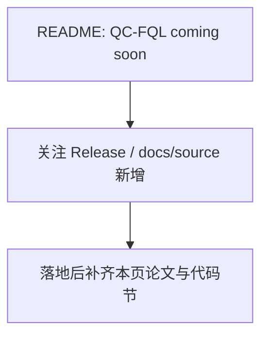

# QC-FQL


> **状态：coming soon** — README 已列出，完整训练入口可能尚未合入。下文基于公开信息，并标明与当前仓库的差距。

## 1. 概览

仓库 README 在强化学习类别中列出 **QC-FQL（coming soon）**。在官方 policy 文档与 `src/lerobot/policies/` 出现完整实现前，**不要假设**可以 `policy.type=qc_fql` 训练。

| 项 | 内容 |
|----|------|
| 类别 | Reinforcement Learning |
| 论文 | [QC-FQL（LeRobot README：coming soon）](https://github.com/huggingface/lerobot) (TBD) |
| 作者（常见引用） | 待官方文档公布 |
| 项目页 | https://github.com/huggingface/lerobot |
| 本仓库代码 | `（尚未作为完整模块合入，以 README 为准）` |
| 官方文档 | `README.md SoTA Models 表` |

---

## 2. 论文精读

### 2.1 要解决的问题

（待官方发布）通常这类名称指向保守/约束或流式 Q 学习变体——以未来论文为准。

### 2.2 方法核心

**暂无**可引用的 LeRobot 实现细节。请关注 Release Note 与 `docs/source/policy_*` 新增文件。

### 2.3 实验与结论（论文报告）

尚无。

### 2.4 你可以带走的设计要点

- 看到 coming soon 就把它当路线图，而非现成功能；\n- 当前实机 RL 请用 HIL-SERL；仿真 model-based 可看 TDMPC。

---

## 3. LeRobot 中的实现地图

### 3.1 关键文件

- （暂无完整 policy 包）

### 3.2 数据 / 控制流



### 3.3 与平台其它层的关系

- 配置注册：`PreTrainedConfig.register_subclass` / reward 配置（以具体模块为准）
- 训练入口：IL/VLA 多用 `lerobot-train`；HIL-SERL 走 actor/learner
- 文档交叉：`docs/source/` 英文页 + 本中文详解

---

## 4. 示例：如何跑起来

当前无可运行示例。可先掌握：

```bash
uv run lerobot-train --help | rg -i "sac|tdmpc" || true
```


---

## 5. 关键代码详解

无。合并后建议从 `configuration_*.py` 的 `register_subclass` 名称开始更新本页。

---

## 6. 社区优秀讨论

> 只列可公开核对的入口；楼层内容会变化。

- 追踪 https://github.com/huggingface/lerobot/releases 与 Discord 公告
- 相关讨论出现时，用 Issue 关键词 `FQL` / `QC-FQL` 检索

- Discord：https://discord.gg/q8Dzzpym3f
- Issues：https://github.com/huggingface/lerobot/issues

---

## 7. 调优与常见坑

| 场景 | 可能原因 | 建议 |
|------|----------|------|
| 误以为已支持 | README 预告 | 改用 HIL-SERL / TDMPC |

---

## 8. 延伸阅读

- 总表：仓库根 `README.md`

- 返回：[`../README.md`](../README.md)
