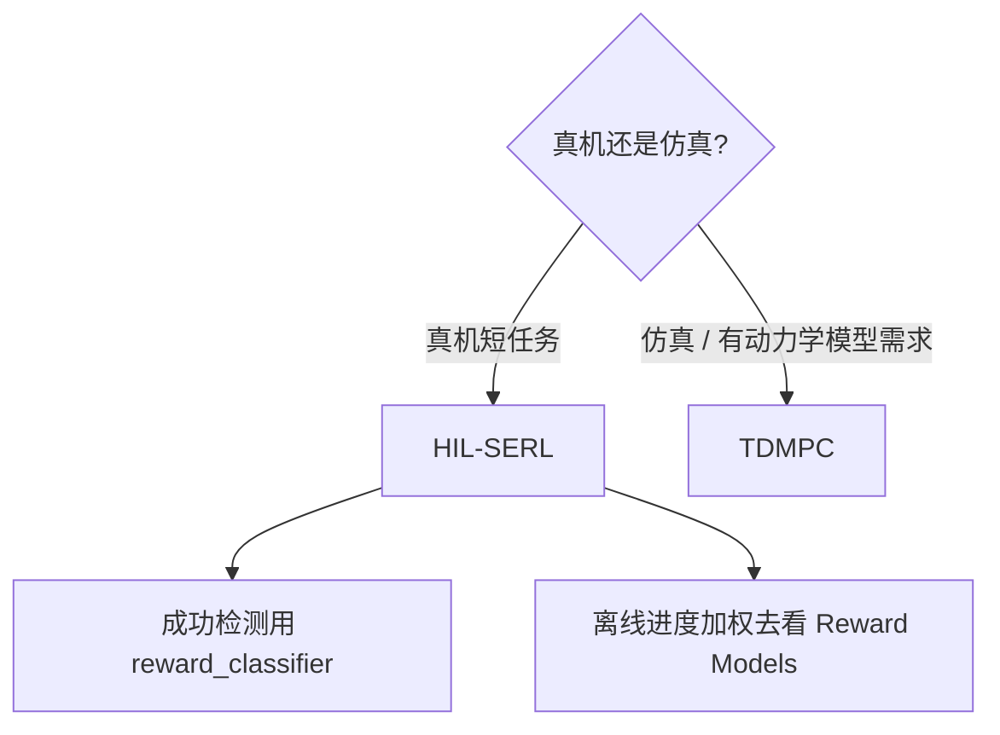

# Reinforcement Learning 模型

LeRobot 的 RL 不是「再训一个 ACT」。在线实机走 **Actor / Learner + SAC**；仿真 model-based 走 **TDMPC**。QC-FQL 仍是路线图。

| 模型 | 场景 | 入口 | 教程 |
|------|------|------|------|
| [HIL-SERL](./HIL-SERL.md) | 真机、人介入、视觉成功分类器 | `python -m lerobot.rl.learner` + `actor` | **深度指南** |
| [TDMPC](./TDMPC.md) | 仿真、潜空间 MPC | `policy.type=tdmpc` | 快速导览 |
| [QC-FQL](./QC-FQL.md) | 未合入 | — | coming soon |

先读 [HIL-SERL](./HIL-SERL.md)，再对照[阶段 8](../../stages/08-RL与真实机器人.md)。奖励模型目录：[../reward-models/README.md](../reward-models/README.md)。返回 [../README.md](../README.md)。
