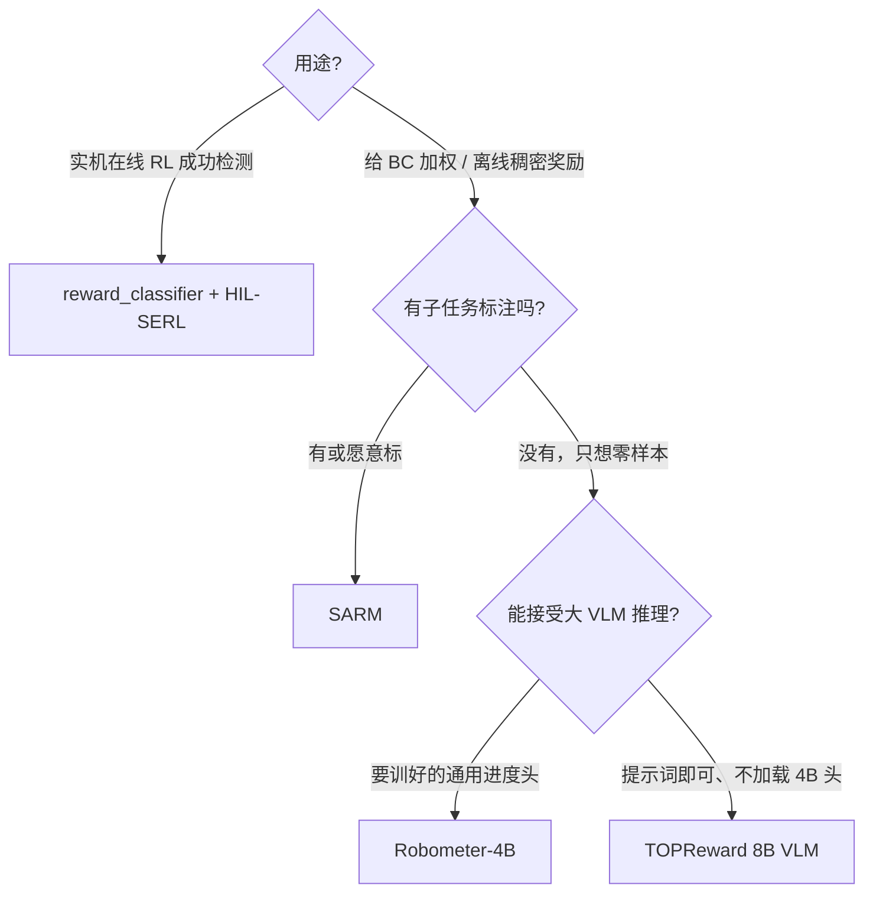

# Reward Models

奖励模型给轨迹打「进度 / 成功」分，供 **RA-BC 加权模仿** 或 **RL 稠密奖励** 使用。它们**不是**策略：HIL-SERL 在线用的二分类成功检测器是另一条线（`reward_classifier`），见 [HIL-SERL](../reinforcement-learning/HIL-SERL.md)。

| 模型 | 监督从哪来 | 输出 | 训练？ | extra | 教程 |
|------|------------|------|--------|-------|------|
| [SARM](./SARM.md) | 演示 + 可选子任务标注 | 阶段感知 progress ∈ [0,1] | 要训 | 见 `sarm.mdx` | 实用指南 |
| [TOPReward](./TOPReward.md) | 冻结 VLM 的 token 对数概率 | 标量 log P("True") | **零样本** | `topreward` | 实用指南 |
| [Robometer](./Robometer.md) | 大规模轨迹比较预训练 | 帧级 progress / success | 仓库内 **只推理** | `robometer` | 实用指南 |
| 分类器（HIL） | 成功/失败镜头 | 二分类成功 | 要训 | `hilserl` | 写在 HIL-SERL |

## 怎么选

选择前先核对：

1. 下游要的是 **标量 reward** 还是 **逐帧 progress**（RA-BC parquet 契约不同）。  
2. 图像 key、`task` 文本是否与策略预处理一致。  
3. 显存：TOPReward 默认 Qwen3-VL-8B；Robometer 4B；SARM 用 CLIP 更轻。  
4. 许可证与下载体积。

上手训练/评测回到[阶段主线](../../README.md)；HIL 工作流见[阶段 8](../../stages/08-RL与真实机器人.md)。返回[模型总目录](../README.md)。
