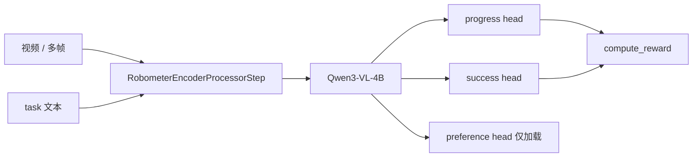

# Robometer：通用轨迹奖励（仓库内推理）

Robometer 在 Qwen3-VL-4B 上加 **progress / success / preference** 三个头。论文用轨迹两两比较做规模化训练。**LeRobot 当前是推理专用**：加载 [`lerobot/Robometer-4B`](https://huggingface.co/lerobot/Robometer-4B)，`compute_reward()` 只问 progress 或 success 头；preference 头留下是为了权重能对上，训练从头不在本集成里。

| 项 | 内容 |
|----|------|
| 注册名 | `reward_model.type=robometer` |
| 论文 | [arXiv 2603.02115](https://arxiv.org/abs/2603.02115) |
| 项目 | https://robometer.github.io/ |
| 上游 | https://github.com/robometer/robometer |
| 代码 | `src/lerobot/rewards/robometer/` |
| 官方指南 | `docs/source/robometer.mdx` |
| extra | `uv sync --extra robometer` |

---

## 1. 三个头，推理只用两个

论文目标：`L = L_pref + L_prog + L_succ`。

推理：

- `reward_output="progress"`（默认）：末帧 progress，clamp 到 [0,1]  
- `reward_output="success"`：成功概率，可再过 `success_threshold` 变成 0/1  

Progress 头可以是离散 bin（`progress_loss_type=discrete`，默认 10 bins）。



---

## 2. 输入与 RA-BC

Preprocessor 读数据集里的图像序列和任务描述。`use_per_frame_progress_token=True` 时要求 `use_multi_image=True`。

离线脚本 `compute_rabc_weights.py` 写出 `robometer_progress.parquet`（含 `progress_sparse`），给 RA-BC 和 `examples/dataset/create_progress_videos.py` 用。文件名不要和 SARM / TOPReward 的输出混用。

---

## 3. 怎么跑

```bash
uv sync --locked --extra robometer
```

其余命令以 `docs/source/robometer.mdx` 为准。4B 骨干建议 GPU。

---

## 4. 对照

| 需求 | 更合适 |
|------|--------|
| 自己的子任务进度定义 | SARM（要训） |
| 零样本、只关心「像不像完成」 | TOPReward |
| 通用帧级进度、现成 4B 权重 | **Robometer** |
| 实机成功检测 10Hz | HIL `reward_classifier` |

对照：[SARM](./SARM.md) · [TOPReward](./TOPReward.md) · [分类对照](./README.md)
