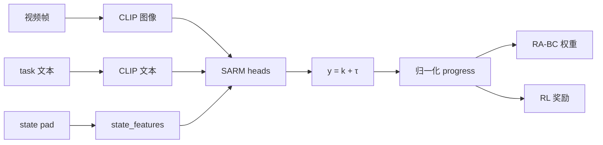

# SARM：阶段感知进度奖励

SARM 从演示视频和任务文本学习 **任务进度**（0→1），缓解「只有终局成功」的稀疏奖励。进度可给 **RA-BC** 加权模仿，也可作 RL 稠密奖励。它不替代 HIL-SERL 的成功分类器。

| 项 | 内容 |
|----|------|
| 注册名 | `reward_model.type=sarm` |
| 论文 | [SARM: Stage-Aware Reward Modeling](https://arxiv.org/abs/2509.25358) |
| 代码 | `src/lerobot/rewards/sarm/` |
| 官方指南 | `docs/source/sarm.mdx` |
| 骨干 | CLIP ViT-B/32（processor 编码图像与文本） |

---

## 1. 它预测什么

每个训练样本的目标是 **stage + τ**：

- `k`：阶段下标  
- `τ ∈ [0,1]`：阶段内进度  
- 编码：`y = k + τ`（processor 写出）

推理时用数据集级 **时间比例** `α̅_k`（`meta/temporal_proportions_*.json`）还原到全局 progress，对应论文 Formula (2)：

```text
progress_t = P_{k-1} + α̅_k × τ_t
```

这样不同时长的演示里，「同一子任务做到一半」会对齐到相近分数。



---

## 2. 三种标注模式

| Mode | 要标注吗 | 头 | 适用 |
|------|----------|----|------|
| `single_stage` | 否 | 只有 sparse；整集线性 0→1 | 先跑通、短任务 |
| `dense_only` | VLM 细粒度 | dual（sparse 自动生成） | 要细进度、不定义高层阶段 |
| `dual` | sparse + dense | dual | 论文完整设定 |

配置字段：`annotation_mode`。不要一上来就 dual；没有稳定子任务边界时 `single_stage` 更可诊断。

Processor（`processor_sarm.py`）还会：

- 编码 `video_features` / `text_features`  
- pad `state_features` 到 `max_state_dim`  
- rewind 增强用 `lengths` mask  

每条样本至少要有 `task` 字符串，以及配置指定的 image/state key。

---

## 3. 怎么跑

严格按 `docs/source/sarm.mdx`（含 RA-BC）。概念上：

```bash
# extra 以 sarm.mdx / pyproject 为准
uv run lerobot-train --reward_model.type=sarm --dataset.repo_id=<repo> ...
```

下游 RA-BC 需要 SARM 写出的 progress 文件；路径和字段以官方指南为准，不要和 TOPReward/Robometer 的 parquet 文件名混用。

---

## 4. 调优

| 现象 | 优先查 |
|------|--------|
| 阶段跳乱 | 子任务边界标注；先退回 `single_stage` |
| 进度与画面不符 | 相机 key、CLIP 预处理、`temporal_proportions` 是否来自同一数据集 |
| RA-BC 没变化 | progress 是否几乎全 1 或全 0；检查 rewind/mask |
| 与策略观测不一致 | 同一套 crop/resize/归一化 |

对照：[TOPReward](./TOPReward.md)（零样本）· [Robometer](./Robometer.md)（通用 4B）· [分类对照](./README.md)
