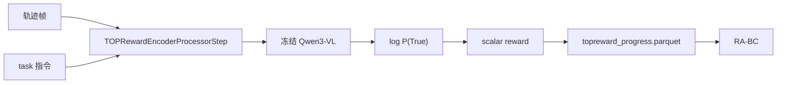

# TOPReward：用 VLM 的 True 对数概率当零样本奖励

TOPReward **不微调**奖励网络：把轨迹视频和任务指令塞进现成 VLM，读最后一个 `"True"` token 的 log-probability 当标量奖励。LeRobot 里它是薄封装 + processor 拼 prompt。

| 项 | 内容 |
|----|------|
| 注册名 | `reward_model.type=topreward` |
| 论文 | [arXiv 2602.19313](https://arxiv.org/abs/2602.19313) |
| 项目 | https://topreward.github.io/webpage/ |
| 上游 | https://github.com/TOPReward/TOPReward |
| 代码 | `src/lerobot/rewards/topreward/` |
| 官方指南 | `docs/source/topreward.mdx` |
| 默认骨干 | `Qwen/Qwen3-VL-8B-Instruct`（约 16GB 下载） |
| extra | `uv sync --extra topreward` |

当前移植 **只支持 Qwen3-VL**。上游还有 Gemini/OpenAI 等 client，仓库尚未接。

---

## 1. 奖励怎么来

Processor 构造类似：

```text
<video>
The above video shows a robot manipulation trajectory that completes the
following task: <instruction> Decide whether the above statement is True
or not. The answer is: True
```

模型只对最后一个 token 做 label-mask，取 `log P("True" | video, prompt)`。  
`save_pretrained` 只写 `config.json`；VLM 身份是 `vlm_name`，不会把 8B 权重复制进奖励 checkpoint。



---

## 2. 输入输出契约

- 需要轨迹帧 + 自然语言 `task`  
- `compute_reward()`：**每个 sample 一个标量**（不是逐帧曲线，除非你自己滑窗）  
- 离线脚本可写出与 SARM 兼容 schema 的 parquet，供 RA-BC / overlay  

GPU 强烈建议。提示词一变，分数分布就变——对比实验必须锁死模板。

---

## 3. 怎么跑

```bash
uv sync --locked --extra topreward
```

配置与打分脚本见 `docs/source/topreward.mdx`。典型坑：第一次跑会拉 8B 权重；CPU 能加载但无法当控制环奖励。

---

## 4. 何时用 / 何时不用

| 用 | 不用 |
|----|------|
| 没有标注、想先给演示打个序 | 要逐帧平滑进度（更像 SARM/Robometer） |
| 能接受 8B 离线打分 | 实机 10Hz 在线奖励 |
| 指令短、画面能看清任务 | 提示含糊、多物体无消歧 |

对照：[SARM](./SARM.md) · [Robometer](./Robometer.md) · [分类对照](./README.md)
