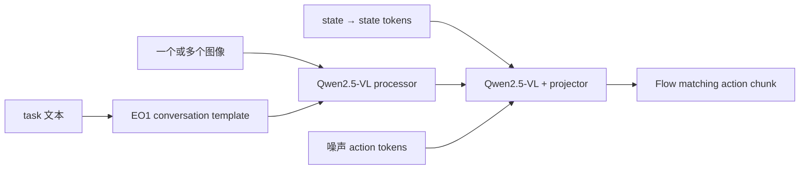

# EO-1：Qwen2.5-VL 与连续 Flow Action Head

LeRobot 中的 EO-1 是完整 EO 项目的**机器人控制子路径**：它把相机、任务语言和 robot state 组织成多模态会话，在 action-token 位置用 flow matching 学习连续 action chunk。更广的交错视觉—文本—动作预训练流程不在当前 policy 内。

| 项目 | 内容 |
|---|---|
| 注册名 | `eo1` |
| 默认 VLM | `Qwen/Qwen2.5-VL-3B-Instruct` |
| chunk / 执行 | 8 / 8 |
| 推理 flow 步数 | 10 |
| 代码 | `src/lerobot/policies/eo1/` |
| 官方指南 | `docs/source/eo1.mdx` |

## 1. 输入与生成流程



数据必须包含至少一个 visual feature、`observation.state`、`action` 和 task 语言。processor 的 `EO1ConversationTemplateStep` 与 `EO1QwenProcessorStep` 负责会话结构和 Qwen 输入；字段名不同应通过 `rename_map` 对齐。

## 2. 安装与训练

```bash
uv sync --locked --extra eo1 --extra training
```

```bash
uv run lerobot-train \
  --dataset.repo_id=<HF_USER/DATASET> \
  --policy.type=eo1 \
  --policy.vlm_base=Qwen/Qwen2.5-VL-3B-Instruct \
  --policy.dtype=bfloat16 \
  --policy.attn_implementation=sdpa \
  --policy.gradient_checkpointing=true \
  --policy.device=cuda \
  --batch_size=4 \
  --steps=30000 \
  --output_dir=outputs/train/eo1
```

官方文档展示了更长的 300k steps / batch 16 配置；这里的命令只是管线基线。先确认 loss、checkpoint 和短 rollout 正常，再按数据规模扩大预算。

`sdpa` 是更便携的 attention 后端。只有 CUDA、PyTorch 和 `flash_attn` 版本完全兼容时才用 `flash_attention_2`。

## 3. 图像、padding 与精度

- `image_min_pixels` / `image_max_pixels` 控制 Qwen 视觉 token 数，影响细节、显存和速度；
- state/action 默认 pad 到 32 维，真实维度不能超过上限；
- 预测后会裁回真实 action dimension；
- `force_fp32_autocast=true` 让 flow head 在 VLM 混合精度时仍用 fp32；
- `supervise_padding_action_dims/actions` 决定 padding 是否进入 loss，修改前应理解 batch mask。

## 4. 源码阅读

1. `configuration_eo1.py`：VLM、图像像素范围、flow 与 padding；
2. `processor_eo1.py`：会话模板、Qwen processor；
3. `EO1VisionActionProjector`：VLM 与 action head 的桥；
4. `EO1VisionFlowMatchingModel.forward()`：训练/采样；
5. `EO1Policy.select_action()`：chunk queue。

## 5. 调优与排错

| 现象 | 原因 | 处理 |
|---|---|---|
| 没有语言条件效果 | task 字段缺失或模板未生成 | 抽查 processor 输出与 prompt |
| 视觉 token OOM | `image_max_pixels` 太高 | 降上限并检查目标仍清晰 |
| action 维度报错 | 超过 32 或 feature 不一致 | 提高 max dim 或修数据 schema |
| flow 不稳定 | 混合精度影响 action head | 保持 `force_fp32_autocast=true` |
| flash attention 加载失败 | 二进制栈不匹配 | 使用 `sdpa` |
| 动作响应慢 | chunk 全执行后才重规划 | 缩短 `n_action_steps`，保持 ≤ chunk |

评测时记录图像 token 数、采样延迟、chunk 执行长度与按任务成功率。继续阅读 [`EVO1.md`](./EVO1.md) 比较 InternVL 两阶段微调，或返回 [VLA 目录](./README.md)。
