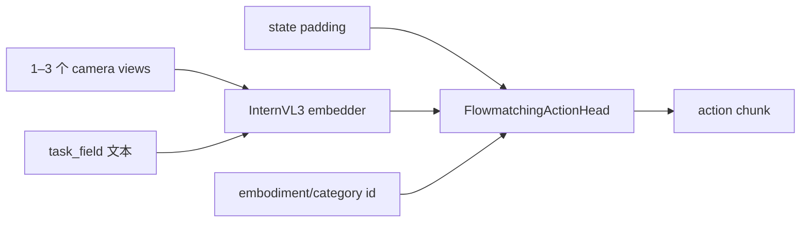

# EVO1：InternVL3 + 两阶段 Flow Matching 微调

EVO1 用原生 Hugging Face InternVL3 编码相机与任务文字，flow-matching action head 生成连续动作。当前 LeRobot 实现的关键不只是骨干，而是 `training_stage` 对冻结策略的严格管理。

| 项目 | 内容 |
|---|---|
| 注册名 | `evo1` |
| 默认 VLM | `OpenGVLab/InternVL3-1B-hf` |
| 默认 stage | `stage1` |
| chunk / 执行 | 50 / 50 |
| 最大视角 | 3 |
| 代码 | `src/lerobot/policies/evo1/` |
| 官方指南 | `docs/source/evo1.mdx` |

## 1. 模型与数据契约



数据需要视觉、state、action 和语言任务；默认语言字段是 `task`，可通过 `task_field` 修改。state/action pad 到 24 维，图像默认 448×448，最多 3 views。

`vlm_model_name` 必须是 transformers 原生转换 checkpoint，例如带 `-hf` 后缀的 `OpenGVLab/InternVL3-1B-hf`，不能直接使用依赖上游 remote code 的非 HF-native 格式。

## 2. 两阶段训练

### Stage 1：只学 action head

```bash
uv sync --locked --extra evo1 --extra training

uv run lerobot-train \
  --dataset.repo_id=<HF_USER/DATASET> \
  --policy.type=evo1 \
  --policy.training_stage=stage1 \
  --policy.vlm_model_name=OpenGVLab/InternVL3-1B-hf \
  --policy.device=cuda \
  --batch_size=4 \
  --steps=5000 \
  --output_dir=outputs/train/evo1_stage1
```

Stage 1 默认冻结语言和视觉分支，训练 action head，用于先验证数据与动作学习。

### Stage 2：从 Stage 1 解冻 VLM 分支

```bash
uv run lerobot-train \
  --dataset.repo_id=<HF_USER/DATASET> \
  --policy.path=outputs/train/evo1_stage1/checkpoints/005000/pretrained_model \
  --policy.training_stage=stage2 \
  --policy.device=cuda \
  --batch_size=2 \
  --steps=80000 \
  --output_dir=outputs/train/evo1_stage2
```

`apply_training_stage_defaults=true` 会在加载 checkpoint 后重新应用当前 stage 的冻结规则，防止 Stage 2 继承 Stage 1 保存的冻结 flag。只有当你准备手动管理每个 `finetune_*` 开关时才设为 false。

## 3. 关键配置

| 参数 | 默认 | 作用 |
|---|---:|---|
| `vlm_num_layers` | 14 | 保留的 InternVL language layers |
| `vlm_dtype` | bfloat16 | VLM 参数精度 |
| `num_inference_timesteps` | 32 | flow 积分/采样步数 |
| `enable_gradient_checkpointing` | true | 降显存、增计算 |
| `use_flash_attn` | true | 可用时启用，否则代码回退 |
| `num_categories` | 1 | action head 的具身类别数 |
| `rtc_config` | null | 可选实时 chunk 支持 |

`chunk_size` 和 `n_action_steps` 默认均为 50，真实机器人上常需缩短执行步数以增加反馈。`postprocess_action_dim` 可显式裁剪输出，`binarize_gripper` 仅在对应评测/硬件的夹爪语义完全一致时使用。

## 4. 源码地图

1. `configuration_evo1.py`：stage 默认值与校验；
2. `processor_evo1.py`：state/action padding 和后处理；
3. `internvl3_embedder.py`：图像、语言、attention fallback；
4. `flow_matching.py`：多具身 action encoder 与 transformer；
5. `modeling_evo1.py`：参数组、loss、chunk queue。

## 5. 常见失败

| 现象 | 原因 | 处理 |
|---|---|---|
| 模型加载失败 | 使用了非 `-hf` InternVL 权重 | 换 native HF checkpoint 或本地转换目录 |
| Stage 2 仍未训练 VLM | 覆盖了 stage defaults | 保持 `apply_training_stage_defaults=true` |
| Stage 2 突然 OOM | 解冻 VLM 后 optimizer 状态增加 | 减 batch，保持 checkpointing，逐项开放分支 |
| 视角报错 | 相机数超过 `max_views` | 减少视角或有计划地修改配置 |
| category 行为混乱 | embodiment ID 字段缺失/映射错 | 校验 `embodiment_id_field` 与类别数 |
| gripper 方向反了 | 二值化约定不匹配 | 禁用或校正 index、阈值和输出值 |

两阶段实验要分别保存“可训练参数数量、显存、loss、闭环成功率”，否则无法判断解冻是否值得。继续阅读 [`EO-1.md`](./EO-1.md)，或返回 [VLA 目录](./README.md)。
