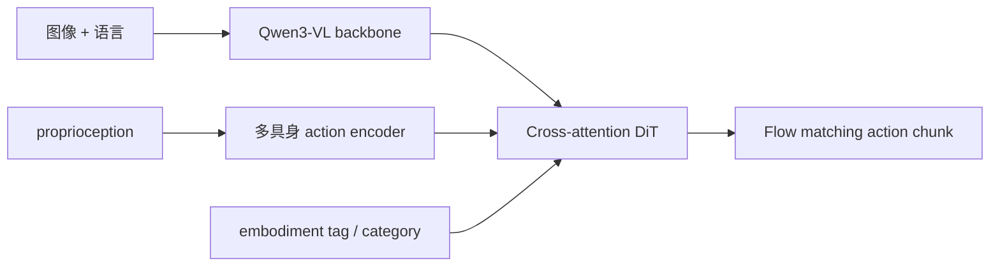

# GR00T N1.7：NVIDIA 跨具身 VLA 的 LeRobot 路径

当前 LeRobot 的 `groot` policy **只支持 GR00T N1.7**。N1.5 已移除；旧 checkpoint 和配置会被拒绝。N1.7 使用 Cosmos-Reason2/Qwen3-VL 骨干与 flow-matching action transformer，基础权重是 `nvidia/GR00T-N1.7-3B`。

| 项目 | 内容 |
|---|---|
| 注册名 | `groot` |
| 默认 chunk | 40（常按任务缩短） |
| 默认 embodiment | `new_embodiment` |
| 代码 | `src/lerobot/policies/groot/` |
| 官方指南 | `docs/source/groot.mdx` |
| 上游 | [NVIDIA Isaac-GR00T](https://github.com/NVIDIA/Isaac-GR00T) |

## 1. 架构与适用场景

GR00T 将语言、图像和 proprioception 编码后，交给支持多具身类别的 action head，通过 flow matching 生成动作 chunk。它更适合已有 NVIDIA GPU 训练环境、需要从大规模跨具身先验后训练的团队，不适合作为低资源首个 VLA 基线。



## 2. 版本、具身和动作坐标

- `base_model_path` 必须指向 N1.7 格式模型；
- `embodiment_tag` 决定 processor 和 action head 如何理解机器人；SO-101 等新平台通常使用 `new_embodiment`；
- 默认 state/action padding 上限均为 132，不能小于真实维度；
- `use_relative_actions=true` 时需要 dataset 路径统计相对动作，并明确排除仍应为绝对值的关节；
- 当前 processor 还负责 N1.7 checkpoint assets、VLM encode、动作 decode，不能拿其他 VLA processor 替代。

## 3. 安装与基线训练

```bash
uv sync --locked --extra groot --extra training
```

```bash
uv run lerobot-train \
  --dataset.repo_id=<HF_USER/DATASET> \
  --dataset.image_transforms.enable=true \
  --policy.type=groot \
  --policy.base_model_path=nvidia/GR00T-N1.7-3B \
  --policy.embodiment_tag=new_embodiment \
  --policy.chunk_size=16 \
  --policy.n_action_steps=16 \
  --policy.use_relative_actions=true \
  --policy.relative_exclude_joints='["gripper"]' \
  --policy.use_bf16=true \
  --policy.device=cuda \
  --batch_size=8 \
  --steps=20000 \
  --output_dir=outputs/train/groot_n17
```

这里把官方示例的 batch 64 改成更保守的 8 作为本地起点；显存允许后再提升。相对动作训练依赖数据集统计，切换 dataset 后不要盲目复用旧 processor 统计。

## 4. 冻结、LoRA 与推理成本

默认训练视觉/LLM 主干较克制：`tune_llm=false`、`tune_visual=false`，而 projector、diffusion model 和 VLLN 路径可训练。先用默认建立基线，再选择：

- `tune_top_llm_layers`：只开放顶层语言层；
- `lora_rank > 0`：使用 LoRA；
- `lora_full_model`：扩大 adapter 覆盖；
- `num_inference_timesteps`：控制 flow 推理步数；
- `use_flash_attention`：仅在环境兼容时启用。

不要同时全量解冻、增大 batch 和启用更长 chunk，这会让 OOM 与效果变化无法归因。

## 5. 源码地图

1. `configuration_groot.py`：N1.7 版本迁移、features 与 embodiment 校验；
2. `processor_groot.py`：输入 pack、checkpoint assets、VLM encode、动作 decode；
3. `groot_n1_7.py`：Qwen3 backbone、multi-embodiment encoder 和 action head；
4. `action_head/cross_attention_dit.py`：flow action transformer；
5. `modeling_groot.py`：训练、chunk 预测与队列执行。

## 6. 常见问题

| 现象 | 原因 | 处理 |
|---|---|---|
| N1.5 checkpoint 被拒绝 | 当前版本只支持 N1.7 | 迁移到 N1.7；确需 N1.5 时固定旧版 LeRobot |
| 动作尺度/方向错误 | embodiment 或 relative action 规则不匹配 | 核对 tag、数据统计和 excluded joints |
| checkpoint 加载不完整 | action head 与 base 版本不同 | 使用同一 N1.7 模型族 |
| OOM | 3B 主干或解冻范围大 | bf16、减 batch、LoRA、保持视觉/LLM 冻结 |
| rollout 延迟高 | flow 步数或视觉主干开销 | profile 后调 `num_inference_timesteps` |
| 多任务失衡 | dataset / trajectory 权重 | 检查两类 balance 配置和分任务采样 |

评测必须按 embodiment、任务和控制频率分别记录，不要只复述模型卡的 LIBERO 数字。继续阅读 [`XVLA.md`](./XVLA.md) 比较 soft-prompt 适配，或返回 [VLA 目录](./README.md)。
