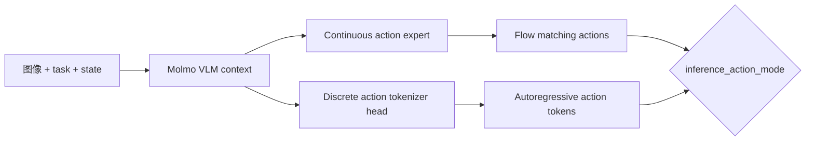

# MolmoAct2：连续 Flow 与离散 Action Token 的联合策略

LeRobot 的 MolmoAct2 同时支持连续 flow-matching action expert 和离散 FAST-like action token 目标。训练时可选 `continuous`、`discrete` 或 `both`，但推理模式必须与训练能力兼容。当前实现是常规 MolmoAct2；带自适应推理深度的 MolmoAct2-Think **尚未集成**。

| 项目 | 内容 |
|---|---|
| 注册名 | `molmoact2` |
| 默认 checkpoint | `allenai/MolmoAct2` |
| 默认动作模式 | `both` |
| 默认 chunk / 执行 | 30 / 30 |
| 代码 | `src/lerobot/policies/molmoact2/` |
| 官方指南 | `docs/source/molmoact2.mdx` |

## 1. 两条动作路径



| `action_mode` | 训练内容 | 合法推理方向 |
|---|---|---|
| `continuous` | flow action expert | continuous |
| `discrete` | 离散 action token | discrete |
| `both` | 两种目标联合训练 | continuous 或 discrete |

配置会直接拒绝 `discrete` 训练后做 continuous 推理，或反过来。rollout 需要明确 `inference_action_mode`，不要依赖模糊默认行为。

## 2. checkpoint 有两条入口

- `checkpoint_path`：加载 AllenAI 发布的原始 HF MolmoAct2 权重，如 `allenai/MolmoAct2-LIBERO`；processor 和归一化由当前 LeRobot dataset/config 构建。
- `policy.path`：加载 LeRobot 保存的 `pretrained_model` 或 Hub repo，同时恢复 policy config、processor 和 normalization stats。

两者语义不同。第二次微调 LeRobot checkpoint 时优先用 `policy.path`，避免丢失 processor 状态。

## 3. 数据和 processor 契约

关键配置包括：

- `image_keys`：相机字段及顺序；
- `setup_type`：机器人/环境描述；
- `control_mode`：如 delta end-effector pose；
- `norm_tag`：选择 checkpoint 适配的量化统计；
- `expected_max_action_dim=32`：发布 checkpoint 的固定 padding 约束；
- `joint_signs` 与 `joint_offsets`：必须同时设置且长度一致，用于硬件坐标系变换。

processor 负责 masked normalization、输入 pack、state/action frame transform、clamp 和输出反变换。相机命名、关节正负号或 control mode 错误，都可能产生“数值正常但机器人方向错误”的危险结果。

## 4. 安装与小数据微调

```bash
uv sync --locked --extra molmoact2 --extra training
```

对少于约 200 条示范的小型数据，官方指南建议从全局 batch 16–32、LoRA VLM 或仅训练 action expert 起步。显存不足时可先用 continuous + action expert only：

```bash
uv run lerobot-train \
  --dataset.repo_id=<HF_USER/DATASET> \
  --policy.type=molmoact2 \
  --policy.checkpoint_path=allenai/MolmoAct2 \
  --policy.action_mode=continuous \
  --policy.train_action_expert_only=true \
  --policy.chunk_size=10 \
  --policy.n_action_steps=10 \
  --policy.image_keys='["observation.images.image"]' \
  --policy.setup_type="single robot arm" \
  --policy.control_mode="joint position" \
  --policy.model_dtype=bfloat16 \
  --policy.gradient_checkpointing=true \
  --policy.device=cuda \
  --batch_size=8 \
  --steps=10000 \
  --output_dir=outputs/train/molmoact2
```

这是资源保守的流程示例，不是跨机器人通用配置；`setup_type`、`control_mode` 和相机名必须换成真实数据语义。

若训练 `both`，可启用 `enable_lora_vlm=true`。`enable_lora_action_expert=true` 只有在 VLM LoRA 已开启时合法；开启后 action expert 也变成 adapter tuning，而不是全量训练。

## 5. 显存预期

仓库官方指南在 H100 80GB、bf16、双相机 LIBERO 的特定设置中测得：continuous 单样本推理约 12.1 GiB；batch 8 的 action-expert-only 约 16.5 GiB；LoRA + both 约 20.2 GiB；full model + both 约 48.3 GiB。它们只能用于量级规划，不可视为其他 GPU/图像/动作长度的保证。

## 6. 源码地图

1. `configuration_molmoact2.py`：模式兼容、LoRA 约束、padding；
2. `processor_molmoact2.py`：图像/任务 pack、归一化与关节坐标变换；
3. `molmoact2_hf_model/action_tokenizer.py`：离散动作；
4. `modeling_molmoact2.py`：参数组、联合 loss、连续/离散推理；
5. `select_action()`：RTC 或普通 chunk queue。

## 7. 常见失败

| 现象 | 优先检查 | 处理 |
|---|---|---|
| rollout 要求 inference mode | 未指定推理分支 | 显式设置 continuous/discrete |
| 模式兼容报错 | 训练与推理分支不匹配 | 用 `both` checkpoint 或改用其已训练分支 |
| checkpoint 能加载但尺度错 | 原始权重与 LeRobot processor 统计混淆 | 区分 `checkpoint_path` 和 `policy.path` |
| 夹爪/关节方向错 | frame transform 配置错误 | 在低速安全环境核对 signs/offsets |
| OOM | full model + both | action expert only、LoRA、减 batch/相机 |
| 离散动作差 | tokenizer、norm tag 或 token 长度不合适 | 核对 tokenizer 与数据动作域 |
| CUDA graph 问题 | 动态 shape 或环境不支持 | 关闭 `enable_inference_cuda_graph` |

部署前必须在断电安全、限速条件下验证 joint frame transform。继续阅读 [`WALL-OSS.md`](./WALL-OSS.md) 比较另一种双动作路线，或返回 [VLA 目录](./README.md)。
