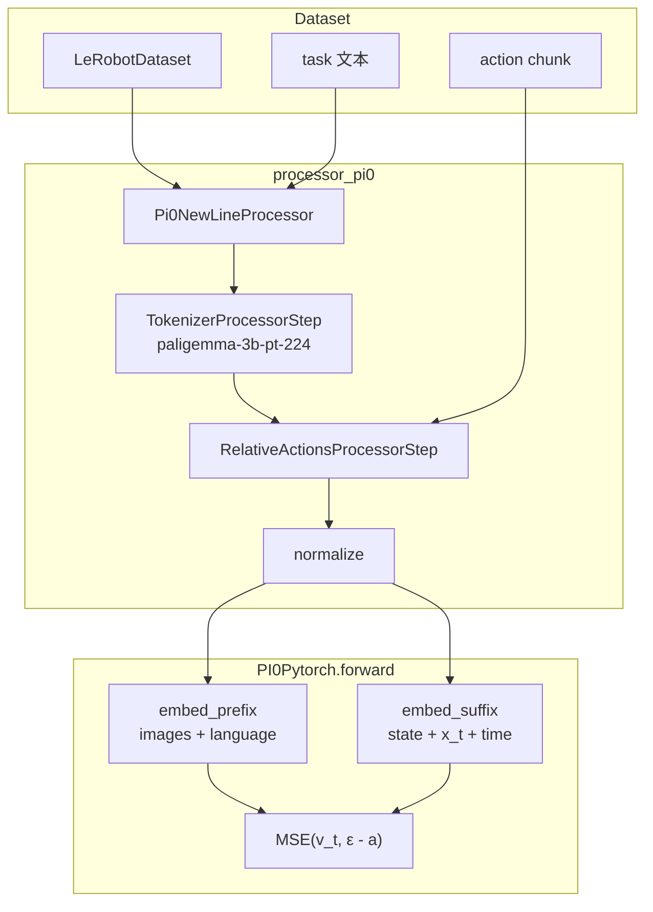
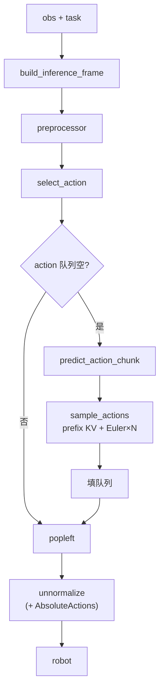
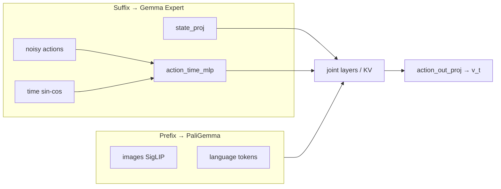

# π₀（Pi0）深度指南

> 对应仓库：`src/lerobot/policies/pi0/`
> 官方英文页：`docs/source/pi0.mdx` · 模块 README：`src/lerobot/policies/pi0/README.md`
> OpenPI 上游：https://github.com/Physical-Intelligence/openpi
> 阶段课交叉：[`../../stages/07-SmolVLA与VLA.md`](../../stages/07-SmolVLA与VLA.md)
> 对照 SmolVLA：[`SmolVLA.md`](./SmolVLA.md) · 下一站 π0.5：[`Pi05.md`](./Pi05.md)

---

## 1. 概览：什么时候选 π₀？

**π₀** 是 Physical Intelligence 的通用 VLA：在 **PaliGemma 系 VLM** 上挂 **Flow Matching Action Expert**，输出连续动作 chunk（论文称可达约 **50Hz**），强调跨具身数据。LeRobot 实现是 **OpenPI 的直接移植**（加载权重时会打印免责声明）。

| 项 | 内容 |
|----|------|
| 类别 | Vision-Language-Action（VLAs） |
| 论文 | [π₀: A Vision-Language-Action Flow Model for General Robot Control](https://arxiv.org/abs/2410.24164)（2024） |
| 作者 | Kevin Black et al.（Physical Intelligence） |
| 项目 / 博客 | https://www.physicalintelligence.company/blog/pi0 |
| 上游实现 | https://github.com/Physical-Intelligence/openpi |
| 注册名 | `policy.type=pi0`（`@PreTrainedConfig.register_subclass("pi0")`） |
| Hub 权重 | [`lerobot/pi0_base`](https://huggingface.co/lerobot/pi0_base) · [`lerobot/pi0_libero`](https://huggingface.co/lerobot/pi0_libero) |
| 本仓库代码 | `configuration_pi0.py` / `modeling_pi0.py` / `processor_pi0.py`（专家实现还依赖 `policies/pi_gemma/`） |
| 示例 | `examples/tutorial/pi0/using_pi0_example.py` |
| 依赖 | `uv sync --extra pi`（`require_package(..., extra="pi")`） |

**一句话：** 多相机 + 语言指令 → PaliGemma 编成 **prefix**；**state + 噪声动作 + 时间** 进 **suffix（Gemma expert）** → flow matching（默认 10 步）生成 `chunk_size` 动作。

适合：要跟 OpenPI / PI 生态对齐、跨具身迁移、比 SmolVLA 更大的语义骨干。
不太适合：单卡吃力、只要 SO 臂快速入门（先 [`SmolVLA.md`](./SmolVLA.md)）、要 AdaRMS / 离散 state 输入（看 π0.5）。

---

## 2. 论文精读（对着代码读）

### 2.1 问题设定

离散动作 token 难撑灵巧高频控制；需要把互联网规模 VLM 语义接到**连续**机器人动作，并跨多种机械臂统一训练。

### 2.2 方法：四个关键设计

#### （1）VLM + Action Expert（双 Gemma）

默认配置：

- `paligemma_variant="gemma_2b"`：视觉-语言骨干宽度 2048、深度 18
- `action_expert_variant="gemma_300m"`：专家宽度 1024、深度 18

类：`PaliGemmaWithExpertModel`（对齐 openpi `gemma_pytorch.py`）。

#### （2）Flow Matching 连续动作

与 SmolVLA 同族：

\[
x_t = t\,\epsilon + (1-t)\,a,\quad u_t=\epsilon-a,\quad \mathcal{L}=\mathrm{MSE}(v_\theta, u_t)
\]

推理：`euler_integrate`，步数字段叫 **`num_inference_steps`**（默认 10；SmolVLA 叫 `num_steps`）。

#### （3）跨具身 + 互联网预训练

论文/文档：Open X-Embodiment + PI 自有数据 + VLM 网页语义；多平台（UR5e、Franka、Trossen、ARX 等）。
实机时：**相机命名必须跟训练/权重约定一致**（OpenPI 风格常见 `base_0_rgb` / `*_wrist_0_rgb`）。

#### （4）高频 chunk 控制

`chunk_size` / `n_action_steps` 默认 **50**（openpi 称 `action_horizon`）。队列式执行与 ACT/SmolVLA 同构。

### 2.3 π₀ vs π₀.5（仓库对照表）

来自 `policies/pi0/README.md`：

| 特征 | π₀ | π₀.5 |
|------|----|------|
| 时间条件 | `action_time_mlp_*` 拼到动作上 | `time_mlp_*` + **AdaRMS** |
| AdaRMS | 不用 | Action expert 使用 |
| Tokenizer 长度 | 48 | 200 |
| 状态输入 | 连续 `state_proj`（在 **suffix**） | 离散 state tokens |
| 参数形态 | 含 state embedding | 无 state embedding（更轻一面） |

读 π₀ 时别把 AdaRMS / `time_mlp_*` 检查点键名搞混——`from_pretrained` 里有 key remap 逻辑。

### 2.4 论文概念 → LeRobot 字段

| 论文 / OpenPI | LeRobot |
|---------------|---------|
| PaliGemma VLM | `paligemma_variant`，`PaliGemmaWithExpertModel.paligemma` |
| Action expert | `action_expert_variant`，`gemma_expert` |
| action_horizon | `chunk_size` |
| Denoising steps | `num_inference_steps` |
| Beta time sampling | `time_sampling_beta_*` / `scale` / `offset` |
| State / action pad | `max_state_dim` / `max_action_dim`（默认 32） |
| Image size | `image_resolution=(224,224)` |
| DeltaActions | `use_relative_actions` + processor Relative/Absolute steps |
| RTC | `rtc_config` |
| 精度 | `dtype` ∈ {`float32`,`bfloat16`} |
| 微调范围 | `freeze_vision_encoder`，`train_expert_only`（**默认都是 False**：全量可训） |

---

## 3. LeRobot 实现地图

### 3.1 目录与职责

```
src/lerobot/policies/pi0/
  configuration_pi0.py   # 注册 pi0、flow、relative、变体校验
  modeling_pi0.py        # PI0Policy + PI0Pytorch + PaliGemmaWithExpert
  processor_pi0.py       # newline + PaliGemma tokenize + relative actions
src/lerobot/policies/pi_gemma/   # 共享 Gemma/PaliGemma 移植件（被 modeling 引用）
src/lerobot/policies/common/flow_matching.py  # Euler / Beta 时间采样
```

| 类 / 函数 | 职责 |
|-----------|------|
| `PI0Config` | 几何、变体、相对动作、优化器预设 |
| `PI0Policy` | 队列、`select_action`、`forward`、特殊 `from_pretrained` |
| `PI0Pytorch` | `embed_prefix/suffix`、训练 MSE、`sample_actions` |
| `PaliGemmaWithExpertModel` | 双塔层对齐 forward + KV cache |
| `make_pi0_pre_post_processors` | OpenPI 顺序：relative → normalize → … → absolute |

### 3.2 与 SmolVLA 最重要的结构差异

| 维度 | SmolVLA | π₀ |
|------|---------|----|
| 骨干 | SmolVLM2-500M | PaliGemma（gemma_2b） |
| **state 位置** | 进 **prefix** | 进 **suffix**（与噪声动作一起） |
| 推理步字段 | `num_steps` | `num_inference_steps` |
| 默认微调 | 冻视觉 + 只训专家 | **全开**（显存更大） |
| 相对动作 | 无内建 | **`use_relative_actions`** |
| Tokenizer | `vlm_model_name` | 固定 `google/paligemma-3b-pt-224` |
| 图像默认 | pad 到 512 | **224×224** |
| `observation_delta_indices` | `[0]` | **`None`** |

### 3.3 训练数据流



### 3.4 推理控制流



### 3.5 与平台其它层

- **Dataset**：语言列 + 多相机；相对动作时需相对空间 stats（见 §4.4）
- **Processor**：顺序刻意对齐 OpenPI：`raw → relative → normalize → model → unnormalize → absolute`
- **Train**：`lerobot-train` + `--policy.path=lerobot/pi0_base`；配置类型从 checkpoint 加载
- **RTC**：同 SmolVLA，`select_action` 禁用，用 `predict_action_chunk`

---

## 4. 示例：如何跑起来

### 4.1 环境

```bash
uv sync --locked --extra pi --extra training
```

### 4.2 加载基座（无机器人）

```bash
uv run python - <<'PY'
import torch
from lerobot.policies.pi0 import PI0Policy
from lerobot.policies import make_pre_post_processors

device = torch.device("cpu")
model_id = "lerobot/pi0_base"
model = PI0Policy.from_pretrained(model_id)  # 会打印 OpenPI port 说明
pre, post = make_pre_post_processors(
    model.config,
    model_id,
    preprocessor_overrides={"device_processor": {"device": str(device)}},
)
print(model.config.paligemma_variant, model.config.chunk_size, model.config.num_inference_steps)
PY
```

### 4.3 微调（官方文档骨架）

```bash
uv run lerobot-train \
  --dataset.repo_id=your_dataset \
  --policy.path=lerobot/pi0_base \
  --output_dir=./outputs/pi0_training \
  --job_name=pi0_training \
  --policy.compile_model=true \
  --policy.gradient_checkpointing=true \
  --policy.dtype=bfloat16 \
  --policy.freeze_vision_encoder=false \
  --policy.train_expert_only=false \
  --steps=3000 \
  --policy.device=cuda \
  --batch_size=32
```

显存紧时优先：

- `gradient_checkpointing=true`
- `dtype=bfloat16`
- `train_expert_only=true`（冻整棵 VLM，只训专家与投影）
- 降 `batch_size`

Libero 特化起点：`lerobot/pi0_libero`。

### 4.4 相对动作（π₀ 特色）

1. 重算 stats（`chunk_size` 与策略一致，默认 50）：

```bash
uv run lerobot-edit-dataset \
  --repo_id your_dataset \
  --operation.type recompute_stats \
  --operation.relative_action true \
  --operation.chunk_size 50 \
  --operation.relative_exclude_joints "['gripper']" \
  --push_to_hub true
```

2. 训练：

```bash
uv run lerobot-train \
  --dataset.repo_id=your_dataset \
  --policy.type=pi0 \
  --policy.use_relative_actions=true \
  --policy.relative_exclude_joints='["gripper"]' \
  ...
```

含义：`relative = action - state`（排除 gripper 等），推理后再 `absolute = relative + state`。

### 4.5 实机 using 示例

```bash
uv run python examples/tutorial/pi0/using_pi0_example.py
```

示例相机 key 是 OpenPI 风格：

- `base_0_rgb` / `left_wrist_0_rgb` / `right_wrist_0_rgb`

**必须**与 Hub `info.json` / 微调数据一致；SO100 单臂常见需要改名或映射，不能照抄 SmolVLA 教程的 `camera1`。

---

## 5. 关键代码详解

### 5.1 Config 要点

```31:44:src/lerobot/policies/pi0/configuration_pi0.py
    paligemma_variant: str = "gemma_2b"
    action_expert_variant: str = "gemma_300m"
    ...
    chunk_size: int = 50  # openpi: action_horizon
    n_action_steps: int = 50
    ...
    num_inference_steps: int = 10
```

```86:87:src/lerobot/policies/pi0/configuration_pi0.py
    freeze_vision_encoder: bool = False
    train_expert_only: bool = False
```

与 SmolVLA 默认相反——从 `pi0_base` 微调时要有意识地选「全量 vs 只训专家」。

### 5.2 Processor：PaliGemma newline + 相对动作

```136:155:src/lerobot/policies/pi0/processor_pi0.py
    input_steps = [
        steps.rename_observations,
        steps.add_batch_dim,
        Pi0NewLineProcessor(),
        TokenizerProcessorStep(
            tokenizer_name="google/paligemma-3b-pt-224",
            max_length=config.tokenizer_max_length,
            padding_side="right",
            padding="max_length",
        ),
        steps.to_device,
        relative_step,
        steps.normalize,
    ]
    output_steps = [
        steps.unnormalize,
        AbsoluteActionsProcessorStep(...),
        steps.to_cpu,
    ]
```

`Pi0NewLineProcessor` 与 SmolVLA 的 `NewLineTaskProcessorStep` 同目的：PaliGemma 提示要以 `\n` 结尾。

### 5.3 Prefix / Suffix：state 在后缀

```487:527:src/lerobot/policies/pi0/modeling_pi0.py
    def embed_prefix(...):
        # 图像 + 语言 → prefix
        ...

    def embed_suffix(self, state, noisy_actions, timestep):
        # state_proj(state) 再拼 action_time MLP(x_t, t)
        ...
```



读源码时用这条线区分 SmolVLA（state 在 prefix）。

### 5.4 训练与推理

训练（`PI0Pytorch.forward`）：构造 \(x_t,u_t\) → 联合 forward → `MSE(u_t, v_t)`。

推理（`sample_actions`）：先算 prefix 的 `past_key_values`，再 `euler_integrate(..., num_inference_steps)`。

策略层：

```1056:1070:src/lerobot/policies/pi0/modeling_pi0.py
    def select_action(self, batch):
        assert not self._rtc_enabled(), ...
        if len(self._action_queue) == 0:
            actions = self.predict_action_chunk(batch)[:, : self.config.n_action_steps]
            self._action_queue.extend(actions.transpose(0, 1))
        return self._action_queue.popleft()
```

### 5.5 图像预处理

`_preprocess_images`：支持 NCHW / NHWC；`resize_with_pad_torch` 到 `image_resolution`；`[0,1]→[-1,1]`；缺失相机可填 -1 + mask=0（配合 `empty_cameras`）。

### 5.6 `from_pretrained` 的移植现实

`PI0Policy.from_pretrained` 会：

1. 打印 OpenPI port 说明
2. 从 `model.safetensors` 加载
3. `_fix_pytorch_state_dict_keys`（adaRMS / `time_mlp_*`→`action_time_mlp_*` 等）
4. 补 `model.` 前缀

权重对不齐时先看这段日志的 missing/unexpected keys，而不是先改网络结构。

### 5.7 PEFT 默认靶点

`_get_default_peft_targets`：专家 `q/v_proj` + `state_proj|action_*_proj|action_time_mlp_*`——LoRA 微调时有用。

---

## 6. 社区优秀讨论

> 只列可公开核对入口；不编造引用。

| 主题 | 入口 | 你会学到 |
|------|------|----------|
| PI 发布博客 | [physicalintelligence…/pi0](https://www.physicalintelligence.company/blog/pi0) | 任务演示、通用控制叙事 |
| 论文 | [arXiv 2410.24164](https://arxiv.org/abs/2410.24164) · [HF Papers](https://huggingface.co/papers/2410.24164) | Flow VLA 细节 |
| OpenPI | [Physical-Intelligence/openpi](https://github.com/Physical-Intelligence/openpi) | 上游真相、相机/数据约定 |
| LeRobot 文档 | [docs pi0](https://huggingface.co/docs/lerobot/en/pi0) | 微调旋钮、relative actions |
| Hub | [pi0_base](https://huggingface.co/lerobot/pi0_base) · [pi0_libero](https://huggingface.co/lerobot/pi0_libero) | 特征与用法 |
| Issues | 搜 `pi0` / `relative` / `paligemma` | 显存、key remap、相机命名 |

Discord：https://discord.gg/q8Dzzpym3f · Issues：https://github.com/huggingface/lerobot/issues

---

## 7. 调优与常见坑

### 7.1 按症状

| 症状 | 可能原因 | 建议 |
|------|----------|------|
| OOM | 默认全量微调 + 大 batch | `gradient_checkpointing`、`bfloat16`、`train_expert_only=true`、降 batch |
| 相机对不上 | 用了 `camera1` 而非 OpenPI key | 查 model card；改 example 字典 |
| 动作尺度漂 | 开了 relative 但 stats 仍是绝对 | `recompute_stats` / `lerobot-edit-dataset` |
| Gripper 怪 | 相对化了夹爪 | `relative_exclude_joints` 含 `gripper` |
| Tokenizer 形状错 | 未走 pi0 processor | `make_pre_post_processors(cfg, model_id)` |
| 空 task | 无语言条件 | 与数据集指令对齐；PaliGemma 需要 `\n`（processor 会补） |
| RTC assert | `select_action` + RTC | 改用 `predict_action_chunk` |
| 权重 missing keys | π0 / π0.5 检查点混用 | 看 remap 日志；确认不是 pi05 权重 |
| 比 SmolVLA 慢/大 | 预期内 | 入门臂优先 SmolVLA；需要 PI 能力再上 π₀ |
| `observation_delta_indices is None` | 设计如此 | 勿按 Diffusion 的多帧 obs 去套 |

### 7.2 推荐起点

| 旋钮 | 起点 | 备注 |
|------|------|------|
| 权重 | `lerobot/pi0_base` | Libero 用 `pi0_libero` |
| steps | 文档示例 3000 起看曲线 | scheduler 在 steps 较小时会按比例缩放 |
| batch | 32（文档） | 按显存砍 |
| `num_inference_steps` | 10 | 延迟敏感可降 |
| `dtype` | `bfloat16` 训练 | |
| 相对动作 | 默认关；需要再开 | 开则 stats 必须匹配 |
| 只训专家 | 显存紧时 `true` | 默认 `false` |

### 7.3 SmolVLA vs π₀ vs ACT

| 维度 | ACT | SmolVLA | π₀ |
|------|-----|---------|----|
| 语言 | 无 | 有 | 有 |
| 骨干规模 | 小 | ~450M | PaliGemma 量级（更大） |
| 动作头 | CVAE Transformer | Flow + Smol expert | Flow + Gemma expert |
| 相对动作 | 无 | 无 | **有** |
| 入门友好 | IL 第一 | **VLA 第一** | OpenPI / 更强迁移 |
| 依赖 extra | — | `smolvla` | **`pi`** |

---

## 8. 五日精读清单（可选）

| 天 | 任务 | 产出 |
|----|------|------|
| D1 | 读 PI 博客 + 论文 Intro；对照 §2.4 | 口述「为何 flow 而不是离散 token」 |
| D2 | 跑 §4.2 加载；记下 remap 日志 | 确认 `gemma_2b` / `num_inference_steps` |
| D3 | Diff：SmolVLA vs Pi0 using 示例 | 相机 key + tokenizer + state 位置三列表 |
| D4 | 精读 `embed_prefix` / `embed_suffix` | 自绘 prefix/suffix 图 |
| D5 | 读 relative actions 一节；或开 `train_expert_only` 短训 | 记下显存与 loss |

---

## 9. 延伸阅读

- arXiv：https://arxiv.org/abs/2410.24164
- OpenPI：https://github.com/Physical-Intelligence/openpi
- π0.5：[`Pi05.md`](./Pi05.md) · Pi0Fast：[`Pi0Fast.md`](./Pi0Fast.md)
- SmolVLA 对照：[`SmolVLA.md`](./SmolVLA.md)
- 返回：[`./README.md`](./README.md) · [`../README.md`](../README.md)

---

### 自测（10 条）

| # | 输入 / 问题 | 预期 |
|---|-------------|------|
| 1 | π₀ 里 state 在 prefix 还是 suffix？ | **suffix**（`embed_suffix`） |
| 2 | 推理步数字段名？ | `num_inference_steps`（不是 `num_steps`） |
| 3 | 默认 `train_expert_only`？ | **False** |
| 4 | Tokenizer 名称？ | `google/paligemma-3b-pt-224` |
| 5 | `use_relative_actions=true` 时 gripper？ | 默认排除，保持绝对 |
| 6 | RTC + `select_action`？ | AssertionError |
| 7 | 依赖 extra？ | **`pi`** |
| 8 | 默认图像分辨率？ | 224×224 |
| 9 | `observation_delta_indices`？ | `None` |
| 10 | using 示例三个相机名？ | `base_0_rgb`, `left_wrist_0_rgb`, `right_wrist_0_rgb` |
