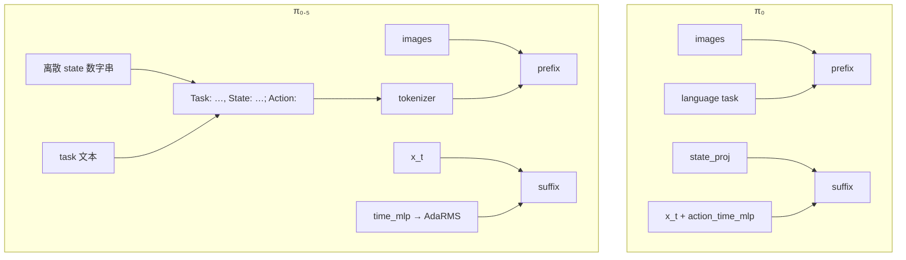
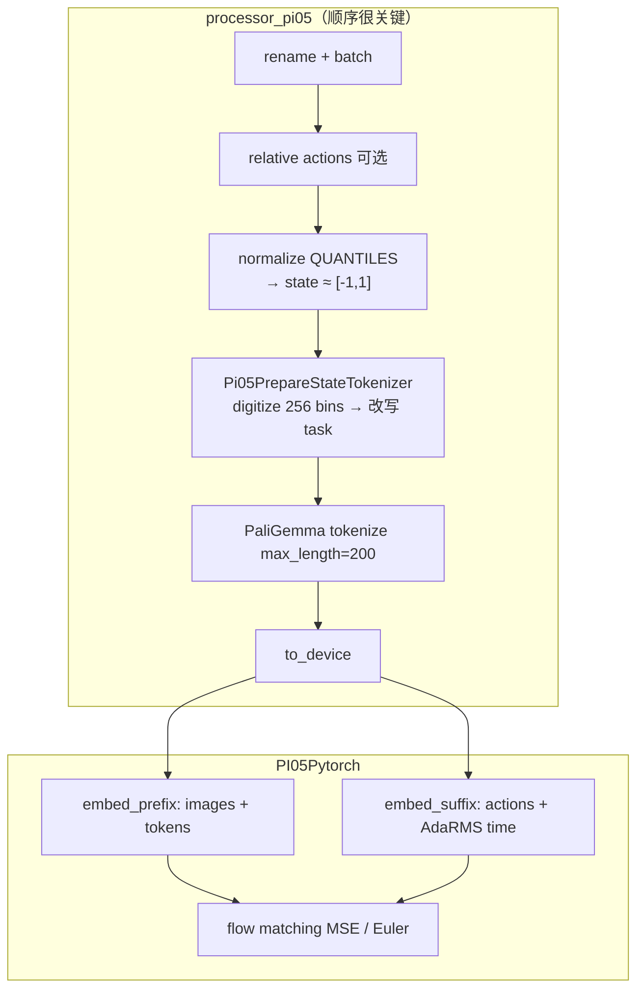

# π₀.₅（Pi05）深度指南

> 对应仓库：`src/lerobot/policies/pi05/`
> 官方英文页：`docs/source/pi05.mdx` · 模块 README：`src/lerobot/policies/pi05/README.md`
> 论文：https://arxiv.org/abs/2504.16054 · 博客：https://www.physicalintelligence.company/blog/pi05
> OpenPI：https://github.com/Physical-Intelligence/openpi
> 强烈建议先读：[`Pi0.md`](./Pi0.md)（共享 PaliGemma + flow matching 骨架）
> 对照 SmolVLA：[`SmolVLA.md`](./SmolVLA.md)

---

## 1. 概览：什么时候选 π₀.₅？

**π₀.₅** 是 Physical Intelligence 在 π₀ 之后的开放世界泛化版：仍是 **PaliGemma + Flow Matching Action Expert**，但状态进入方式、时间条件注入、归一化与提示词长度都换了一套。LeRobot 注册名为 **`pi05`**，权重常见 [`lerobot/pi05_base`](https://huggingface.co/lerobot/pi05_base)。

| 项 | 内容 |
|----|------|
| 类别 | Vision-Language-Action（VLAs） |
| 论文 | [π₀.₅: a Vision-Language-Action Model with Open-World Generalization](https://arxiv.org/abs/2504.16054)（2025） |
| 作者 | Physical Intelligence et al.（完整列表见 `policies/pi05/README.md`） |
| 项目 / 博客 | https://www.physicalintelligence.company/blog/pi05 |
| 注册名 | `policy.type=pi05` |
| Hub 权重 | [`pi05_base`](https://huggingface.co/lerobot/pi05_base) · [`pi05_libero`](https://huggingface.co/lerobot/pi05_libero) |
| 本仓库代码 | `configuration_pi05.py` / `modeling_pi05.py` / `processor_pi05.py` |
| 依赖 | 与 π₀ 相同：`uv sync --extra pi` |

**一句话：** 把 **离散化后的 state 写进语言提示**（不再 `state_proj`），用 **AdaRMS + `time_mlp_*`** 给专家做时间条件，默认 **QUANTILES** 归一化；动作仍是 flow matching chunk。

适合：已能跑 π₀、要跟 OpenPI π₀.₅ / 开放场景配方对齐、Libero 等基准。
不太适合：只想 SO 臂快速闭环（先 SmolVLA）；不想处理 quantile stats / 离散 state 提示（可先 π₀）。

---

## 2. 论文精读（对着代码读）

### 2.1 问题设定

实验室内敏捷/灵巧不是唯一瓶颈——**换房间、换物体、换语义语境**就崩。泛化要同时覆盖：

- **物理层**：未见物体如何抓（勺柄 vs 盘边）
- **语义层**：衣服进脏衣篮而不是床上
- **环境层**：真实杂乱家居 / 商店 / 办公

### 2.2 方法：异构数据共训 + 架构微调

博客/文档强调 **co-training on heterogeneous data**：网页多模态、口头辅导、子任务标签、跨具身与多家庭移动操作（文档量级约 400h 移动演示）等，形成课程式混合。

LeRobot 移植侧你能直接摸到的**架构差分**（相对 π₀）才是本指南重点：

| 差分 | π₀ | π₀.₅ |
|------|----|------|
| 时间条件 | `action_time_mlp_*` 拼到动作 token | `time_mlp_*` → **AdaRMS** 条件 |
| AdaRMS | 关 | **专家开**（`use_adarms=[False, True]`） |
| Tokenizer 长度 | 48 | **200** |
| 状态 | 连续 `state_proj`（在 **suffix**） | **离散进语言 prefix**（无 `state_proj`） |
| 归一化默认 | STATE/ACTION **MEAN_STD** | **QUANTILES** |

### 2.3 实验与结论（文档可核对）

LeRobot `pi05.mdx` 报告：在 Libero 上对 libero 基座再微调约 6k steps，与 OpenPI 参考接近：

| Benchmark | LeRobot | OpenPI 参考 |
|-----------|---------|-------------|
| Libero Spatial | 97.0% | 98.8% |
| Libero Object | 99.0% | 98.2% |
| Libero Goal | 98.0% | 98.0% |
| Libero 10 | 96.0% | 92.4% |
| Average | 97.5% | 96.85% |

开放世界案例以 [PI 博客](https://www.physicalintelligence.company/blog/pi05) 为准。

### 2.4 论文 / OpenPI → LeRobot 字段

| 概念 | LeRobot |
|------|---------|
| 注册 | `pi05` / `PI05Config` / `PI05Policy` |
| VLM / Expert 变体 | 同 π₀：`gemma_2b` + `gemma_300m` |
| 离散 state 提示 | `Pi05PrepareStateTokenizerProcessorStep` |
| AdaRMS 时间条件 | `time_mlp_in/out` → `adarms_cond` |
| Flow 步数 | `num_inference_steps=10` |
| Chunk | `chunk_size` / `n_action_steps` = 50 |
| Quantile 归一化 | `normalization_mapping` STATE/ACTION → `QUANTILES` |
| 相对动作 | 同 π₀：`use_relative_actions` |
| RTC | `rtc_config`（`select_action` 不支持） |

---

## 3. LeRobot 实现地图

### 3.1 目录

```
src/lerobot/policies/pi05/
  configuration_pi05.py
  modeling_pi05.py          # PI05Policy + PI05Pytorch（AdaRMS expert）
  processor_pi05.py         # 离散 state → 提示词 + tokenize
```

共享：`policies/pi_gemma/`、`policies/common/flow_matching.py`。

### 3.2 与 π₀ 对照（必读）

| 维度 | π₀ | π₀.₅ |
|------|----|------|
| `predict_action_chunk` 是否传 state 张量 | 是（`prepare_state`） | **否**（state 已在 tokens 里） |
| `embed_suffix` 签名 | `(state, noisy_actions, timestep)` | **`(noisy_actions, timestep)`** |
| 时间 MLP 名 | `action_time_mlp_*` | **`time_mlp_*`** |
| 默认 normalize | MEAN_STD | **QUANTILES** |
| 提示形态 | task + `\n` | **`Task: …, State: …;\nAction: `** |
| `tokenizer_max_length` | 48 | **200** |



### 3.3 训练 / 推理数据流



**硬约束：** `Normalizer` 必须在离散化之前——注释写明 tokenizer step 假定 state 已在 `[-1, 1]`。

### 3.4 与平台其它层

- **Dataset**：需要 **quantile stats**（见 §4.3）；缺则报错或需改 mapping
- **Train**：`--policy.path=lerobot/pi05_base`；配置类型从 checkpoint 加载
- **Eval**：Libero 复现见文档 [Libero](https://huggingface.co/docs/lerobot/libero) 节

---

## 4. 示例：如何跑起来

### 4.1 环境

```bash
uv sync --locked --extra pi --extra training
```

### 4.2 加载基座

```bash
uv run python - <<'PY'
from lerobot.policies.pi05 import PI05Policy
from lerobot.policies import make_pre_post_processors

model_id = "lerobot/pi05_base"
model = PI05Policy.from_pretrained(model_id)
pre, post = make_pre_post_processors(
    model.config,
    model_id,
    preprocessor_overrides={"device_processor": {"device": "cpu"}},
)
print(
    model.config.tokenizer_max_length,
    model.config.normalization_mapping,
    model.config.num_inference_steps,
)
PY
```

### 4.3 Quantile stats（π₀.₅ 常见前置）

默认 `STATE`/`ACTION` 用 `QUANTILES`。数据集若没有 quantile 统计：

```bash
uv run python src/lerobot/scripts/augment_dataset_quantile_stats.py \
  --repo-id=your_dataset
```

或临时改回 MEAN_STD（可能与预训练分布不匹配，仅作调试）：

```bash
--policy.normalization_mapping='{"ACTION": "MEAN_STD", "STATE": "MEAN_STD", "VISUAL": "IDENTITY"}'
```

### 4.4 微调

```bash
uv run lerobot-train \
  --dataset.repo_id=your_dataset \
  --policy.path=lerobot/pi05_base \
  --output_dir=./outputs/pi05_training \
  --job_name=pi05_training \
  --policy.compile_model=true \
  --policy.gradient_checkpointing=true \
  --policy.dtype=bfloat16 \
  --policy.freeze_vision_encoder=false \
  --policy.train_expert_only=false \
  --steps=3000 \
  --policy.device=cuda \
  --batch_size=32 \
  --wandb.enable=true
```

显存紧：`train_expert_only=true` + `gradient_checkpointing` + 降 batch。
Libero 起点：`lerobot/pi05_libero`。

### 4.5 相对动作

与 π₀ 同流程（`chunk_size` 默认 50）：

```bash
uv run lerobot-edit-dataset \
  --repo_id your_dataset \
  --operation.type recompute_stats \
  --operation.relative_action true \
  --operation.chunk_size 50 \
  --operation.relative_exclude_joints "['gripper']" \
  --push_to_hub true
```

训练加：`--policy.use_relative_actions=true`。

---

## 5. 关键代码详解

### 5.1 Config：QUANTILES + 200 tokens

```70:78:src/lerobot/policies/pi05/configuration_pi05.py
    tokenizer_max_length: int = 200
    normalization_mapping: dict[str, NormalizationMode] = field(
        default_factory=lambda: {
            "VISUAL": NormalizationMode.IDENTITY,
            "STATE": NormalizationMode.QUANTILES,
            "ACTION": NormalizationMode.QUANTILES,
        }
    )
```

（文件中 `tokenizer_max_length` 出现两次赋值，最终值仍为 **200**。）

### 5.2 离散 State → 语言提示

```65:75:src/lerobot/policies/pi05/processor_pi05.py
        discretized_states = np.digitize(state_np, bins=np.linspace(-1, 1, 256 + 1)[:-1]) - 1
        ...
            full_prompt = f"Task: {cleaned_text}, State: {state_str};\nAction: "
```

要点：

1. 256 bins，对齐 openpi `PaligemmaTokenizer.tokenize`
2. 清洗 task：去 `_`、换行变空格
3. **无 task / 无 state → 直接 ValueError**（比 π₀ 更严）
4. 之后才 `TokenizerProcessorStep(max_length=200)`

### 5.3 AdaRMS 时间条件（无 state_proj）

```417:431:src/lerobot/policies/pi05/modeling_pi05.py
        self.paligemma_with_expert = PaliGemmaWithExpertModel(
            ...
            use_adarms=[False, True],  # 仅 expert
            ...
        )
        self.action_in_proj = ...
        self.action_out_proj = ...
        self.time_mlp_in = ...
        self.time_mlp_out = ...
```

`embed_suffix`：动作投影 + `time_mlp` 得到 `adarms_cond`，**不把时间拼进动作维**。
`from_pretrained` 会把检查点里的 `action_time_mlp_*` remap 成 `time_mlp_*`，并 **跳过 `state_proj`**。

### 5.4 Policy I/O：不再单独喂 state

```1043:1047:src/lerobot/policies/pi05/modeling_pi05.py
        images, img_masks = self._preprocess_images(batch)
        tokens, masks = batch[f"{OBS_LANGUAGE_TOKENS}"], batch[f"{OBS_LANGUAGE_ATTENTION_MASK}"]
        actions = self.model.sample_actions(images, img_masks, tokens, masks, **kwargs)
```

训练 `forward` 同理——注释写明 *no separate state needed for PI05*。

### 5.5 Flow matching（与 π₀ 同族）

仍是 \(x_t=t\epsilon+(1-t)a\)，\(u_t=\epsilon-a\)，MSE；推理 `euler_integrate` × `num_inference_steps`。
队列：`select_action` / RTC 限制与 π₀ 相同。

### 5.6 PEFT 靶点注意

`_get_default_peft_targets` 字符串里仍写着 `state_proj|...|action_time_mlp_*`——这是 **π₀ 命名残留**。π₀.₅ 实际模块是 `time_mlp_in/out` 且无 `state_proj`。用 PEFT 时请核对正则是否匹配到真实参数名。

---

## 6. 社区优秀讨论

| 主题 | 入口 | 你会学到 |
|------|------|----------|
| 开放世界叙事 | [PI Blog π0.5](https://www.physicalintelligence.company/blog/pi05) | 异构数据共训动机 |
| 论文 | [arXiv 2504.16054](https://arxiv.org/abs/2504.16054) · [HF Papers](https://huggingface.co/papers/2504.16054) | 方法细节 |
| OpenPI | [openpi](https://github.com/Physical-Intelligence/openpi) | 离散 state tokenize 上游 |
| LeRobot 文档 | [docs pi05](https://huggingface.co/docs/lerobot/en/pi05) | 微调、quantile、Libero 表 |
| Hub | [pi05_base](https://huggingface.co/lerobot/pi05_base) | 特征与用法 |
| Issues | 搜 `pi05` / `quantile` / `AdaRMS` | stats、权重 remap |

Discord：https://discord.gg/q8Dzzpym3f · Issues：https://github.com/huggingface/lerobot/issues

---

## 7. 调优与常见坑

### 7.1 按症状

| 症状 | 可能原因 | 建议 |
|------|----------|------|
| 缺 quantile / normalize 炸 | 数据集无 quantile stats | 跑 `augment_dataset_quantile_stats.py` |
| `State is required` / `No task` | processor 严校验 | 保证 obs 有 state、complementary 有 task |
| 提示超长截断 | state 离散串 + task 很长 | `tokenizer_max_length=200`；缩短指令 |
| 用 π₀ 权重加载 π₀.₅ | key / adaRMS / state_proj 不匹配 | 用 `pi05_*`；看 remap 日志 |
| OOM | 同 π₀ | checkpoint + bf16 + `train_expert_only` |
| 相对动作尺度错 | stats 未按 relative 重算 | `lerobot-edit-dataset` recompute |
| 离散乱码式行为 | normalize 未在 digitize 前 | 勿打乱 processor 顺序 |
| PEFT 无效果 | 靶点名仍是 action_time_mlp | 改成匹配 `time_mlp_*` |
| OOD 仍差 | 后训练域覆盖不够 | 采目标域数据；泛化首先是数据问题 |

### 7.2 推荐起点

| 旋钮 | 起点 | 备注 |
|------|------|------|
| 权重 | `lerobot/pi05_base` | Libero → `pi05_libero` |
| steps | 3000 起（文档示例） | Libero 文档另有 +6k 设定 |
| batch | 32 | 按显存 |
| normalize | 保持 QUANTILES | 与预训练一致 |
| `num_inference_steps` | 10 | |
| 相对动作 | 默认关 | 需要再开并重算 stats |

### 7.3 选型速查

| 需求 | 更合适 |
|------|--------|
| SO 臂 + 语言，轻量 | SmolVLA |
| OpenPI π₀ / MEAN_STD / state_proj | π₀ |
| OpenPI π₀.₅ / 开放泛化 / quantiles | **π₀.₅** |
| 只要模仿、无语言 | ACT / Diffusion |

---

## 8. 五日精读清单（可选）

| 天 | 任务 | 产出 |
|----|------|------|
| D1 | 读 PI π0.5 博客 + 对照 π₀ 表 | 口述三层泛化 |
| D2 | 加载 `pi05_base`；打印 normalize + tokenizer_max_length | 确认 QUANTILES / 200 |
| D3 | 精读 `Pi05PrepareStateTokenizerProcessorStep` | 手写一条完整 prompt |
| D4 | Diff：`embed_suffix` π₀ vs π₀.₅ | AdaRMS vs action_time_mlp 图 |
| D5 | 补 quantile stats 或读 Libero 复现节 | 记下前置检查清单 |

---

## 9. 延伸阅读

- arXiv：https://arxiv.org/abs/2504.16054
- π₀ 对照：[`Pi0.md`](./Pi0.md) · Pi0Fast：[`Pi0Fast.md`](./Pi0Fast.md)
- SmolVLA：[`SmolVLA.md`](./SmolVLA.md)
- 返回：[`./README.md`](./README.md) · [`../README.md`](../README.md)

---

### 自测（10 条）

| # | 输入 / 问题 | 预期 |
|---|-------------|------|
| 1 | π₀.₅ 默认 STATE 归一化？ | **QUANTILES** |
| 2 | state 进模型的路径？ | **离散写入语言提示**，无 `state_proj` |
| 3 | 时间条件模块名？ | **`time_mlp_*` + AdaRMS** |
| 4 | `use_adarms`？ | `[False, True]`（仅 expert） |
| 5 | `tokenizer_max_length`？ | **200** |
| 6 | normalize 与 digitize 顺序？ | **先 normalize，再离散化** |
| 7 | 提示模板关键词？ | `Task:` / `State:` / `Action:` |
| 8 | `sample_actions` 是否吃 state 张量？ | **否** |
| 9 | 依赖 extra？ | **`pi`**（与 π₀ 共用） |
| 10 | 缺 task 时 processor？ | **ValueError** |
