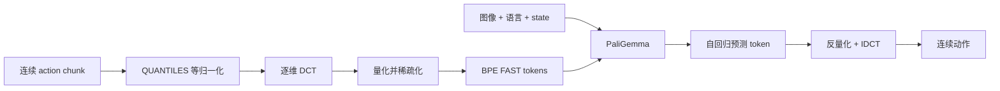

# π0-FAST：把连续动作压缩成可自回归生成的 token

π0-FAST 使用 FAST（Frequency-space Action Sequence Tokenization）把连续 action chunk 转成紧凑 token，再像语言模型一样做 next-token prediction。LeRobot 注册名是 `pi0_fast`，不要与 `pi0` 或 `pi05` checkpoint 混用。

| 项目 | 内容 |
|---|---|
| 动作表示 | DCT + 量化 + BPE 的 FAST token |
| 骨干 | PaliGemma：SigLIP 视觉塔 + Gemma 语言模型 |
| 默认 tokenizer | `lerobot/fast-action-tokenizer` |
| 代码 | `src/lerobot/policies/pi0_fast/` |
| 官方指南 | `docs/source/pi0fast.mdx` |

## 1. FAST 在做什么

对形状为 `(H, D)` 的动作片段，FAST 依次执行归一化、逐动作维度 DCT、系数量化、按低频优先展平，再用 BPE 压缩。低频系数描述轨迹整体趋势，高频系数补充快速变化；这比逐时刻逐维度分箱更适合高频、精细动作。



论文/官方指南报告训练最高约 5 倍于 diffusion 路线，这是其特定实验设置下的结果。你仍需单独测 tokenizer 长度、KV cache 命中、GPU 和控制频率。

## 2. 默认时间与生成参数

| 配置 | 默认值 | 含义 |
|---|---:|---|
| `chunk_size` | 50 | 预测动作数 |
| `n_action_steps` | 50 | 每次放入执行队列的动作数 |
| `max_action_tokens` | 256 | 一个 chunk 的 token 上限 |
| `max_decoding_steps` | 256 | 自回归解码上限 |
| `temperature` | 0.0 | 默认贪心解码 |
| `use_kv_cache` | true | 推理缓存 attention K/V |
| `max_state_dim` / `max_action_dim` | 32 / 32 | padding 上限 |

`n_action_steps` 必须不大于 `chunk_size`。执行步数越多，重规划越少；但机器人受到扰动后纠错也越慢。官方复现实验使用过 `n_action_steps=10`，并不意味着所有机器人都应设为 10。

## 3. 安装与训练

```bash
uv sync --locked --extra pi --extra training
```

从基础 checkpoint 微调：

```bash
uv run lerobot-train \
  --dataset.repo_id=<HF_USER/DATASET> \
  --policy.type=pi0_fast \
  --policy.path=lerobot/pi0fast-base \
  --policy.dtype=bfloat16 \
  --policy.gradient_checkpointing=true \
  --policy.chunk_size=10 \
  --policy.n_action_steps=10 \
  --policy.device=cuda \
  --batch_size=4 \
  --steps=100000 \
  --output_dir=outputs/train/pi0fast
```

首次实验先使用通用 tokenizer。只有当 token 序列经常触及 `max_action_tokens`、重建误差明显或动作域非常特殊时，再训练自有 tokenizer：

```bash
uv run lerobot-train-tokenizer \
  --repo_id <HF_USER/DATASET> \
  --action_horizon 10 \
  --encoded_dims "0:6" \
  --vocab_size 1024 \
  --normalization_mode QUANTILES \
  --output_dir ./artifacts/my_fast_tokenizer
```

随后传 `--policy.action_tokenizer_name=./artifacts/my_fast_tokenizer`。tokenizer 的 action horizon、编码维度和训练时 policy 必须对齐。

## 4. 源码地图

1. `configuration_pi0_fast.py`：tokenizer、chunk、相对动作、RTC 与 KV cache；
2. `processor_pi0_fast.py`：state padding、语言/tokenizer 输入和动作反变换；
3. `PI0FastPaliGemma`：图像语言主干；
4. `PI0FastPolicy.forward()`：训练 token loss；
5. `predict_action_chunk()`：自回归解码与 FAST 还原；
6. `select_action()`：动作队列。

默认 action/state 用 `QUANTILES` 归一化。`use_relative_actions` 开启后，可用 `relative_exclude_joints=["gripper"]` 避免夹爪通道被改成相对量；这要求 `action_feature_names` 能正确标识关节。

## 5. 调优与排错

| 现象 | 优先检查 | 处理 |
|---|---|---|
| token 被截断 | chunk 太长或 tokenizer 不匹配 | 看实际 token 长度；增上限或重训 tokenizer |
| 动作解码形状错误 | encoded dims / action dim 不一致 | 对齐 tokenizer 元数据和 dataset feature |
| 推理仍慢 | KV cache 关闭、解码序列长 | 确认 `use_kv_cache=true`，分析 token 数 |
| 动作迟钝 | `n_action_steps` 太大 | 缩短执行 chunk，提高重规划频率 |
| OOM | 2B 骨干、长序列 | bf16、gradient checkpointing、减 batch |
| 相对动作异常 | 夹爪等绝对通道未排除 | 校验 feature names 和 exclude joints |
| 权重加载失败 | 拿了 π0/π0.5 权重 | 使用 π0-FAST 专用 checkpoint |

验收至少记录：token 长度分布、动作重建误差、每次 chunk 解码延迟、闭环成功率和重规划频率。

继续阅读 [`Pi0.md`](./Pi0.md) 比较 flow matching，或返回 [VLA 目录](./README.md)。
