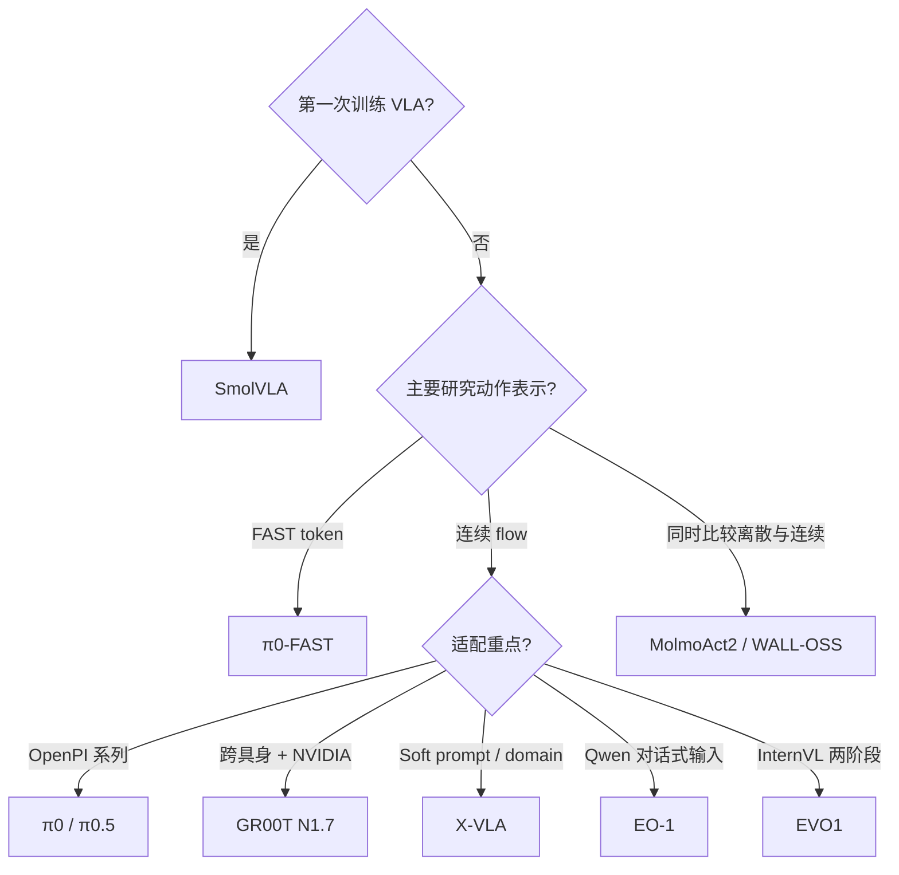

# VLA 模型

VLA（Vision-Language-Action）策略把相机、语言任务和机器人状态共同映射为动作。本目录关注 LeRobot **当前代码实际提供的训练与推理路径**，不把上游项目尚未移植的能力混进教程。

| 模型 | 动作生成 | 主要骨干 / 适用方向 | 教程 |
|---|---|---|---|
| [SmolVLA](./SmolVLA.md) | Flow matching | 轻量、适合作为首个 VLA 基线 | 深度指南 |
| [π0](./Pi0.md) | Flow matching | OpenPI 路线、连续动作 | 深度指南 |
| [π0-FAST](./Pi0Fast.md) | FAST 自回归 token | 在意训练/推理生成方式与 KV cache | 实用指南 |
| [π0.5](./Pi05.md) | Flow matching | π0 系列增强版、离散 state token | 深度指南 |
| [GR00T N1.7](./GR00T.md) | Flow matching | NVIDIA 3B、跨具身后训练 | 实用指南 |
| [X-VLA](./XVLA.md) | Flow matching | soft prompt 适配 robot/domain | 实用指南 |
| [EO-1](./EO-1.md) | Flow matching | Qwen2.5-VL、多模态会话式输入 | 实用指南 |
| [MolmoAct2](./MolmoAct2.md) | 连续 flow + 离散 token | 可联合训练两种动作目标 | 实用指南 |
| [WALL-OSS](./WALL-OSS.md) | Diffusion 或 FAST | Qwen2.5-VL MoE、跨具身 | 实用指南 |
| [EVO1](./EVO1.md) | Flow matching | InternVL3、两阶段微调 | 实用指南 |

## 怎么选

选择前先核对四件事：

1. checkpoint 格式是否与 policy 完全匹配；
2. 数据集是否包含稳定的 `task` 语言字段；
3. 相机数量、state/action 维度与动作坐标系是否满足配置；
4. 显存、下载空间和模型许可证是否可接受。

推荐阅读顺序：**SmolVLA → π0 → π0.5 / π0-FAST → 与你的骨干或具身最接近的模型**。上手数据、训练和评测请回到[阶段主线](../../README.md)，返回[模型总目录](../README.md)。
