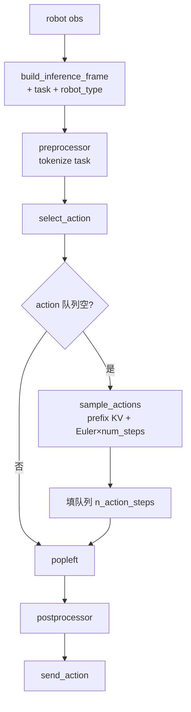
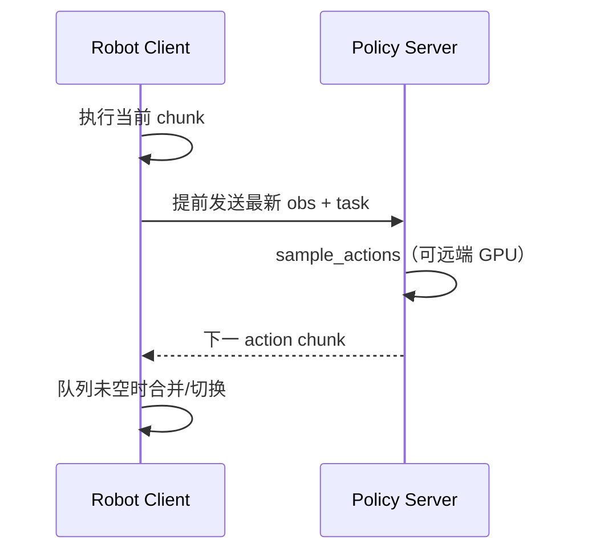
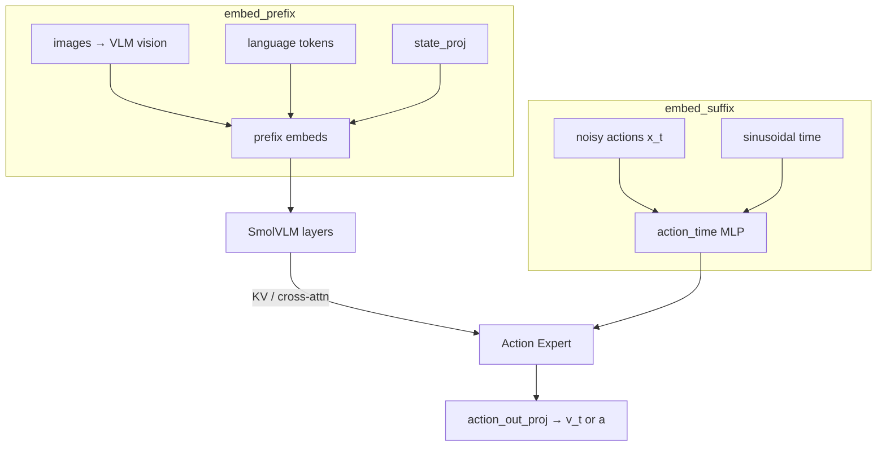

# SmolVLA 深度指南

> 对应仓库：`src/lerobot/policies/smolvla/`
> 官方英文页：`docs/source/smolvla.mdx` · 论文卡：`docs/source/policy_smolvla_README.md`
> 阶段课交叉：[`../../stages/07-SmolVLA与VLA.md`](../../stages/07-SmolVLA与VLA.md)
> 异步推理：`docs/source/async.mdx` · 博客 https://huggingface.co/blog/async-robot-inference
> 对照 ACT / Diffusion：[`../imitation-learning/ACT.md`](../imitation-learning/ACT.md) · [`../imitation-learning/Diffusion.md`](../imitation-learning/Diffusion.md)

---

## 1. 概览：什么时候选 SmolVLA？

**SmolVLA** 是 Hugging Face 面向「消费级硬件 + 社区数据集」的紧凑 VLA（约 **450M**）：视觉-语言骨干（SmolVLM）+ **Flow Matching 动作专家**，并配套**异步推理栈**。在 LeRobot 里，它是 **VLA 入门首选**——比 π0 / GR00T 更轻，比 ACT 多了自然语言条件。

| 项 | 内容 |
|----|------|
| 类别 | Vision-Language-Action（VLAs） |
| 论文 | [SmolVLA: A Vision-Language-Action Model for Affordable and Efficient Robotics](https://arxiv.org/abs/2506.01844)（2025） |
| 作者 | Mustafa Shukor et al.（Hugging Face 等，完整列表见 `policies/smolvla/README.md`） |
| 博客 | https://huggingface.co/blog/smolvla |
| 基座权重 | https://huggingface.co/lerobot/smolvla_base |
| 注册名 | `policy.type=smolvla`；微调常用 `--policy.path=lerobot/smolvla_base` |
| 本仓库代码 | `configuration_smolvla.py` / `modeling_smolvla.py` / `smolvlm_with_expert.py` / `processor_smolvla.py` |
| 示例 | `examples/tutorial/smolvla/` · `examples/tutorial/async-inf/` |
| 依赖 | `uv sync --extra smolvla`（transformers 等）；异步另需 `--extra async` |

**一句话：** 多相机图像 + 机器人状态 + **自然语言指令** → VLM 编成前缀 → Action Expert 用 **flow matching（默认 10 步 Euler）** 生成 `chunk_size` 动作 → 队列逐步执行（或 async/RTC 叠加重规划）。

适合：SO-100/101 等低成本臂、有语言标注的数据集、想从预训练起微调。
不太适合：完全无语言的纯模仿（用 ACT/Diffusion 更直接）、要极大容量跨本体基础模型（看 π / GR00T）。

---

## 2. 论文精读（对着代码读）

### 2.1 问题设定

巨型 VLA 训练/部署门槛高；大量 **HF 社区 `lerobot` 标签数据**未被充分利用。目标：

> 在可负担硬件上，用开源社区数据做出「够用」的语言条件策略，并解决 chunk 策略带来的**推理空档**。

### 2.2 方法：四个关键设计

#### （1）紧凑 VLM + Action Expert

- 骨干：`HuggingFaceTB/SmolVLM2-500M-Video-Instruct`（配置字段 `vlm_model_name`）
- 只用 LLM 前 **`num_vlm_layers=16`** 层
- Action Expert：宽度约为 VLM 的 `expert_width_multiplier=0.75`，默认与 VLM 层数对齐（`num_expert_layers=-1`）
- 微调默认：`freeze_vision_encoder=True`，`train_expert_only=True`（主要训专家 + 可训 `state_proj`）
- 若设 `train_expert_only=False`，也不是“无条件全量解冻”：实现会为 DDP
  兼容冻结指定末层/归一化参数，并验证冻结模式确实匹配当前 Transformers 参数名

代码入口：`SmolVLMWithExpertModel`（`smolvlm_with_expert.py`）+ `VLAFlowMatching`（`modeling_smolvla.py`）。

#### （2）Flow Matching（不是 DDPM）

训练（简化）：

\[
x_t = t\,\epsilon + (1-t)\,a,\quad u_t = \epsilon - a,\quad \mathcal{L}=\mathrm{MSE}(v_\theta(x_t,t), u_t)
\]

推理：从噪声出发，**Euler 积分 `num_steps` 次**（默认 **10**）得到动作 chunk。共享原语在 `policies/common/flow_matching.py`（与 π0 等同源）。

对比 Diffusion Policy：训练同是「单步噪声/速度回归」，但调度与条件注入方式不同；SmolVLA 条件来自 **VLM prefix KV cache**。

#### （3）Action Chunking + 队列

与 ACT 同构：`chunk_size` / `n_action_steps`（默认都是 **50**），`select_action` 用动作队列。
`n_obs_steps=1`（当前帧；多相机各自一张）。

#### （4）异步推理（model-agnostic）+ 可选 RTC

论文/博客：执行与预测解耦 → 约 **30% 更快完成**、固定时间内约 **2× 任务吞吐**（以博客报告为准）。
仓库：`docs/source/async.mdx`、`examples/tutorial/async-inf/`。
另有 **RTC（Real-Time Chunking）**：`rtc_config`；注意 **`select_action` 不支持 RTC**，要用 `predict_action_chunk`。

### 2.3 实验与结论（以论文/博客报告为准）

- ~450M，约 100M 在 action expert；社区许可兼容数据预训练
- 仿真（LIBERO / Meta-World）与实机（SO100/101）相对更大 VLA / ACT 有竞争力
- 官方文档建议：自采数据约 **50 episodes**，并让每个任务变体有足够重复（例如 5 个物块位置 × 10 集）；25 集实验过欠拟合

### 2.4 论文概念 → LeRobot 字段

| 论文 / 博客概念 | LeRobot 字段 / 代码 |
|----------------|---------------------|
| VLM backbone | `vlm_model_name`，`load_vlm_weights` |
| 截断 LLM 层 | `num_vlm_layers=16` |
| Action expert 宽度 | `expert_width_multiplier` |
| Attention（cross / interleaved） | `attention_mode="cross_attn"`，`self_attn_every_n_layers` |
| Flow matching 步数 | `num_steps=10` |
| Chunk | `chunk_size` / `n_action_steps` |
| 状态/动作 pad 到统一维 | `max_state_dim=32`，`max_action_dim=32` |
| 图像 resize+pad | `resize_imgs_with_padding=(512,512)`（宽,高；内部再转 H,W） |
| 缺相机占位 | `empty_cameras` |
| 冻结视觉 / 只训专家 | `freeze_vision_encoder`，`train_expert_only` |
| Tokenizer | `tokenizer_max_length=48`，processor 里 `TokenizerProcessorStep` |
| 任务字符串 | `task` → `NewLineTaskProcessorStep` 强制尾部 `\n` |
| Aloha 空间适配 | `adapt_to_pi_aloha`（`use_delta_joint_actions_aloha` 尚未移植） |
| RTC | `rtc_config` |
| 异步栈 | 独立于 policy 的 server/client（见 async 文档） |

---

## 3. LeRobot 实现地图

### 3.1 目录与职责

```
src/lerobot/policies/smolvla/
  configuration_smolvla.py   # 注册 smolvla、chunk、flow、微调开关
  modeling_smolvla.py        # SmolVLAPolicy + VLAFlowMatching
  smolvlm_with_expert.py     # VLM ↔ Expert 拼装与注意力
  processor_smolvla.py       # newline + tokenize + normalize
```

| 类 / 函数 | 职责 |
|-----------|------|
| `SmolVLAConfig` | 时间几何、VLM/专家超参、优化器预设、RTC |
| `SmolVLAPolicy` | 队列、`select_action` / `predict_action_chunk`、`forward` loss |
| `VLAFlowMatching` | `embed_prefix/suffix`、训练 MSE、`sample_actions` + Euler |
| `SmolVLMWithExpertModel` | 加载/截断层、专家宽度、联合 forward + KV cache |
| `make_smolvla_pre_post_processors` | 语言流水线（相对 ACT 的核心增量） |

### 3.2 训练数据流

```mermaid
flowchart TB
  subgraph Data["Dataset"]
    DS[LeRobotDataset]
    LANG[task / language 列]
    DT["delta: obs=[0]<br/>action=0..chunk_size-1"]
  end
  subgraph Prep["processor_smolvla"]
    REN[rename + batch]
    NL[NewLineTaskProcessorStep]
    TOK[TokenizerProcessorStep]
    DEV[to_device + normalize]
  end
  subgraph Train["SmolVLAPolicy.forward"]
    IMG[prepare_images → [-1,1]]
    ST[prepare_state pad]
    FM["x_t = tε+(1-t)a<br/>predict v_t"]
    LOSS[MSE 速度场]
  end
  DS --> DT --> REN --> NL --> TOK --> DEV
  LANG --> NL
  DEV --> IMG --> FM
  DEV --> ST --> FM --> LOSS
```

### 3.3 同步推理（队列）



### 3.4 异步推理（概念）



细节与调参见 `docs/source/async.mdx`（`chunk_size_threshold` 等）。

### 3.5 与平台其它层

- **Dataset**：必须有可用的语言字段；`observation_delta_indices=[0]`，`action_delta_indices=range(chunk_size)`
- **Processor**：相对 ACT/Diffusion，多了 **换行 + tokenizer**；视觉在 config 里是 `IDENTITY`，像素缩放在 `prepare_images` 内完成
- **Train**：优先 `--policy.path=lerobot/smolvla_base`（带预训练），不要无脑从零 `type=smolvla` 除非你知道 `load_vlm_weights`
- **Eval/实机**：`lerobot-rollout`（见 smolvla.mdx）或 tutorial using 示例

---

## 4. 示例：如何跑起来

### 4.1 环境

```bash
uv sync --locked --extra smolvla --extra training
# 异步另加：
# uv sync --locked --extra async
```

### 4.2 只加载权重（无机器人）

```bash
uv run python - <<'PY'
import torch
from lerobot.policies.smolvla import SmolVLAPolicy
from lerobot.policies import make_pre_post_processors

device = torch.device("cpu")  # 或 mps / cuda
model_id = "lerobot/smolvla_base"
model = SmolVLAPolicy.from_pretrained(model_id)
pre, post = make_pre_post_processors(
    model.config,
    model_id,
    preprocessor_overrides={"device_processor": {"device": str(device)}},
)
print(type(model).__name__, model.config.chunk_size, model.config.num_steps)
PY
```

### 4.3 微调（官方推荐路径）

```bash
uv run lerobot-train \
  --policy.path=lerobot/smolvla_base \
  --dataset.repo_id=${HF_USER}/mydataset \
  --batch_size=64 \
  --steps=20000 \
  --output_dir=outputs/train/my_smolvla \
  --job_name=my_smolvla_training \
  --policy.device=cuda \
  --wandb.enable=true
```

文档量级：A100 约 **20k steps ≈ 4h**（按硬件伸缩）。参考数据可视化：[svla_so100_pickplace](https://huggingface.co/spaces/lerobot/visualize_dataset?path=%2Flerobot%2Fsvla_so100_pickplace%2Fepisode_0)。
无本地 GPU：官方 Colab notebook（见 `smolvla.mdx` 徽章链接）。

### 4.4 实机 using 示例骨架

```bash
uv run python examples/tutorial/smolvla/using_smolvla_example.py
```

必改：`port` / `id` / **相机名与分辨率对齐 model card / 训练数据** / **非空 `task`（与录制时句式一致）**。

### 4.5 异步

```bash
# 见 docs/source/async.mdx 与 examples/tutorial/async-inf/
# Policy Server + Robot Client（gRPC）
```

---

## 5. 关键代码详解

### 5.1 Config：chunk 与微调开关

```28:30:src/lerobot/policies/smolvla/configuration_smolvla.py
    n_obs_steps: int = 1
    chunk_size: int = 50
    n_action_steps: int = 50
```

```68:71:src/lerobot/policies/smolvla/configuration_smolvla.py
    freeze_vision_encoder: bool = True
    train_expert_only: bool = True
    train_state_proj: bool = True
```

```63:63:src/lerobot/policies/smolvla/configuration_smolvla.py
    num_steps: int = 10
```

约束：`n_action_steps <= chunk_size`（`__post_init__`）。

冻结边界最终由 `smolvlm_with_expert.py::set_requires_grad()` 决定。当前实现对
`train_expert_only=False` 的部分冻结使用真实的
`text_model.layers.*` / `text_model.norm.weight` 参数名，并在模式没有匹配任何
参数时抛出错误。升级 Transformers 后若这里报错，应核对参数树，而不是删除检查。

### 5.2 Processor：语言是一等公民

```65:77:src/lerobot/policies/smolvla/processor_smolvla.py
    input_steps = [
        steps.rename_observations,
        steps.add_batch_dim,
        NewLineTaskProcessorStep(),
        TokenizerProcessorStep(
            tokenizer_name=config.vlm_model_name,
            padding=config.pad_language_to,
            padding_side="right",
            max_length=config.tokenizer_max_length,
        ),
        steps.to_device,
        steps.normalize,
    ]
```

契约测试：`tests/processor/test_smolvla_processor.py`

- `"test task"` → `"test task\n"`
- 已有 `\n` 不再重复追加
- 列表 task 逐条处理

**读 VLA 时优先读 processor + 测试，再下钻 `smolvlm_with_expert.py`。**

### 5.3 `select_action`：队列；RTC 禁用

```241:266:src/lerobot/policies/smolvla/modeling_smolvla.py
    def select_action(...):
        assert not self._rtc_enabled(), (
            "RTC is not supported for select_action, use it with predict_action_chunk"
        )
        ...
        if self._check_get_actions_condition():
            actions = self._get_action_chunk(batch, noise)
            self._queues[ACTION].extend(actions.transpose(0, 1)[: self.config.n_action_steps])
        return self._queues[ACTION].popleft()
```

平均每环境步成本 ≈ `num_steps / n_action_steps` 次 expert 去噪（prefix 可 KV cache）。

### 5.4 `prepare_images`：SigLIP 约定

- 多相机：存在的 key 逐个处理；缺失可用 `empty_cameras` 填「全 -1 + mask=0」
- `resize_with_pad` 到配置尺寸；像素 `[0,1] → [-1,1]`
- 注意：注释写 224，**当前默认配置是 (512, 512)**——以 `SmolVLAConfig` 为准

### 5.5 训练：`VLAFlowMatching.forward`

```686:721:src/lerobot/policies/smolvla/modeling_smolvla.py
        x_t = time_expanded * noise + (1 - time_expanded) * actions
        u_t = noise - actions
        ...
        v_t = self.action_out_proj(suffix_out)
        losses = F.mse_loss(u_t, v_t, reduction="none")
```

`sample_time` 用 Beta(1.5, 1.0) 再缩放到开区间（见 `sample_time_beta`）——与 openpi 系一致。

### 5.6 推理：`sample_actions` + Euler

```741:770:src/lerobot/policies/smolvla/modeling_smolvla.py
        # 先跑 prefix，缓存 past_key_values
        _, past_key_values = self.vlm_with_expert.forward(..., inputs_embeds=[prefix_embs, None], use_cache=...)
        return euler_integrate(
            lambda input_x_t, current_timestep: self.denoise_step(...),
            noise,
            num_steps,
            rtc_processor=...,
            ...
        )
```

**Prefix = 图像 tokens + 语言 tokens + state**；**Suffix = 噪声动作 × 时间嵌入**。
推理时 VLM 侧 KV 只算一次，`num_steps` 次主要刷新 expert 路径。

### 5.7 架构简图（源码 ASCII 对齐）



### 5.8 using 示例 vs ACT 的增量

| 步骤 | ACT | SmolVLA |
|------|-----|---------|
| 加载 | `ACTPolicy.from_pretrained` | `SmolVLAPolicy.from_pretrained` |
| processor | 常无第二参 / 默认 | **第二参 `model_id`** + device override |
| frame | 观测即可 | **`task` + `robot_type`** |
| 相机 | 训练时 key | 必须对齐 **Hub info.json / 训练特征名** |

---

## 6. 社区优秀讨论

> 只列可公开核对入口；不编造楼层引用。

| 主题 | 入口 | 你会学到 |
|------|------|----------|
| 发布与动机 | [HF Blog · SmolVLA](https://huggingface.co/blog/smolvla) | 450M、社区数据、async 数字 |
| 论文讨论 | [HF Papers 2506.01844](https://huggingface.co/papers/2506.01844) | 方法细节与社区评论 |
| 异步推理专文 | [async-robot-inference](https://huggingface.co/blog/async-robot-inference) | sync vs async、gRPC、阈值阈值 |
| 官方使用指南 | [docs smolvla](https://huggingface.co/docs/lerobot/en/smolvla) | 采数、微调、rollout |
| 基座模型卡 | [lerobot/smolvla_base](https://huggingface.co/lerobot/smolvla_base) | 相机/特征期望 |
| Issues | 搜 `smolvla` / `task` / `async` | tokenizer、设备、相机命名 |

通用：Discord https://discord.gg/q8Dzzpym3f · Issues https://github.com/huggingface/lerobot/issues

---

## 7. 调优与常见坑

### 7.1 按症状

| 症状 | 可能原因 | 建议 |
|------|----------|------|
| 「会动但不懂指令」 | 空 `task` / 句式与录制不一致 | 与 dataset 语言列对齐；勿指望空串泛化 |
| Tokenizer / shape 错 | 未走 smolvla processor | `make_pre_post_processors(cfg, model_id)` |
| 相机对不上 | key 名/分辨率与训练不同 | 查 Hub `info.json`；改 `OpenCVCameraConfig` 字典 key |
| 显存爆 | batch / 512 图 / 未冻结 | 降 `batch_size`；确认 `freeze_vision_encoder`；CPU/MPS 先空转 |
| 默认跑到 CUDA | device 未 override | `preprocessor_overrides={"device_processor": {"device": "mps"}}` |
| 关闭 `train_expert_only` 后训练范围不符合预期 | 把开关误解成无条件全量解冻 | 打印 `requires_grad` 参数与数量；以 `set_requires_grad()` 为准 |
| 微调不动 | 从零 type=smolvla 且未加载基座 | 用 `--policy.path=lerobot/smolvla_base` |
| 数据少不收敛 | <25–50 ep 或变体无重复 | 按官方：~50 ep，变体均衡 |
| RTC assert | `select_action` + rtc enabled | 改用 `predict_action_chunk` 或关 RTC |
| Aloha 关节怪 | 空间未适配 | 查 `adapt_to_pi_aloha`；delta aloha **尚未实现**会直接 NotImplemented |
| 异步仍卡顿 | 阈值阈值 / 网络 | 读 async.mdx 调 `chunk_size_threshold`；近端 GPU |

### 7.2 推荐起点

| 旋钮 | 起点 | 备注 |
|------|------|------|
| 权重 | `lerobot/smolvla_base` | 几乎总是从这里微调 |
| steps | 20k 起看曲线 | 论文实机可到 200k；博客示例也写过 20k |
| batch | 64（显存够） | 不够就降，优先保住分辨率 |
| `num_steps` | 10 | 延迟敏感可试更小（质量权衡） |
| `chunk_size` / `n_action_steps` | 50 / 50 | 可减执行开环长度换更密重规划 |
| 冻结 | 默认 freeze vision + expert only | 数据很多再考虑松绑 |
| 语言 | 英文短句 + 与录制一致 | newline 由 processor 处理 |

### 7.3 ACT / Diffusion / SmolVLA 选型

| 维度 | ACT | Diffusion | SmolVLA |
|------|-----|-----------|---------|
| 语言 | 无 | 无 | **有** |
| 生成式动作 | CVAE | DDPM/DDIM | **Flow matching** |
| 推理步 | 1× Transformer | × inference steps | × `num_steps`（默认 10） |
| 预训练 | 通常从零/小数据 | 从零 | **强烈依赖 smolvla_base** |
| 异步栈 | 可用（model-agnostic） | 可用 | **论文主推场景** |
| 入门 | IL 第一课 | 多峰第二课 | **VLA 第一课** |

---

## 8. 五日精读清单（可选）

| 天 | 任务 | 产出 |
|----|------|------|
| D1 | 读 Blog + 论文 Intro；对照 §2.4 | 能口述「为何要 async」 |
| D2 | 跑 §4.2 加载；读 processor 测试 | 打印 chunk_size / num_steps |
| D3 | Diff：ACT vs SmolVLA using 示例 | 三列表（相机/task/override） |
| D4 | 精读 `embed_prefix` + `sample_actions` | 自画 prefix/suffix 图 |
| D5 | 读 async.mdx 或跑 async-inf 骨架 | 写下 sync 空档在哪发生 |

---

## 9. 延伸阅读

- arXiv：https://arxiv.org/abs/2506.01844
- 阶段第 7 课：[`../../stages/07-SmolVLA与VLA.md`](../../stages/07-SmolVLA与VLA.md)
- 下一站 VLA：[`Pi0.md`](./Pi0.md)
- 返回 VLA 目录：[`./README.md`](./README.md) · 模型总目录：[`../README.md`](../README.md)

---

### 自测（10 条）

| # | 输入 / 问题 | 预期 |
|---|-------------|------|
| 1 | VLA 相对 ACT 的最小增量输入？ | **自然语言 `task`（经 tokenize）** |
| 2 | `make_pre_post_processors(cfg, model_id)` 第二参？ | 从预训练加载 processor / stats 对齐 |
| 3 | `NewLineTaskProcessorStep("pick")` | `"pick\n"` |
| 4 | 默认 `num_steps` | 10 |
| 5 | 训练损失目标 | 速度场 \(u_t=\epsilon-a\)，非 DDPM ε  alone |
| 6 | `n_action_steps > chunk_size` | Config ValueError |
| 7 | RTC + `select_action` | AssertionError |
| 8 | `observation_delta_indices` | `[0]` |
| 9 | VISUAL normalize 模式 | `IDENTITY`（像素在 `prepare_images` 内处理） |
| 10 | 空 `task` 能否跑通管道？ | 能；**不能**指望任务泛化 |
