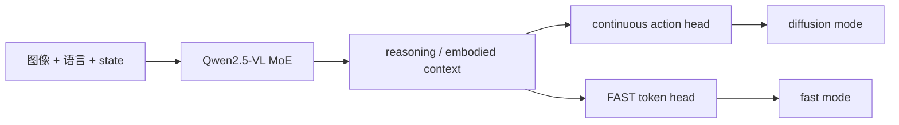

# WALL-OSS：Qwen2.5-VL MoE 的 Diffusion / FAST 双模式策略

WALL-OSS 是 X Square Robot 的开源具身基础模型，LeRobot 从 Wall-X 移植，代码目录是 `wall_x`，注册名也是 `wall_x`。其 tightly-coupled MoE 架构支持连续 diffusion/flow 路径和离散 FAST next-token 路径。

| 项目 | 内容 |
|---|---|
| 注册名 | `wall_x` |
| 默认权重 | `x-square-robot/wall-oss-flow` |
| 默认模式 | `prediction_mode=diffusion` |
| chunk / 执行 | 32 / 32 |
| 代码 | `src/lerobot/policies/wall_x/` |
| 官方指南 | `docs/source/walloss.mdx` |
| 上游 | [X-Square-Robot/wall-x](https://github.com/X-Square-Robot/wall-x) |

## 1. Inspiration 与 Integration 的边界

上游方法描述两阶段范式：Inspiration 用离散动作先验强化语义—动作对齐，Integration 用连续 flow matching 做高频控制。LeRobot policy 暴露的是可后训练/推理的 `prediction_mode`：

| 模式 | 配置 | 动作生成 |
|---|---|---|
| 连续 | `diffusion` | action head 迭代生成连续 chunk |
| 离散 | `fast` | 自回归生成 FAST action token |



checkpoint 必须与模式匹配。默认 `wall-oss-flow` 面向连续路径；不要仅改字符串就假设它已具备另一分支的合适权重。

## 2. 特征和尺寸约束

- 至少一个视觉 feature；
- 需要 robot state 和 action；
- 默认 `max_state_dim=max_action_dim=20`，真实 feature 不得超过；
- `n_action_steps <= chunk_size`；
- `fast` 模式需要有效 `action_tokenizer_path`，默认 `lerobot/fast-action-tokenizer`；
- visual 默认 identity，state/action 使用 quantile normalization。

processor 的 `WallXTaskProcessor` 负责把 task 放进模型预期结构。训练集里没有稳定的 task 语言时，VLA 条件能力无法正常学习。

## 3. 安装与训练

```bash
uv sync --locked --extra wallx --extra training
```

连续模式基线：

```bash
uv run lerobot-train \
  --dataset.repo_id=<HF_USER/DATASET> \
  --policy.type=wall_x \
  --policy.pretrained_name_or_path=x-square-robot/wall-oss-flow \
  --policy.prediction_mode=diffusion \
  --policy.attn_implementation=eager \
  --policy.device=cuda \
  --batch_size=4 \
  --steps=3000 \
  --output_dir=outputs/train/walloss_flow
```

官方示例使用 batch 32；这里从 4 开始，先量显存再扩展。`eager` 最便于建立兼容基线，之后可在环境支持时比较 `sdpa` / `flash_attention_2`。视觉 attention 还有独立的 `vision_attn_implementation`，不要把两个开关混为一谈。

若要跑 FAST，先确认使用的是支持离散分支的 checkpoint/tokenizer，然后建立单独输出目录：

```bash
--policy.prediction_mode=fast \
--policy.action_tokenizer_path=lerobot/fast-action-tokenizer
```

## 4. 源码地图

1. `configuration_wall_x.py`：模式、特征维度和 tokenizer 校验；
2. `processor_wall_x.py`：task 与默认 pre/post pipeline；
3. `qwen_model/`：Qwen2.5-VL MoE 和视觉 attention；
4. `ActionHead`：连续动作 flow/diffusion 组件；
5. `Qwen2_5_VLMoEForAction.forward()`：文本/动作两种 mode；
6. `WallXPolicy.forward()` / `predict_action_chunk()`：训练分支与队列。

## 5. 调优顺序

1. 固定一个与 checkpoint 匹配的 `prediction_mode`；
2. 核对 task、相机、state/action 维度和归一化；
3. 用 `eager` 建立可复现基线；
4. 调 chunk 与执行长度；
5. 再优化 attention backend；
6. 最后才对比 diffusion 与 FAST。

## 6. 常见失败

| 现象 | 原因 | 处理 |
|---|---|---|
| 注册名找不到 | 写成 `walloss` | 使用 `policy.type=wall_x` |
| 切 fast 后输出异常 | checkpoint/tokenizer 不支持 | 使用匹配离散分支的资产 |
| action dim 校验失败 | 真实维度超过 20 | 调整 max dim，并确认 checkpoint head 兼容 |
| Qwen 权重下载失败 | 网络/磁盘/缓存 | 提前缓存或传本地路径 |
| flash attention 报错 | CUDA 二进制不匹配 | 回退 eager 或 sdpa |
| 动作开环太久 | 32 个动作全部执行 | 减 `n_action_steps`，保持不超过 chunk |
| fast token 太长 | 动作域/tokenizer 不匹配 | 检查 token 长度和自有 tokenizer 方案 |

双模式对比必须用相同数据划分、动作坐标和评测协议，同时报告生成延迟与成功率。继续阅读 [`MolmoAct2.md`](./MolmoAct2.md)，或返回 [VLA 目录](./README.md)。
