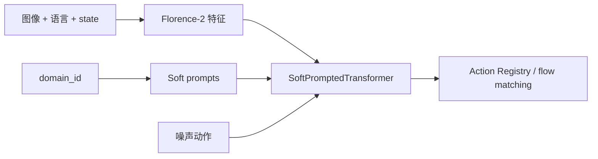

# X-VLA：用 Soft Prompt 吸收机器人与数据域差异

X-VLA 把每种硬件/数据域当成一个 domain，用少量可学习 soft prompts 从多模态融合的早期阶段条件化策略。LeRobot 注册名是 `xvla`，默认由 Florence-2 视觉语言模块、24 层 policy transformer 和 flow-matching action space 组成。

| 项目 | 内容 |
|---|---|
| 默认 checkpoint | `lerobot/xvla-base`（0.9B 级） |
| 默认动作空间 | `ee6d` |
| 默认 chunk / 执行 | 32 / 32 |
| 代码 | `src/lerobot/policies/xvla/` |
| 官方指南 | `docs/source/xvla.mdx` |

## 1. 为什么 Soft Prompt 适合跨具身

不同机器人有不同相机、关节和动作语义。X-VLA 用 `domain_id` 选择一组 soft prompts，将差异注入 Transformer；迁移新域时可以只训练 prompt，冻结主干。官方材料报告其 Phase II 只调约 1% 参数的设置，但这属于特定 checkpoint 与实验方案。



## 2. Action Registry 是第一道契约

`action_mode` 不只是输出维度，它还决定预处理、损失和后处理：

- `ee6d`：默认末端执行器 6D 表示；
- `joint`、`franka_joint7`、`agibot_ee6d`：预定义机器人空间；
- `so101_bimanual`：双臂 SO-101 的专用 padding/裁剪；
- `auto`：按数据 action dimension 构建 `AutoActionSpace`，适合先跑自定义机器人基线。

模型默认 `max_action_dim=20`。真实动作维度可以较小，由 action space pad 到模型维度，再在输出端裁回。若坐标、旋转或夹爪语义不匹配，仅仅维度相同也会失败。

## 3. Domain ID 与多相机

默认 `num_domains=30`、soft prompt 长度 32。`domain_feature_key` 可从 batch 读取 domain；否则需保证 processor 产生正确 ID。一个新 domain 不能随意复用已有 ID，否则会使用错误 prompt。

X-VLA 至少要求一个视觉 feature；`use_proprio=true` 时还必须有 state。可通过 `num_image_views` 和 `empty_cameras` 将不同相机数量补齐，但所有视角的命名与顺序必须稳定。

## 4. 安装与微调

```bash
uv sync --locked --extra xvla --extra training
```

```bash
uv run lerobot-train \
  --dataset.repo_id=<HF_USER/DATASET> \
  --policy.path=lerobot/xvla-base \
  --policy.type=xvla \
  --policy.dtype=bfloat16 \
  --policy.action_mode=auto \
  --policy.freeze_vision_encoder=false \
  --policy.freeze_language_encoder=false \
  --policy.train_policy_transformer=true \
  --policy.train_soft_prompts=true \
  --policy.device=cuda \
  --steps=20000 \
  --output_dir=outputs/train/xvla
```

这是官方指南推荐的“新任务完整适配”方向。若只想验证 prompt adaptation，可冻结视觉、语言和 policy transformer，只训练新 domain 的 soft prompts；必须同时对照完整微调，才能判断参数效率与上限。

## 5. 源码地图与关键参数

1. `configuration_xvla.py`：Florence 配置、domain、action mode 与冻结开关；
2. `processor_xvla.py`：图像缩放/归一化、domain ID、旋转转换；
3. `action_hub.py`：动作空间注册表；
4. `soft_transformer.py`：soft prompt 和 domain-aware layers；
5. `modeling_xvla.py`：VLM、flow loss、chunk queue。

| 参数 | 默认 | 影响 |
|---|---:|---|
| `hidden_size / depth / num_heads` | 1024 / 24 / 16 | 主策略容量与显存 |
| `num_denoising_steps` | 10 | 推理速度—质量 |
| `use_hetero_proj` | false | 是否按 domain 使用异构投影 |
| `freeze_vision_encoder` | false | 是否更新视觉主干 |
| `train_soft_prompts` | true | 是否学习 domain prompts |

## 6. 排错

| 现象 | 优先检查 | 处理 |
|---|---|---|
| action shape 对但机器人乱动 | `action_mode` 坐标语义不匹配 | 选择/实现正确 ActionSpace |
| 新机器人像旧机器人动作 | domain ID 复用 | 分配新 ID 并训练新 prompt |
| 缺 state 报错 | `use_proprio=true` | 提供 state 或明确关闭 proprio |
| 多相机错位 | 视角顺序或补空相机不一致 | 固定 feature 顺序与 `empty_cameras` |
| OOM | 0.9B、24 层且全量解冻 | bf16、减 batch、冻结 backbone |
| soft prompt 无提升 | 域差异超过 prompt 容量 | 与解冻 transformer/VLM 的对照实验比较 |

继续阅读 [`GR00T.md`](./GR00T.md) 比较 category/embodiment 路线，或返回 [VLA 目录](./README.md)。
