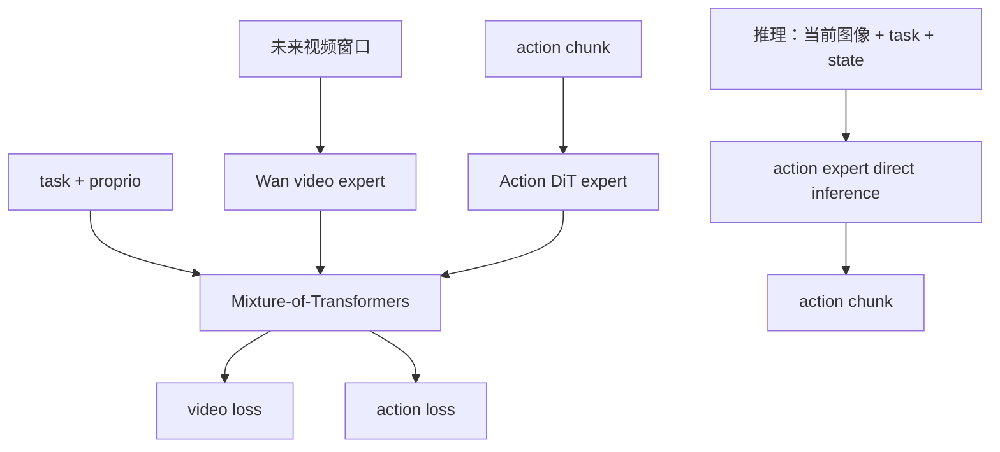

# FastWAM：训练时学习视频，推理时直接预测动作

FastWAM（Fast World Action Model）的核心问题是：世界动作模型是否必须在测试时生成未来视频？它保留训练期视频建模，让 video expert 与 action expert 共同学习，但 rollout 时直接输出 action chunk，省掉测试时未来 observation 的迭代生成。

| 项目 | 内容 |
|---|---|
| 注册名 | `fastwam` |
| 默认视频骨干 | `Wan-AI/Wan2.2-TI2V-5B` |
| 默认基础权重 | FastWAM base checkpoint（配置自动解析） |
| action horizon / 执行 | 32 / 32 |
| 代码 | `src/lerobot/policies/fastwam/` |
| 官方指南 | `docs/source/fastwam.mdx` |
| 项目页 | [FastWAM](https://yuantianyuan01.github.io/FastWAM/) |

## 1. 训练与推理并不对称



训练总损失由配置字典控制：

\[
L = \lambda_{video}L_{video} + \lambda_{action}L_{action}
\]

默认两者都是 1。若 `freeze_video_expert=true`，还应把 `loss.lambda_video=0`，否则会继续做无法给冻结 expert 传梯度的视频 loss 计算。

## 2. 视频与动作频率几何

默认：

```text
action_horizon = 32
num_video_frames = 33
action_video_freq_ratio = 4
```

数据加载的 observation indices 是 `[0,4,8,...,32]`，即原始 33 帧窗口下采样成 9 个模型视频帧；动作仍加载 `[0,...,31]`。8 个视频 transition 对应 32 个动作，因此 horizon 必须能被 transition 数整除。

配置还要求：

- `n_action_steps <= action_horizon`；
- `num_video_frames > 1`；
- `(num_video_frames - 1)` 可被 `action_video_freq_ratio` 整除；
- action horizon 与视频 transition 数兼容。

修改控制频率时要成组修改这些参数，而不是只改 `action_horizon`。

## 3. 多相机拼接契约

`image_size=(224,448)` 表示**拼接后的总图像尺寸**。每个相机必须是 `(3,224,camera_width)`，所有宽度之和必须等于 448。例如两个 224×224 相机横向拼接正好满足默认值。

模型不会从相同 shape 中理解哪个是 wrist 或 agent view。输入 feature 的顺序、宽度分配和训练 checkpoint 必须一致。

当 `proprio_dim=8` 时，必须有 shape `(8,)` 的 `observation.state`；不使用 proprio 可设为 `null`。action feature 必须严格等于 `(action_dim,)`。

## 4. 安装与基线训练

```bash
uv sync --locked --extra fastwam --extra training
```

```bash
uv run lerobot-train \
  --dataset.repo_id=<HF_USER/DATASET> \
  --policy.type=fastwam \
  --policy.action_dim=7 \
  --policy.proprio_dim=8 \
  --policy.action_horizon=32 \
  --policy.n_action_steps=10 \
  --policy.image_size='[224,448]' \
  --policy.torch_dtype=bfloat16 \
  --policy.use_gradient_checkpointing=true \
  --policy.device=cuda \
  --batch_size=1 \
  --steps=30000 \
  --output_dir=outputs/train/fastwam
```

FastWAM 的默认 Wan 资产很大。先用 batch 1 验证数据与 checkpoint，再测显存决定是否增加。官方指南中的 300k steps 属于长训练示例，不是管线冒烟要求。

若只训练 action expert：

```bash
--policy.freeze_video_expert=true \
--policy.loss='{"lambda_video":0.0,"lambda_action":1.0}'
```

这是计算/显存与世界辅助学习之间的明确消融，应保留一个未冻结对照。

## 5. checkpoint 与外部资产

模型需要 Wan video DiT、VAE、UMT5 text encoder 和 tokenizer。LeRobot-format checkpoint 会处理本地所需组件，但冻结 VAE/文本资产仍可能从 Hugging Face 缓存加载。首次运行前要规划：

- Wan2.2 权重下载空间；
- `bfloat16` 是否受 GPU 支持；
- Hub 离线缓存路径；
- checkpoint 对应的 `model_id`、video/action DiT config。

FastWAM 使用 PyTorch SDPA。由于 MoT 需要任意 boolean query-key mask，安装第三方 `flash-attn` 不会让这条路径自动加速。

## 6. 推理与评测

```bash
uv run lerobot-eval \
  --policy.path=ZibinDong/fastwam_libero_uncond_2cam224 \
  --policy.device=cuda \
  --policy.torch_dtype=float32 \
  --policy.n_action_steps=10 \
  --env.type=libero \
  --env.task=libero_10 \
  --env.observation_height=224 \
  --env.observation_width=224 \
  --eval.batch_size=1 \
  --eval.n_episodes=10
```

官方 checkpoint 的 LIBERO gripper 约定使用 `toggle_action_dimensions=[-1]`。其他机器人不要照搬；它会切换指定 action 通道的符号/约定，必须与数据和硬件确认。

`inference_seed=42` 默认让采样可复现。评测随机性时应扫描 seed，而不是只报告固定 seed 单次结果。

## 7. 源码地图

1. `configuration_fastwam.py`：资产解析、频率几何和 feature 校验；
2. `processor_fastwam.py`：LIBERO action toggle；
3. `wan/video_dit.py`：视频专家；
4. `wan/modular.py`：MoT 路由；
5. `modeling_fastwam.py::_batch_to_training_sample()`：LeRobot batch 适配；
6. `forward()`：video/action 联合 loss；
7. `predict_action_chunk()`：直接动作推理。

## 8. 排错与验收

| 现象 | 优先检查 | 处理 |
|---|---|---|
| 图像 width sum 报错 | 多相机总宽不等于 `image_size[1]` | 明确每相机 feature shape |
| horizon 校验失败 | 视频 transition 与动作数不整除 | 联动修改三项频率参数 |
| 缺 state | `proprio_dim` 非空 | 提供匹配 state 或设为 null |
| 冻结 video 后仍很慢 | 仍计算 video loss | 将 `lambda_video` 设为 0 |
| OOM | 5B Wan expert + optimizer | 冻结 video、checkpointing、batch 1 |
| flash-attn 无效果 | FastWAM 使用 SDPA mask | 不把安装包当作性能开关 |
| gripper 反向 | toggle 继承自 LIBERO checkpoint | 校验并修改 toggle dimensions |
| 推理没有预测视频 | 这是模型设计 | 直接评估动作；需要想象视频选 LingBot-VA |

至少报告 `loss_video`、`loss_action`、action chunk 延迟、闭环成功率，以及冻结 video expert 的消融。继续阅读 [`VLA-JEPA.md`](./VLA-JEPA.md)，或返回 [World Models 目录](./README.md)。
