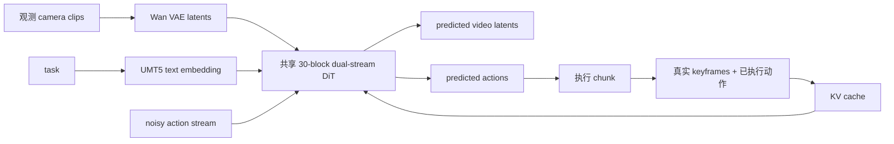

# LingBot-VA：自回归视频—动作双流世界模型

LingBot-VA 基于 Wan2.2，将未来 video latent 与 robot action 放进共享 30 层 Transformer 的两条流中联合建模。与只在训练时使用视觉预测的模型不同，它在推理时持续想象 latent，并把真实执行后的 keyframe 和动作反馈进 KV cache。

| 项目 | 内容 |
|---|---|
| 注册名 | `lingbot_va` |
| 主干 | 约 5B 参数 `WanTransformer3DModel` |
| 冻结组件 | Wan VAE + UMT5-XXL + tokenizer，约 20GB 权重 |
| 默认 checkpoint | `lerobot/lingbot_va_base` |
| 代码 | `src/lerobot/policies/lingbot_va/` |
| 官方指南 | `docs/source/lingbot_va.mdx` |

## 1. 双流和闭环缓存



训练 loss 是时间加权、action-mask 后的：

\[
L = L_{latent} + L_{action}
\]

推理使用两套独立 flow scheduler：默认视频 20 步、动作 50 步。第一个 observation 初始化 latent/cache；chunk 执行期间采样真实 keyframe；下一 chunk 前将真实反馈写回 cache，避免纯开环想象无限漂移。

## 2. 时间与动作布局

默认 `frame_chunk_size=4`、`action_per_frame=4`，因此一个 chunk 产生 16 个单步动作，并全部执行后 refill。训练观察索引由视频 VAE 的时间下采样关系生成，不等同于普通连续 4 帧。

模型内部 action space 固定 30 维，`used_action_channel_ids` 选择当前 checkpoint 使用的通道：

- LIBERO：`0–6`，单臂 EEF delta + gripper；
- RoboTwin：双臂 EEF + gripper 映射到指定 16 个通道；
- 发布 checkpoint 不直接预测 joint trajectory。

joint-space 数据必须先映射为 checkpoint 预期的 EEF 语义，不能只 pad 到 30 维。

## 3. 相机顺序是模型输入的一部分

默认 LIBERO 相机顺序：外部 `observation.images.image`，然后 wrist `observation.images.image2`，以 `width_concat` 拼 latent。RoboTwin 使用 `robotwin_tshape`：head 与两个 wrist 组成 T 形布局。

交换 camera key 即使 tensor shape 不变，也会改变空间位置含义。迁移数据时应固定：相机物理含义、顺序、水平翻转、`camera_layout` 与 128×128 处理尺寸。

## 4. 安装、评测与想象视频

```bash
uv sync --locked --extra lingbot_va
```

LIBERO checkpoint 评测：

```bash
uv run lerobot-eval \
  --policy.path=lerobot/lingbot_va_libero_long \
  --policy.device=cuda \
  --env.type=libero \
  --env.task=libero_10 \
  --env.observation_height=128 \
  --env.observation_width=128 \
  --eval.batch_size=1 \
  --eval.n_episodes=10 \
  --output_dir=outputs/eval/lingbot_va
```

streaming cache 目前按单环境评测实现，必须使用 `eval.batch_size=1`。

保存想象视频：

```bash
--policy.save_predicted_video=true
```

policy 将 chunk latent 放到 `last_predicted_latents`；eval 的 callback 收集后调用 `decode_predicted_latents()`，写出 `pred_episode_*.mp4`。这会增加 VAE 解码、CPU 内存和磁盘开销，仅在需要分析时开启。

## 5. 微调

训练 block-causal mask **必须**用 `attn_mode=flex`；默认 `torch` SDPA 是推理路径。完整 5B DiT 在 24–32GB GPU 上无法容纳 AdamW 全量微调，优先 LoRA：

```bash
uv sync --locked --extra lingbot_va --extra training

uv run lerobot-train \
  --policy.path=lerobot/lingbot_va_libero_long \
  --policy.attn_mode=flex \
  --policy.use_peft=true \
  --dataset.repo_id=<HF_USER/DATASET> \
  --batch_size=1 \
  --steps=10000 \
  --output_dir=outputs/train/lingbot_va
```

冻结 VAE 和 UMT5 不进入 optimizer。UMT5 默认放 CPU，可节省约 11GB VRAM，但每个 episode 的 prompt encode 会带来 CPU 延迟。

## 6. 源码地图

1. `configuration_lingbot_va.py`：双流尺寸、相机布局、scheduler 与 channel IDs；
2. `processor_lingbot_va.py`：图像与动作 quantile pipeline；
3. `utils.py`：Wan transformer、VAE streaming、flow scheduler 与 attention；
4. `training_loss_from_streams()`：latent/action 联合 loss；
5. `select_action()`：真实 keyframe feedback；
6. `decode_predicted_latents()`：评测可视化。

## 7. 排错

| 现象 | 原因 | 处理 |
|---|---|---|
| 训练报 attention 错 | 使用了 `torch`/`flashattn` | 训练改为 `flex` |
| 第二个 chunk 开始漂移 | cache、keyframe stride 或 reset 有误 | 确认 episode 开头 `reset()`，检查反馈路径 |
| 动作通道错 | `used_action_channel_ids` 不匹配 | 按 EEF schema 重映射 |
| 想象视频左右/视角错 | camera order/layout/hflip 不一致 | 与 checkpoint 固定配置对齐 |
| OOM | 5B DiT + VAE + text encoder | LoRA、text encoder 放 CPU、batch 1 |
| 评测 batch 报错 | streaming 只支持单环境 | `eval.batch_size=1` |
| checkpoint 很小但仍下载很多 | 冻结 Wan/UMT5 资产未打包 | 预留约 20GB 缓存并检查网络 |

想象视频要与真实 env 视频并排看，同时以动作成功率为最终指标。继续阅读 [`FastWAM.md`](./FastWAM.md)，或返回 [World Models 目录](./README.md)。
