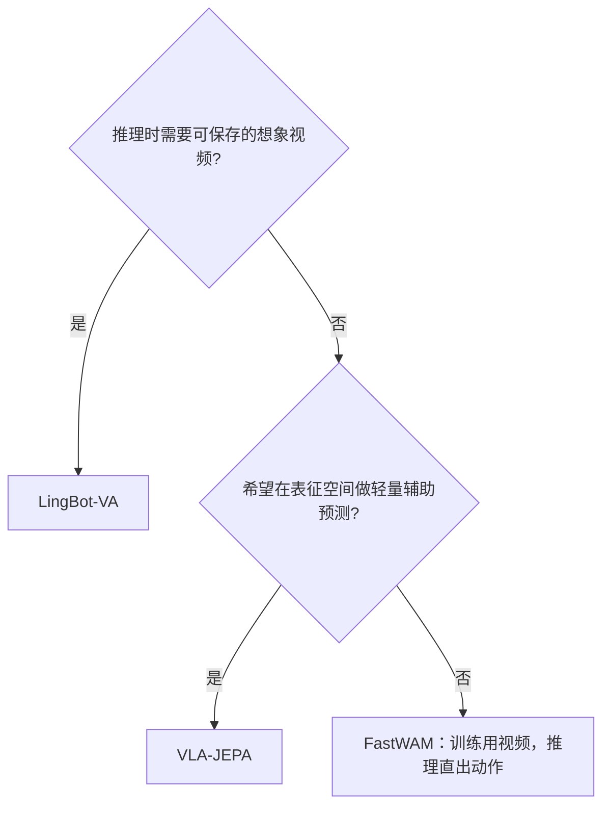

# World Models

这里的三种策略都利用未来视觉表征辅助动作学习，但它们在推理时是否真的“想象未来”并不相同。

| 模型 | 训练时的世界建模 | 推理方式 | 教程 |
|---|---|---|---|
| [VLA-JEPA](./VLA-JEPA.md) | 在 V-JEPA2 表征空间预测未来 frame embedding | Qwen 条件的 action DiT 直接生成动作 | 实用指南 |
| [LingBot-VA](./LingBot-VA.md) | 视频 latent 与 action 双流 flow matching | 自回归想象 latent，并反馈真实 keyframe | 实用指南 |
| [FastWAM](./FastWAM.md) | Wan 视频专家与 action 专家联合训练 | 直接 action prediction，不生成测试时未来视频 | 实用指南 |

## 怎么选

选择前先确认：

1. 数据是否提供未来视频窗口，而不只是当前帧；
2. 多相机顺序、拼接布局和图像尺寸是否与 checkpoint 一致；
3. action 坐标系、通道布局和视频/动作频率是否匹配；
4. 是否有足够显存和磁盘容纳 Wan/V-JEPA/Qwen 等外部权重；
5. 评测是否同时记录动作成功率与世界预测质量。

世界预测看起来合理不等于闭环控制成功；反之，FastWAM 本来就不在推理阶段生成未来视频。上手数据、训练与评测请返回[阶段主线](../../README.md)，返回[模型总目录](../README.md)。
