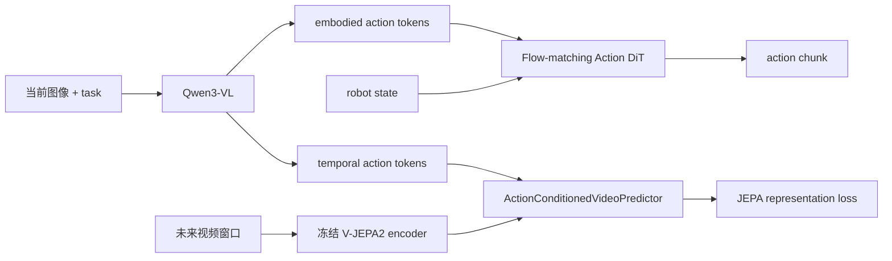

# VLA-JEPA：用未来表征预测辅助动作学习

VLA-JEPA 不在像素空间生成未来图像，而是在冻结的 V-JEPA2 表征空间中，用动作条件 predictor 预测未来 frame embedding。动作仍由 Qwen3-VL 条件的 DiT flow head 生成；JEPA 是训练期辅助目标，不是 rollout 时的显式规划器。

| 项目 | 内容 |
|---|---|
| 注册名 | `vla_jepa` |
| 默认语言视觉骨干 | `Qwen/Qwen3-VL-2B-Instruct` |
| 默认 JEPA encoder | `facebook/vjepa2-vitl-fpc64-256` |
| chunk / 执行 | 7 / 7 |
| 代码 | `src/lerobot/policies/vla_jepa/` |
| 官方指南 | `docs/source/vla_jepa.mdx` |
| checkpoint 集合 | [lerobot/VLA-JEPA](https://huggingface.co/collections/lerobot/vla-jepa) |

## 1. 联合训练数据流



`VLAJEPAModel.forward()` 返回 `action_loss` 与加权后的 `wm_loss`，policy 求和：

\[
L = L_{action} + \lambda_{wm}L_{JEPA}, \qquad \lambda_{wm}=0.1
\]

action loss 默认对每个 batch item 重复 8 次独立噪声采样（`repeated_diffusion_steps`）。JEPA predictor 使用 block-causal attention，让每个时间位置只访问当前及过去。

## 2. 一个容易忽略的配置联动

`freeze_qwen=true` 时，`__post_init__()` 会自动将 `enable_world_model=false`。原因是 JEPA predictor 的动作条件来自 Qwen token；冻结 Qwen 后，该辅助路径对主干不再提供所需梯度，继续计算世界损失没有训练意义。

因此有三种清晰实验：

| 方案 | Qwen | JEPA loss | 用途 |
|---|---|---|---|
| 完整训练 | 可训练 | 开启 | 研究世界预测辅助作用 |
| 冻结 Qwen 微调 | 冻结 | 自动关闭 | 降显存、只适配 action head |
| 无世界模型消融 | 可训练 | 手动关闭 | 测量 JEPA 辅助目标的真实增益 |

## 3. 时间窗口

默认 `num_video_frames=8`，`observation_delta_indices=[0,1,...,7]`：训练样本必须能提供当前到未来共 8 帧。动作索引为 `[0,...,6]`。

`num_video_frames` 至少是 `2 × jepa_tubelet_size`；默认 tubelet 2，因此最少 4 帧。若数据管线只加载当前图像，world loss 会退化或无法构建，不应将其误认为普通 VLA 单帧训练。

多相机时 predictor 输入维度与视角数相关。官方转换 checkpoint 以两视角为主要设定；单视角数据会复制 latent 保持两视角 predictor 形状。更改 tubelet 或 predictor embed shape 属于结构变化，不能期待严格加载所有权重。

## 4. 安装与训练

```bash
uv sync --locked --extra vla_jepa --extra training
```

从预训练权重完整微调：

```bash
uv run lerobot-train \
  --policy.path=lerobot/VLA-JEPA-Pretrain \
  --dataset.repo_id=<HF_USER/DATASET> \
  --policy.enable_world_model=true \
  --policy.device=cuda \
  --batch_size=4 \
  --steps=30000 \
  --output_dir=outputs/train/vla_jepa
```

若只想低成本建立动作基线：

```bash
--policy.freeze_qwen=true
```

对 action/state 维度不同的新机器人，需要明确允许重初始化投影层：

```bash
--policy.reinit_modules='["model.action_model.action_encoder","model.action_model.action_decoder","model.action_model.state_encoder"]'
```

只有列出的 prefix 可以 shape mismatch；其他不匹配仍报错。这能避免“静默跳过大量权重”。

## 5. Processor 与动作后处理

默认视觉不归一化，state 用 `MEAN_STD`，action 用 `MIN_MAX`。processor 还可：

- clip normalized actions；
- 在训练前将 gripper 预吸附到阈值两侧；
- 在输出后将 gripper 二值化。

默认 `gripper_dim=6` 只适合 7D action 的常见布局。换机器人时必须修改 gripper index/threshold，或关闭这些步骤，否则可能改变非夹爪关节。

## 6. 源码地图

1. `configuration_vla_jepa.py`：时间窗口、loss 权重和冻结联动；
2. `processor_vla_jepa.py`：动作 clip、gripper snap/binarize；
3. `qwen_interface.py`：多模态 prompt 与特殊 action token；
4. `world_model.py`：action-conditioned JEPA predictor；
5. `action_head.py`：DiT flow matching；
6. `modeling_vla_jepa.py`：联合 loss、跨具身加载和动作队列。

## 7. 排错与验收

| 现象 | 优先检查 | 处理 |
|---|---|---|
| `wm_loss` 始终为 0 | Qwen 冻结或 world model 关闭 | 检查两项配置及启动日志 |
| 未来帧不足 | dataset delta window 不够 | 保证至少加载 `num_video_frames` |
| 换机器人加载失败 | state/action projection shape 不同 | 精确设置 `reinit_modules` |
| gripper 通道异常 | 默认 index 6 不适用 | 修改或关闭 snap/binarize |
| JEPA loss 降但控制没提升 | 辅助目标与动作任务不一致 | 做 `enable_world_model=false` 消融 |
| OOM | Qwen + V-JEPA + 8 帧多视角 | 冻结 Qwen/关闭 WM、减 batch/分辨率 |

至少同时记录 `action_loss`、日志中的加权 `wm_loss`、闭环成功率和多步延迟；比较不同权重时再换算原始 JEPA loss。继续阅读 [`LingBot-VA.md`](./LingBot-VA.md)，或返回 [World Models 目录](./README.md)。
