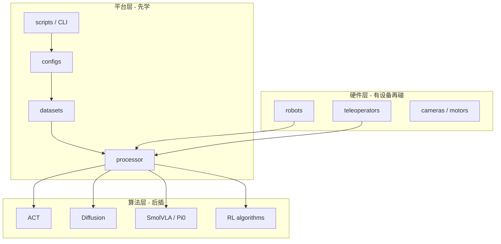
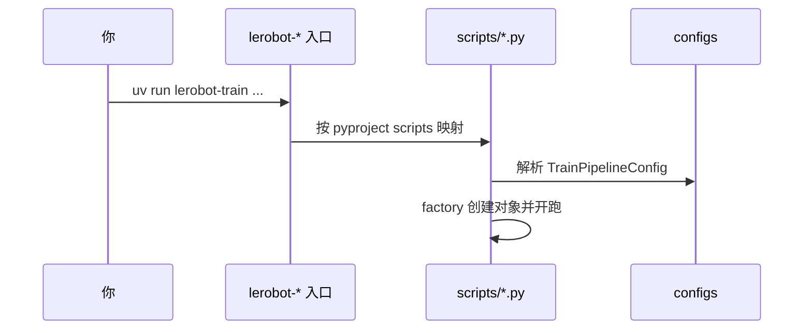

# LeRobot 第 0 阶段：项目预热与安装认知

## 1. 本阶段目标

1. 跑通最小环境验证，确认本机能 `import lerobot`
2. 从 `pyproject.toml` 看懂 CLI 入口与 extras 分层
3. 用一张图分清：平台层 / 算法层 / 硬件层
4. 知道后续每课「示例锚点」在哪，避免从头乱翻

---

## 2. 你会用到的材料

| 材料 | 用途 |
|------|------|
| `README.md` | 定位 |
| `pyproject.toml` | extras、`[project.scripts]` |
| `docs/source/installation.mdx` | 官方安装 |
| `src/lerobot/lerobot_types.py` | 内部共享类型定义（原 `types.py`） |
| `AGENTS.md` | 架构速查 |
| `AGENT_GUIDE.md` | 实机速查 |

---

## 3. 可运行示例

### 3.1 最小验证（必做）

```bash
# 仓库根目录
uv sync --locked --extra test --extra dev
uv run python -c "import lerobot; print('lerobot OK', lerobot.__file__)"
uv run lerobot-info
uv run pytest tests/processor/test_pipeline.py -q
```

**预期：**

- 打印出 `lerobot` 包路径
- `lerobot-info` 输出环境摘要（版本/设备等，以本机为准）
- pytest 通过或仅因可选依赖 skip（失败则先读缺包名）

### 3.2 按目标加 extra（选做）

```bash
uv sync --locked --extra training          # 训练主链
uv sync --locked --extra feetech           # SO 臂舵机
uv sync --locked --extra smolvla           # SmolVLA
uv sync --locked --extra pusht             # PushT 仿真
```

**降级：** 暂时装不上 `all` 没关系；本阶段只要 test/dev + 能 import。

---

## 4. 主线原理图

### 4.1 平台分层



### 4.2 你发出一条 CLI 之后



---

## 5. 代码解析

### 5.1 CLI 从哪里来？

打开 `pyproject.toml`，搜索 `[project.scripts]`。你会看到类似：

```toml
# 示意：以你仓库中实际条目为准
lerobot-train = "lerobot.scripts.lerobot_train:main"
lerobot-eval = "lerobot.scripts.lerobot_eval:main"
lerobot-record = "lerobot.scripts.lerobot_record:main"
```

**解析：**

- 左边是 shell 命令名
- 右边是 `模块:可调用对象`
- 所以「学 CLI」= 读对应 `src/lerobot/scripts/lerobot_*.py` 的 `main`

### 5.2 公开导入与内部模块名

当前源码把内部共享类型文件改名为 `src/lerobot/lerobot_types.py`，以避免
`types.py` 与 Python 标准库同名。教程和下游代码应继续走公开入口：

```python
from lerobot.configs import FeatureType, PolicyFeature
```

不要从已经移除的旧 `types` 子模块导入，也不要因为内部文件改名就把所有示例
改成从 `lerobot.lerobot_types` 导入。公开入口能隔离这类内部重构。

### 5.3 extras 在干什么？

同文件 `[project.optional-dependencies]`：

| extra | 典型用途 |
|-------|----------|
| `training` | accelerate、训练栈 |
| `dataset` | 数据集读写依赖 |
| `feetech` | SO 臂 |
| `smolvla` | SmolVLA 相关 |
| `pusht` / `aloha` | 仿真环境 |

**解析：** 基础包刻意很瘦；功能按需叠加，避免「装全家桶才开始学」。

### 5.4 包结构扫一眼

```bash
uv run python - <<'PY'
from pathlib import Path
import lerobot
root = Path(lerobot.__file__).parent
print("package root:", root)
for p in sorted(root.iterdir()):
    if p.is_dir() and not p.name.startswith(("__", ".")):
        print("-", p.name)
PY
```

**预期：** 看到 `datasets`、`policies`、`processor`、`configs`、`scripts`、`robots` 等。

---

## 6. 设计思路

1. **平台与算法分离**：换 ACT→Diffusion 不应重写 dataset 存储格式。
2. **extras 可选**：CI/笔记本/实机依赖不同，强制 monolithic install 会劝退新人。
3. **CLI 薄、库厚**：命令只是入口；真正逻辑在 `configs` + `factory` + 模块 API。
4. **Hub 优先共享**：数据集与策略以可推送资产为中心，而不是私有文件夹约定。

若把一切写成「一个 train.py 两千行 if-else」，新机器人/新策略每次都改主干——这是 LeRobot 极力避免的。

---

## 7. 运行时调优（环境向）

| 症状 | 可能原因 | 建议 |
|------|----------|------|
| `ModuleNotFoundError: accelerate` | 缺 `training` | `uv sync --locked --extra training` |
| pytest 收集很少/大量 skip | 缺对应 extra | 看 skip 原因再加 |
| `lerobot` import 到错环境 | 没用 `uv run` | 一律 `uv run ...` |
| macOS 上 CUDA 相关警告 | 设备不匹配 | 后续课程改 `mps`/`cpu` |
| LFS 相关测试挂 | 未拉大文件 | `git lfs install && git lfs pull` |
| 磁盘暴涨 | 缓存了多个大数据集/权重 | 清理 HF cache，先用小 repo |

---

## 8. 动手练习

1. 把 `pyproject.toml` 里所有 `lerobot-*` 命令抄成一张表：命令 → 脚本路径。
2. 为自己写「两周目标」：只 IL / 要仿真 / 要实机——并列出对应 extras。
3. 再跑一遍第 3 节命令，把终端关键输出贴进笔记。

---

## 9. 自测问题

1. `lerobot-train` 映射到哪个文件的哪个函数？
2. 为什么推荐 `uv run` 而不是系统 python？
3. 平台层四个核心目录是什么？
4. 没有机器人能否学到第 6 阶段？
5. `examples/tutorial` 和本目录分工？

**参考要点：** scripts 入口；隔离依赖；scripts/configs/datasets/processor；可以（Hub+仿真）；脚本 vs 中文课。

---

## 10. 常见坑

- 混用 conda/pip/uv 多套 site-packages
- 一上来 `extra all` 装崩
- 把官方 docs 当「已含代码行级解析」——那是参考，本教程补代码课

---

## 11. 下一阶段预告

第 1 阶段会**对着 `lerobot_train.py` 拆训练循环**，并用调优表解释 `batch_size` / `num_workers` / `save_freq`。
