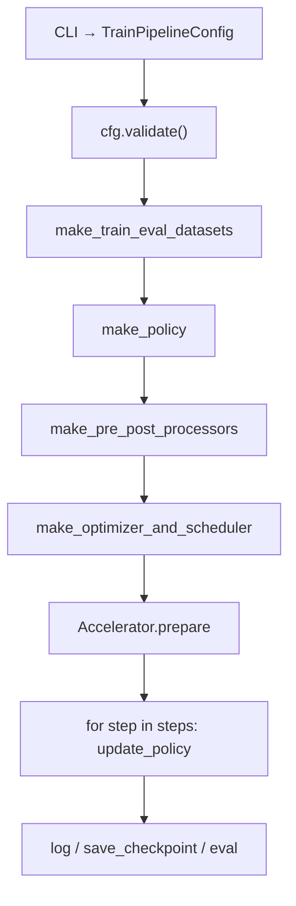
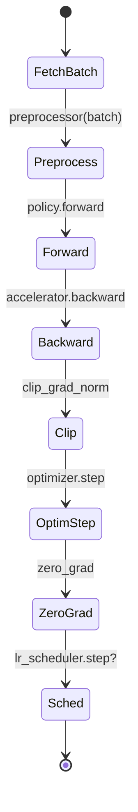

# LeRobot 第 1 阶段：训练主链与配置系统

## 1. 本阶段目标

1. 能对照源码讲清 `train()` 的装配顺序
2. 能拆解 `update_policy` 单步里发生的事
3. 理解 `TrainPipelineConfig` 如何驱动 dataset/policy/processor/optimizer
4. 会用调优表处理 OOM、IO 瓶颈、存盘过频等问题

---

## 2. 你会用到的材料

| 材料 | 用途 |
|------|------|
| `src/lerobot/scripts/lerobot_train.py` | `train` / `update_policy` |
| `src/lerobot/configs/train.py` | `TrainPipelineConfig` |
| `src/lerobot/configs/policies.py` | `PreTrainedConfig` |
| `src/lerobot/datasets/factory.py` | `make_train_eval_datasets` |
| `src/lerobot/policies/factory.py` | `make_policy` / processors |
| `src/lerobot/optim/factory.py` | 优化器 |
| `src/lerobot/common/train_utils.py` | checkpoint |
| `examples/tutorial/act/act_training_example.py` | 迷你训练循环对照 |

---

## 3. 可运行示例

### 3.1 先看清 CLI 参数面

```bash
uv sync --locked --extra training
uv run lerobot-train --help | head -n 80
```

**预期：** 看到 `dataset.*`、`policy.*`、`batch_size`、`steps`、`save_freq` 等命名空间。

### 3.2 对照「官方完整脚本」与「教程迷你脚本」

打开并通读（先别急着 push hub）：

`examples/tutorial/act/act_training_example.py`

建议本地改两处再跑（可选）：

1. `device` 改成你有的：`cuda` / `mps` / `cpu`
2. **注释掉**三行 `push_to_hub`
3. 保持 `training_steps = 1`（只验证链路）

```bash
# 需能访问 Hub 数据集；首次会下载
uv run python examples/tutorial/act/act_training_example.py
```

**预期产物：** `outputs/robot_learning_tutorial/act/` 下出现 policy/processor 文件。
**降级：** 网络差就只静态阅读脚本，对照下面代码解析。

### 3.3 完整训练形态（了解即可）

真实训练一般是：

```bash
uv run lerobot-train \
  --dataset.repo_id=lerobot/svla_so101_pickplace \
  --policy.type=act \
  --batch_size=8 \
  --steps=100000 \
  --output_dir=outputs/train/act_demo
```

具体超参以你机器与任务为准；本课重点是**主链**，不是刷榜。

---

## 4. 主线原理图

### 4.1 装配流



### 4.2 单步更新状态



---

## 5. 代码解析

### 5.1 配置是「装配清单」

`src/lerobot/configs/train.py` 中 `TrainPipelineConfig` 关键字段（默认值以源码为准）：

```python
# 摘录字段名，便于检索源码
# dataset: DatasetConfig
# policy: PreTrainedConfig | None
# env: EnvConfig | None
# batch_size: int = 8
# steps: int = 100_000
# num_workers: int = 4
# log_freq: int = 200
# save_freq: int = 20_000
# env_eval_freq: int = 20_000
# resume: bool = False
```

**解析：** 脚本很少写死「用哪个数据集/模型」；几乎都从 cfg 读。改行为优先改 CLI/配置，而不是改 `train()` 大函数。

### 5.2 `train()` 里真正创建对象的顺序

在 `lerobot_train.py` 的 `train()`（阅读时按符号跳转）：

1. `cfg.validate()`
2. 创建 `Accelerator`（混合精度、分布式）
3. `make_train_eval_datasets(cfg)` —— **主进程先下数据，再 barrier**
4. 可选 `make_env`（仅当需要训练中仿真 eval）
5. `make_policy(...)` 或 reward model 分支
6. `make_pre_post_processors(...)`（stats 或 pretrained）
7. `make_optimizer_and_scheduler`
8. 构建 DataLoader（`num_workers` / `prefetch_factor` / `persistent_workers`）
9. 进入 `for _ in range(step, cfg.steps): ... update_policy(...)`

**解析：** 「算法」只出现在 `make_policy` 之后；前面全是平台装配。

### 5.3 `update_policy`：一步里发生了什么

```119:158:src/lerobot/scripts/lerobot_train.py
    with accelerator.autocast():
        if sample_weights is not None:
            # ...
            loss = (per_sample_loss * sample_weights).sum() / (sample_weights.sum() + epsilon)
        else:
            loss, output_dict = policy.forward(batch)

    accelerator.backward(loss)

    if grad_clip_norm > 0:
        grad_norm = accelerator.clip_grad_norm_(policy.parameters(), grad_clip_norm)
    else:
        grad_norm = torch.nn.utils.clip_grad_norm_(
            policy.parameters(), float("inf"), error_if_nonfinite=False
        )

    with lock if lock is not None else nullcontext():
        optimizer.step()

    optimizer.zero_grad()
```

**逐行要点：**

| 片段 | 含义 |
|------|------|
| `autocast` | 按 policy dtype 走 bf16/fp16/fp32 |
| `policy.forward` | **算法私有**损失 |
| `sample_weights` | 可选样本加权（如 RA-BC 迁移后的 sample_weighting） |
| `backward` + `clip` | 平台统一稳梯度 |
| `optimizer.step/zero_grad` | 通用优化 |

### 5.4 迷你脚本对照

`examples/tutorial/act/act_training_example.py` 把同一思想缩成：

```python
batch = preprocessor(batch)
loss, _ = policy.forward(batch)
loss.backward()
optimizer.step()
optimizer.zero_grad()
```

**解析：** 官方脚本多出来的是 accelerate、日志、checkpoint、eval、分布式下载同步——不是另一种训练算法。

### 5.5 当前续训语义：模型、状态与 processor 必须成套恢复

当前 `TrainPipelineConfig` 在 `resume=true` 时重新读取 `--config_path`。本地路径
既可以指向 checkpoint 的 `train_config.json`，也可以直接指向它的
`pretrained_model/` 目录；Hub repo 则会解析最新 checkpoint。典型形态：

```bash
uv run lerobot-train \
  --resume=true \
  --config_path=outputs/train/<run>/checkpoints/<step>/pretrained_model
```

续训与普通微调的 processor stats 规则不同：

- 普通微调：加载预训练 processor 结构，但用当前数据集 stats 覆盖归一化统计量。
- 真正续训：checkpoint 中保存的 processor stats 是权威数据，不再强制覆盖为原始
  dataset stats；某些 policy 会对 state/action stats 做 padding 或适配。

因此，续训不是“只加载模型权重再接着迭代”。模型、optimizer/scheduler、采样状态、
训练步数和 pre/postprocessor 都属于 checkpoint 契约。MPS 的 Torch RNG 状态也有
独立保存/恢复分支，排查复现问题时不要只看 CUDA。

---

## 6. 设计思路

1. **配置驱动装配**：新 policy 注册 `PreTrainedConfig` 子类 + factory，不必分叉 `train()`。
2. **`validate()` 前置**：把非法组合尽早失败（resume、缺 policy、路径等）。
3. **processor 与权重同生命周期**：保存/加载时一起走，避免「只有 pt 没有 normalize」。
4. **训练循环通用化**：算法差异关进 `forward`；平台差异关进 accelerator/utils。

反模式：在 `modeling_*.py` 里打开文件读数据集、自己写分布式——那会让 Hub 复现与 CI 全部变脆。

---

## 7. 运行时调优

| 参数/现象 | 作用 | 调法建议 |
|-----------|------|----------|
| `batch_size`（默认 8） | 显存与梯度噪声 | OOM → 降；利用率低 → 升；多卡看 effective BS=`batch×进程数` |
| `num_workers` | DataLoader 并行解码 | IO 等 GPU → 增到 4–8；内存爆/卡死 → 降；macOS 过大易怪问题 |
| `prefetch_factor` / `persistent_workers` | 降低 worker 重启开销 | workers>0 时再开；调试时先关简化 |
| `steps` / `save_freq` / `log_freq` | 训练长度与 IO | 教程可小；正式训练避免 `save_freq` 过小导致磁盘打满 |
| `env_eval_freq` | 训练中仿真评测 | 无 env 或太慢 → 0；需要曲线再开 |
| `grad_clip_norm`（在 optimizer 配置） | 炸梯度 | loss NaN 先查数据/lr，再收紧 clip |
| `policy.dtype` / mixed precision | 速度与数值 | 大模型优先 bf16（硬件支持时）；不稳回 fp32 |
| resume 后改 `batch_size` | 采样偏移告警 | 日志会提示；尽量与 ckpt 一致 |
| resume 后归一化报 shape 错 | 错把 dataset stats 覆盖 checkpoint stats | 用完整 checkpoint 续训，确认 pre/postprocessor 文件齐全 |
| 视频解码慢 | ffmpeg/backend | 查 `dataset.video_backend`；先用小 episodes 子集 |

**设备：**

- CUDA：关注 `gpu_mem_gb` 日志
- MPS：部分算子回退 CPU，batch 先小
- CPU：只适合链路验证，不适合正式 ACT/Diffusion

---

## 8. 动手练习

1. 在笔记里按 `train()` 顺序列 9 步装配清单，并标出源码函数名。
2. 对比迷你脚本与官方脚本，列出官方多出的 ≥6 项能力。
3. 假设 24GB 显存训 ACT：写出你的起始 `batch_size/num_workers/save_freq` 并说明理由。

---

## 9. 自测问题

1. 为什么主进程先 `make_train_eval_datasets`？
2. `update_policy` 里算法相关的调用是哪一行？
3. `--config_path` 在本地续训时可指向哪两类位置？
4. 为什么续训时不能总用原始 dataset stats 覆盖 processor stats？
5. checkpoint 工具在哪个模块？
6. 迷你脚本 `training_steps=1` 的教学目的？
7. 有效 batch size 怎么算？

**参考要点：** 避免多进程重复下载；`policy.forward`；`train_config.json` 或
`pretrained_model/`；policy 可能适配过 stats 的形状；`common/train_utils.py`；
验证链路非收敛；`batch×num_processes`。

---

## 10. 常见坑

- 未装 `training` extra
- 只存权重不存 processor
- resume 时乱改 batch 又不看日志
- 把教程一步训练当成收敛结果

---

## 11. 下一阶段预告

第 2 阶段深入 **Dataset v3 + `delta_timestamps`**，并用 notebook 看清一帧样本长什么样。
