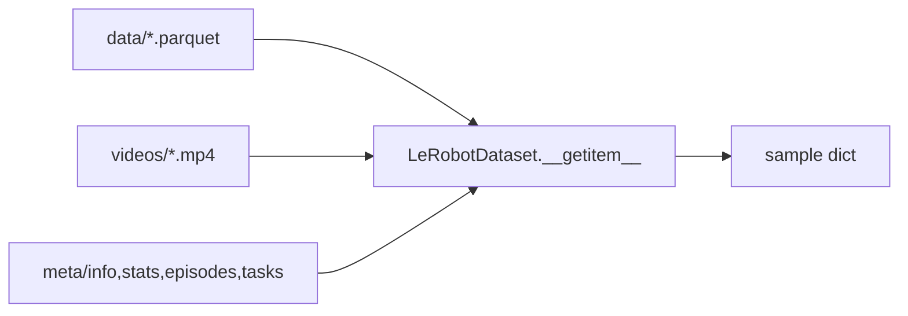
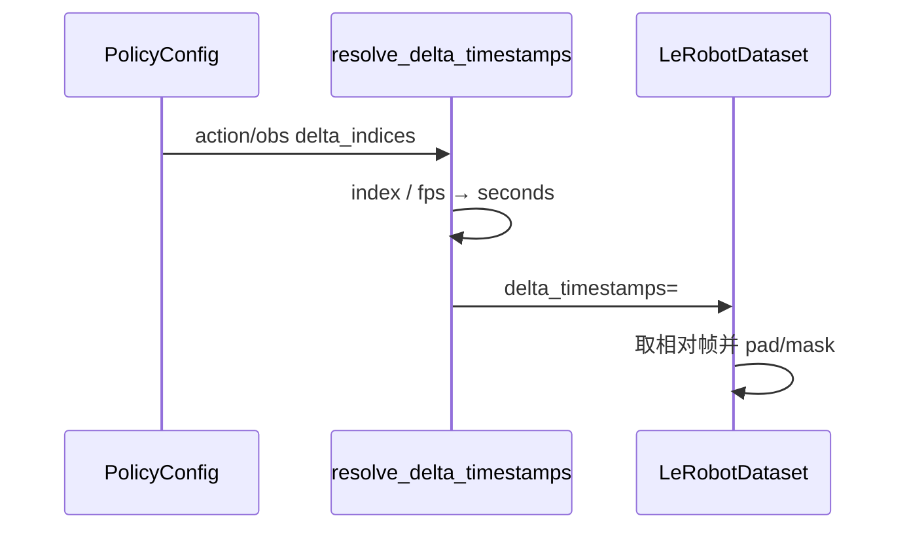

# LeRobot 第 2 阶段：数据集系统与 LeRobotDataset

## 1. 本阶段目标

1. 用 notebook 亲眼看到 meta / 单帧 / 图像 / action
2. 能讲清 v3：`Parquet + MP4 + meta/` 如何支撑大规模
3. 对着 `resolve_delta_timestamps` 手算一组时间窗
4. 会调：下载体积、解码后端、episodes 子集、streaming

---

## 2. 你会用到的材料

| 材料 | 用途 |
|------|------|
| `docs/source/lerobot-dataset-v3.mdx` | 布局权威说明 |
| `src/lerobot/datasets/factory.py` | `resolve_delta_timestamps` / `make_dataset` |
| `src/lerobot/datasets/dataset_metadata.py` | Metadata |
| `src/lerobot/datasets/lerobot_dataset.py` | Dataset |
| `src/lerobot/datasets/streaming_dataset.py` | 流式 |
| `tutorial/notebooks/数据学习.ipynb` | 动手主战场 |
| `tests/datasets/` | 契约 |

---

## 3. 可运行示例

### 3.1 Notebook（本课主示例）

```bash
uv sync --locked --extra dataset --extra test
uv run jupyter notebook tutorial/notebooks/数据学习.ipynb
# 或用 VS Code / Cursor 直接打开运行
```

按顺序跑前几格：Metadata → `ds[0]` keys → 相机图 → action 曲线。
后面 ACT chunk / VAE 格子是加餐，可与第 4 阶段交叉看。

### 3.2 最小 Python 探查

```bash
uv run python - <<'PY'
from lerobot.datasets import LeRobotDataset, LeRobotDatasetMetadata
repo = "lerobot/pusht"
meta = LeRobotDatasetMetadata(repo)
print("fps", meta.fps, "robot", meta.robot_type)
print("cameras", meta.camera_keys)
ds = LeRobotDataset(repo)
x = ds[0]
print(sorted(x.keys())[:20])
print("action shape", x["action"].shape)
PY
```

**降级：** 只跑 `LeRobotDatasetMetadata`（更轻）；或换你已缓存的 `repo_id`。

### 3.3 与训练配置对齐的「假想 delta」

不必完整训练，只要理解：train 时 factory 会调用下面函数把 policy indices 变成秒。

---

## 4. 主线原理图

### 4.1 存储 → API



### 4.2 Policy 窗口如何注入



---

## 5. 代码解析

### 5.1 `resolve_delta_timestamps`（必读短函数）

```34:66:src/lerobot/datasets/factory.py
def resolve_delta_timestamps(
    cfg: PreTrainedConfig | RewardModelConfig, ds_meta: LeRobotDatasetMetadata
) -> dict[str, list] | None:
    delta_timestamps = {}
    for key in ds_meta.features:
        if key == REWARD and cfg.reward_delta_indices is not None:
            delta_timestamps[key] = [i / ds_meta.fps for i in cfg.reward_delta_indices]
        if key == ACTION and cfg.action_delta_indices is not None:
            delta_timestamps[key] = [i / ds_meta.fps for i in cfg.action_delta_indices]
        if key.startswith(OBS_PREFIX) and cfg.observation_delta_indices is not None:
            delta_timestamps[key] = [i / ds_meta.fps for i in cfg.observation_delta_indices]
    if len(delta_timestamps) == 0:
        delta_timestamps = None
    return delta_timestamps
```

**解析：**

- 遍历的是 **数据集里真实存在的 feature key**
- 只有配置提供了对应 `*_delta_indices` 才会生成窗口
- 单位从「帧索引」变成「秒」，再交给 dataset 对齐

### 5.2 `make_dataset` 还做了什么

同文件稍后：

- 可选 `ImageTransforms`
- `streaming=False` → `LeRobotDataset`；`True` → `StreamingLeRobotDataset`
- 传入 `episodes` 子集、`video_backend`、`tolerance_s`、`return_uint8` 等

**解析：** 训练脚本几乎不手写 Dataset 构造细节，全走 factory，保证 CLI 与代码路径一致。

### 5.3 Notebook / 公开 API

```python
from lerobot.datasets import LeRobotDataset, LeRobotDatasetMetadata
```

**解析：** 教程与新代码统一走包导出；避免深层内部路径在重构时失效。

### 5.4 有 chunk 时 action 形状直觉

- 无 delta：`action` 常为 `(action_dim,)`
- ACT `chunk_size=100`：常为 `(100, action_dim)`（再经 collate 变 batch 维）

用 notebook Step 2 验证，不要死记数字。

---

## 6. 设计思路

1. **存储与 API 解耦**：磁盘拼大文件，API 仍按 episode/frame 思考。
2. **元数据即索引**：没有 meta 就无法定位 shard 内偏移。
3. **stats 外置**：归一化属于训练契约，随数据集版本演化。
4. **时间窗由 policy 声明**：换 ACT→Diffusion 改 indices，不必改存储格式。

---

## 7. 运行时调优

| 场景 | 建议 |
|------|------|
| 首次下载太大 | 先 Metadata；或 `dataset.episodes=[0,1,2]` 子集 |
| 解码成瓶颈 | 查 `video_backend`；保证 ffmpeg；减 `num_workers` 对比实验 |
| 多 worker 内存爆 | 降 `num_workers`；注意 uint8/float 与变换 |
| 只要快速迭代 | `streaming=True` 评估是否适合你的 shuffle 需求 |
| fps 与 delta 不匹配 | 读 `tolerance_s` / check_delta 报错信息 |
| 可视化慢 | notebook 先画单帧，再画 chunk 轨迹 |

---

## 8. 动手练习

1. 跑通 notebook 前 4 个代码格，截图 keys 列表。
2. 假设 `fps=30`，Diffusion `n_obs_steps=2`，手写 `observation.*` 的 timestamp 列表。
3. 做表：`info.json / stats / episodes / tasks → 谁读 → 训练哪步用到`。

---

## 9. 自测问题

1. v3 为何不「一集一个文件」硬编码？
2. `delta_timestamps` 的单位是什么？
3. stats 主要服务谁？
4. Streaming 适合什么？
5. 为什么 factory 要按 `ds_meta.features` 的 key 循环？

---

## 10. 常见坑

- 相机 key 与实机不一致
- 把 v2 路径假设套到 v3
- 忽略 pad，后面 ACT loss 被污染

---

## 11. 下一阶段预告

第 3 阶段解析 **`make_pre_post_processors`**：样本如何变成模型张量、动作如何变回世界。
