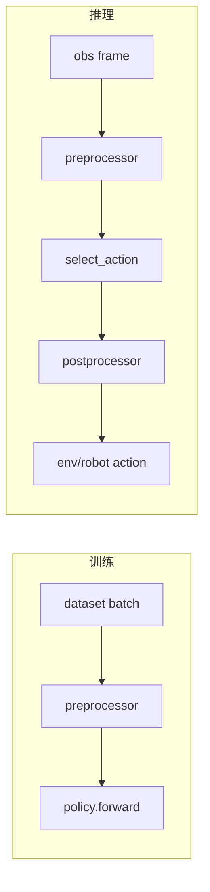
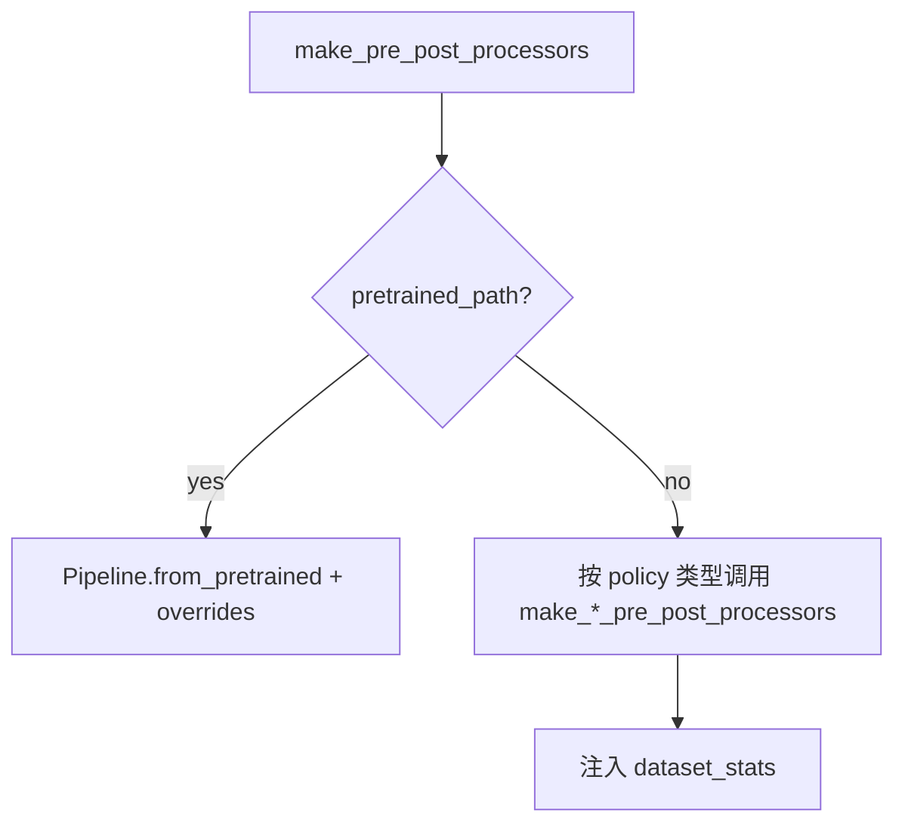

# LeRobot 第 3 阶段：Processor 体系与数据转换中间层

## 1. 本阶段目标

1. 对着工厂函数看懂「新建 vs 从 pretrained 加载」两条路径
2. 能指出训练/推理各自调用 pre/post 的位置
3. 理解 normalize/device 等 step 为何必须可序列化
4. 会调：device override、缺 stats、键名不匹配

---

## 2. 你会用到的材料

| 材料 | 用途 |
|------|------|
| `docs/source/introduction_processors.mdx` | 概念 |
| `src/lerobot/lerobot_types.py` | `EnvTransition` 等内部共享类型 |
| `src/lerobot/processor/pipeline.py` | Step / Pipeline |
| `src/lerobot/processor/normalize_processor.py` | 归一化 |
| `src/lerobot/policies/factory.py` | `make_pre_post_processors` |
| `examples/tutorial/act/act_training_example.py` | 训练侧调用 |
| `examples/tutorial/smolvla/using_smolvla_example.py` | 推理侧 override |
| `tests/processor/test_pipeline.py` | 契约 |

---

## 3. 可运行示例

### 3.1 跑 processor 测试（无硬件）

```bash
uv run pytest tests/processor/test_pipeline.py tests/processor/test_normalize_processor.py -q
```

### 3.2 在迷你训练里「打印 preprocessor 之后的键」

以 `act_training_example.py` 为模板，在：

```python
batch = preprocessor(batch)
```

后临时加：

```python
print(sorted(batch.keys()))
print({k: tuple(v.shape) for k, v in batch.items() if hasattr(v, "shape")})
```

跑 `training_steps=1`，对照 raw dataset sample 的差异。
**跑完删掉调试打印。**

### 3.3 推理侧 device override（模式记忆）

```python
preprocess, postprocess = make_pre_post_processors(
    model.config,
    model_id,
    preprocessor_overrides={"device_processor": {"device": str(device)}},
)
```

见 `examples/tutorial/smolvla/using_smolvla_example.py`。

---

## 4. 主线原理图

### 4.1 训练 / 推理对称



### 4.2 工厂分支



---

## 5. 代码解析

### 5.1 工厂入口

```143:221:src/lerobot/policies/factory.py
def make_pre_post_processors(
    policy_cfg: PreTrainedConfig,
    pretrained_path: str | None = None,
    pretrained_revision: str | None = None,
    **kwargs: Unpack[ProcessorConfigKwargs],
) -> tuple[...]:
    if pretrained_path:
        preprocessor = PolicyProcessorPipeline.from_pretrained(
            pretrained_model_name_or_path=pretrained_path,
            config_filename=kwargs.get(
                "preprocessor_config_filename", f"{POLICY_PREPROCESSOR_DEFAULT_NAME}.json"
            ),
            overrides=kwargs.get("preprocessor_overrides", {}),
            ...
        )
        postprocessor = PolicyProcessorPipeline.from_pretrained(...)
        return preprocessor, postprocessor
    # else: 按 policy 类型新建（文件后半部分）
```

**解析：**

- **有路径**：复现训练时的 step 顺序与统计量，再用 overrides 改 device 等
- **无路径**：必须提供 `dataset_stats` 等，才能新建 normalize

### 5.2 迷你训练中的用法

```python
preprocessor, postprocessor = make_pre_post_processors(cfg, dataset_stats=dataset_metadata.stats)
...
batch = preprocessor(batch)
loss, _ = policy.forward(batch)
...
preprocessor.save_pretrained(output_directory)
postprocessor.save_pretrained(output_directory)
```

**解析：** 保存三件套（policy+pre+post）是推理可复现的最低标准。

### 5.3 Pipeline 抽象（读类，不抄全家）

在 `processor/pipeline.py` 关注：

- `ProcessorStep`：单步变换
- `DataProcessorPipeline` / policy 别名类型：有序 step 列表 + Hub 序列化
- registry：按名字恢复 step 类

**解析：** 业务差异尽量变成「加一个 step」，而不是改 `forward` 里的 if。

`EnvTransition` 等内部类型现在来自 `lerobot.lerobot_types`。这是仓库内部实现
细节；教程示例需要 `FeatureType` / `PolicyFeature` 时仍从 `lerobot.configs`
导入，避免被内部文件改名牵着走。

---

## 6. 设计思路

1. **模型保持纯函数味道**：吃规范张量，吐规范动作。
2. **变换可版本化**：stats 与 step 顺序随 checkpoint 走。
3. **训练/部署同构**：同一 preprocessor，避免 train-serve skew。
4. **env/robot processor 另层**：硬件奇怪处不要污染 policy 契约。

---

## 7. 运行时调优

| 症状 | 排查 |
|------|------|
| 推理动作幅度离谱 | 是否加载了 postprocessor？stats 是否匹配数据集？ |
| MPS/CPU 仍去 CUDA | 缺 `preprocessor_overrides` device |
| KeyError 某相机名 | rename step / 特征名未对齐 |
| 训练 OK 实机崩 | 图像值域（0-1 vs 0-255）、通道顺序、分辨率 |
| 加载 processor 很慢 | 正常应很轻；若很重检查是否误载巨大权重路径 |
| 多卡 | device step 与 accelerator 设备一致性 |

---

## 8. 动手练习

1. 画出你本次调试打印的「pre 前 keys → pre 后 keys」。
2. 阅读一个 normalize 测试，用三句话总结契约。
3. 假设忘了 save postprocessor，推理会表现为什么症状？

---

## 9. 自测问题

1. pretrained 路径下 stats 还要不要每次重算？
2. pre/post 哪个负责 unnormalize action？
3. 为什么 step 要能注册/序列化？
4. env processor 与 policy processor 边界？

---

## 10. 常见坑

- 只推模型不推 processor JSON
- 在 modeling 里手写 normalize
- override 字典键名写错导致静默不用

---

## 11. 下一阶段预告

第 4 阶段用 ACT **把 processor + chunk + queue** 串成完整故事，并给 chunk/队列调优表。
