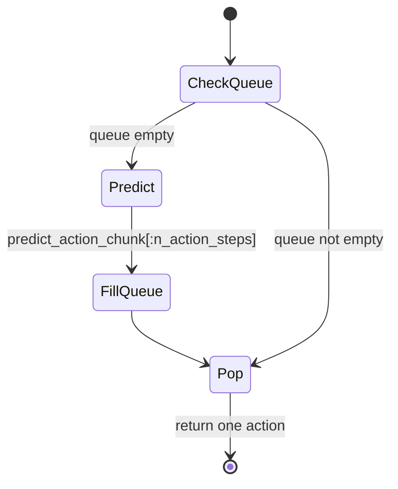

# LeRobot 第 4 阶段：ACT 策略贯通学习

## 1. 本阶段目标

1. 跑通（或精读）`examples/tutorial/act` 训练/推理骨架
2. 对着源码讲清 `forward` 的 L1(+KL) 与 `select_action` 队列
3. 理解 `chunk_size` / `n_action_steps` / temporal ensemble 约束
4. 会调：chunk 长度、执行步数、batch、实机相机契约

---

## 2. 你会用到的材料

| 材料 | 用途 |
|------|------|
| `docs/source/policy_act_README.md` | 论文入口 |
| `src/lerobot/policies/act/configuration_act.py` | 超参 |
| `src/lerobot/policies/act/modeling_act.py` | 核心逻辑 |
| `src/lerobot/policies/act/processor_act.py` | 专用 processor |
| `examples/tutorial/act/act_training_example.py` | 训练示例 |
| `examples/tutorial/act/act_using_example.py` | 实机示例 |
| `tutorial/notebooks/数据学习.ipynb`（ACT 段） | 形状直觉 |

---

## 3. 可运行示例

### 3.1 一步训练（验证链路）

编辑 `examples/tutorial/act/act_training_example.py`：

- `device` → 你的设备
- **注释** `push_to_hub`
- 保持 `training_steps = 1`

```bash
uv sync --locked --extra training
uv run python examples/tutorial/act/act_training_example.py
```

**预期：** 打印 step/loss；`outputs/robot_learning_tutorial/act/` 有保存文件。

### 3.2 正式训练形态（了解）

```bash
uv run lerobot-train \
  --policy.type=act \
  --dataset.repo_id=lerobot/svla_so101_pickplace \
  --batch_size=8 \
  --steps=100000 \
  --output_dir=outputs/train/act_so101
```

### 3.3 实机推理（有硬件；否则精读）

`act_using_example.py`：填 port/id，核对相机 key/分辨率，再循环 `select_action`。
**无硬件：跳过运行，完成下面代码解析即可。**

---

## 4. 主线原理图

### 4.1 训练数据窗


### 4.2 推理队列



---

## 5. 代码解析

### 5.1 示例：从 meta 到 delta

```python
# examples/tutorial/act/act_training_example.py（逻辑摘录）
features = dataset_to_policy_features(dataset_metadata.features)
output_features = {k: ft for k, ft in features.items() if ft.type is FeatureType.ACTION}
input_features = {k: ft for k, ft in features.items() if k not in output_features}
cfg = ACTConfig(input_features=input_features, output_features=output_features)
...
delta_timestamps = {
    "action": make_delta_timestamps(cfg.action_delta_indices, dataset_metadata.fps),
}
delta_timestamps |= {
    k: make_delta_timestamps(cfg.observation_delta_indices, dataset_metadata.fps)
    for k in cfg.image_features
}
```

**解析：** features 决定网络 I/O；`action_delta_indices` 通常是 `range(chunk_size)`，决定监督序列长度。

### 5.2 `forward`：损失怎么算

```137:164:src/lerobot/policies/act/modeling_act.py
    def forward(self, batch: dict[str, Tensor]) -> tuple[Tensor, dict]:
        ...
        actions_hat, (mu_hat, log_sigma_x2_hat) = self.model(batch)

        abs_err = F.l1_loss(batch[ACTION], actions_hat, reduction="none")
        valid_mask = ~batch["action_is_pad"].unsqueeze(-1)
        num_valid = valid_mask.sum() * abs_err.shape[-1]
        l1_loss = (abs_err * valid_mask).sum() / num_valid.clamp_min(1)
        ...
        if self.config.use_vae and log_sigma_x2_hat is not None:
            mean_kld = (...).sum(-1).mean()
            loss = l1_loss + mean_kld * self.config.kl_weight
        else:
            loss = l1_loss
        return loss, loss_dict
```

**解析：**

- 监督是 **整段 chunk** 的 L1
- `action_is_pad` 挡住越界帧
- VAE 打开时附加 KL，`kl_weight` 可调

### 5.3 `select_action`：队列

```101:123:src/lerobot/policies/act/modeling_act.py
    def select_action(self, batch: dict[str, Tensor]) -> Tensor:
        self.eval()
        if self.config.temporal_ensemble_coeff is not None:
            actions = self.predict_action_chunk(batch)
            action = self.temporal_ensembler.update(actions)
            return action

        if len(self._action_queue) == 0:
            actions = self.predict_action_chunk(batch)[:, : self.config.n_action_steps]
            self._action_queue.extend(actions.transpose(0, 1))
        return self._action_queue.popleft()
```

**解析：**

- 默认：queue 空才跑网络，一次填 `n_action_steps`
- temporal ensemble：另一条路径，配置要求 `n_action_steps==1`
- `predict_action_chunk` 内部会把图像键打包成 `OBS_IMAGES` 列表

### 5.4 配置约束（读 `__post_init__`）

- `n_action_steps <= chunk_size`
- `n_obs_steps == 1`（当前未做多观测步）
- temporal ensemble 与 `n_action_steps>1` 互斥

---

## 6. 设计思路

1. **Chunking**：用短视域轨迹缓解逐步 BC 的复合误差与抖动。
2. **队列执行**：控制频率与推理频率解耦——不必每控一步都跑 Transformer。
3. **Pad mask**：真实 episode 变长，损失必须忽略假监督。
4. **平台复用**：ACT 仍是 `PreTrainedPolicy`，可与 train/eval/Hub 无缝衔接。

---

## 7. 运行时调优

| 旋钮 | 过小 | 过大 | 建议 |
|------|------|------|------|
| `chunk_size` | 短视，抖动 | 难学、更吃显存 | 从默认 100 附近按任务地平线调 |
| `n_action_steps` | 推理太勤 | 开环太久，易偏航 | 先 =chunk 或折中；闭环要求高则减小 |
| `temporal_ensemble_coeff` | — | 需 `n_action_steps=1` | 平滑优先再开 |
| `kl_weight` / `use_vae` | 正则不足 | 动作重建变差 | 看 `l1_loss` vs `kld_loss` 日志 |
| `batch_size` | 噪声大 | OOM | 图像分辨率↑则 batch↓ |
| 实机相机 | — | key/分辨率错则必失败 | 对齐训练 `info`/model card |
| 部署 device | — | MPS 算子缺口 | override device；必要时 CPU 对照 |

**训练时长经验（粗）：** 小任务从数小时级起步，以 eval/实机成功率为准，不是只看 loss。

---

## 8. 动手练习

1. 注释 push 后跑通一步训练。
2. 用笔记模拟 queue：`n_action_steps=4` 时，多少 env step 触发一次 `predict_action_chunk`？
3. 在 notebook 看 `action_is_pad` 如何影响假想 loss。

---

## 9. 自测问题

1. 为什么 `forward` 要看 `action_is_pad`？
2. queue 用 `transpose(0,1)` 的原因？
3. temporal ensemble 时为何限制 `n_action_steps`？
4. 训练示例为何要 `dataset_to_policy_features`？

---

## 10. 常见坑

- 实机相机名写成 `side/up` 但模型要别的 key
- 只加载 policy 不加载 processor
- 把 `training_steps=1` 当收敛

---

## 11. 下一阶段预告

第 5 阶段用 **Diffusion** 对照：同样队列思想，换成观测历史 + 去噪生成 + `horizon`。
