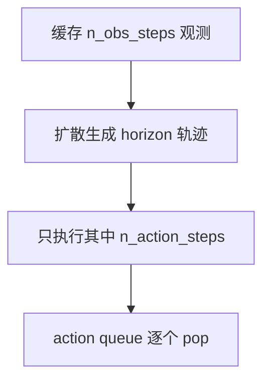

# LeRobot 第 5 阶段：Diffusion Policy 对照学习

## 1. 本阶段目标

1. 跑通/精读 `examples/tutorial/diffusion` 与 ACT 示例的平行结构
2. 讲清 `n_obs_steps` / `horizon` / `n_action_steps` 与 docstring 时间表
3. 对照 ACT：训练目标与推理成本差异
4. 会调：`num_inference_steps`、scheduler、horizon、显存

---

## 2. 你会用到的材料

| 材料 | 用途 |
|------|------|
| `docs/source/policy_diffusion_README.md` | 论文入口 |
| `configuration_diffusion.py` | 时间窗与约束 |
| `modeling_diffusion.py` | `select_action` / `forward` / scheduler |
| `processor_diffusion.py` | 专用 processor |
| `examples/tutorial/diffusion/` | 示例 |
| 对照第 4 阶段 ACT 文档 | 对照表 |

---

## 3. 可运行示例

### 3.1 一步训练

```bash
# 编辑 diffusion_training_example.py：改 device、注释 push_to_hub
uv run python examples/tutorial/diffusion/diffusion_training_example.py
```

注意示例里 `delta_timestamps` 含 `observation.state` + `action` + 图像键——比 ACT 更「历史化」。

### 3.2 正式训练（形态）

```bash
uv run lerobot-train --policy.type=diffusion --dataset.repo_id=<your_repo> \
  --batch_size=8 --steps=100000 --output_dir=outputs/train/diffusion_demo
```

依赖：`diffusers`（`diffusion` extra / 训练栈按报错补）。

---

## 4. 主线原理图

### 4.1 与 ACT 平行的平台路径


### 4.2 推理时间表（源码 docstring 可视化）



约束直觉：`n_action_steps <= horizon - n_obs_steps + 1`（见 `select_action` 文档字符串）。

---

## 5. 代码解析

### 5.1 时间索引如何生成

```251:256:src/lerobot/policies/diffusion/configuration_diffusion.py
    def observation_delta_indices(self) -> list:
        return list(range(1 - self.n_obs_steps, 1))

    def action_delta_indices(self) -> list:
        return list(range(1 - self.n_obs_steps, 1 - self.n_obs_steps + self.horizon))
```

**例：** `n_obs_steps=2, horizon=64` → obs indices `[-1,0]`；action 从 `-1` 起长度为 64。
这直接决定 dataset 切片，是「算法→数据」的硬接口。

### 5.2 `select_action`：双队列（obs 历史 + action）

```125:161:src/lerobot/policies/diffusion/modeling_diffusion.py
    def select_action(self, batch: dict[str, Tensor], noise: Tensor | None = None) -> Tensor:
        if ACTION in batch:
            batch.pop(ACTION)
        ...
        self._queues = populate_queues(self._queues, batch)

        if len(self._queues[ACTION]) == 0:
            actions = self.predict_action_chunk(batch, noise=noise)
            self._queues[ACTION].extend(actions.transpose(0, 1))

        action = self._queues[ACTION].popleft()
        return action
```

**解析：**

- 先更新观测队列，再在 action 队列空时触发扩散生成
- 与 ACT 相同「段式生成 + 逐步消费」，但生成器是 denoising

### 5.3 `forward`：训练只做扩散损失

```163:173:src/lerobot/policies/diffusion/modeling_diffusion.py
    def forward(self, batch: dict[str, Tensor]) -> tuple[Tensor, None]:
        ...
        loss = self.diffusion.compute_loss(batch)
        return loss, None
```

`compute_loss` 内部：采样噪声时间步 → `add_noise` → U-Net 预测 → 与噪声/样本目标比（读该函数注释）。
**对比 ACT：** 不是直接 L1 回归干净动作（除非配置成 sample prediction，仍属扩散入口）。

### 5.4 推理步循环（成本中心）

`conditional_sample` 里对 `noise_scheduler.timesteps` 循环 `num_inference_steps` 次。
**解析：** 实机延迟主要看这里，而不是 `forward` 训练路径。

---

## 6. 设计思路

1. **多模态条件 + 轨迹分布**：扩散适合多峰动作分布。
2. **观测历史**：缓解部分可观测，提供动态线索。
3. **Horizon 建模 vs 执行截取**：学更长上下文，执行只取可靠前缀。
4. **平台层故意与 ACT 同构**：降低「换算法就要换数据管道」的成本。

### ACT vs Diffusion（实操对照）

| 项 | ACT | Diffusion |
|----|-----|-----------|
| 观测 | 常 1 步 | `n_obs_steps`（如 2） |
| 长度名 | `chunk_size` | `horizon` |
| 训练 | L1(+KL) | 扩散损失 |
| 推理成本 | 一次前向/段 | × `num_inference_steps` |
| 骨干 | Transformer | Cond. U-Net |

---

## 7. 运行时调优

| 旋钮 | 建议 |
|------|------|
| `num_inference_steps` | 延迟高 → 降；质量差 → 升；可试 DDIM 换更少步 |
| `noise_scheduler_type` | DDPM 稳、DDIM 常更快 |
| `horizon` | 须满足 U-Net 下采样整除；过大显存↑ |
| `n_action_steps` | 开环误差↑则减小，更勤重新规划 |
| `n_obs_steps` | 增历史吃 IO/显存；从 2 起步 |
| `batch_size` | 扩散 U-Net + 多帧图像很吃显存，优先降 batch |
| `drop_n_last_frames` | 与窗口完整性相关，别随意改到数据变「空」 |
| 与 ACT 同任务对比 | 固定数据与评测协议，只换 policy.type |

---

## 8. 动手练习

1. 并排打开两个 `*_training_example.py`，列出相同步骤与仅有差异。
2. 用默认 `n_obs_steps/horizon` 手算 `action_delta_indices` 长度是否等于 horizon。
3. 写一条「若控制频率 30Hz、每次扩散 100ms」时，`n_action_steps` 下限的粗算。

---

## 9. 自测问题

1. 为何 `select_action` 要 `pop(ACTION)`？
2. 不等式 `n_action_steps <= horizon - n_obs_steps + 1` 直觉？
3. 训练慢与推理慢分别先查什么？
4. 平台相同指的是哪几层？

---

## 10. 常见坑

- 用 ACT 单帧 batch 形状读 Diffusion
- horizon 与 `down_dims` 不兼容
- 推理步数当成 epoch

---

## 11. 下一阶段预告

第 6 阶段进入 **`rollout`**：env/policy 双 processor 串联与评测调优。
