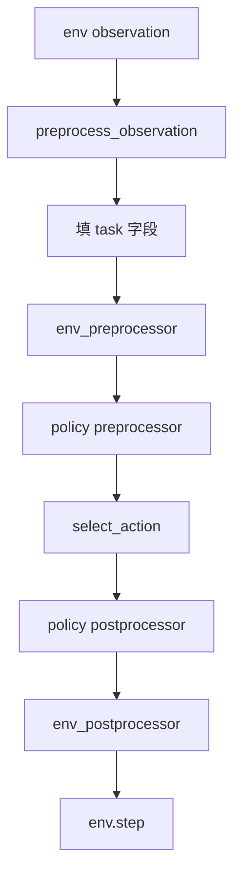
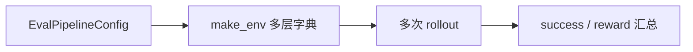

# LeRobot 第 6 阶段：env 与 eval 评测主线学习

## 1. 本阶段目标

1. 对着 `rollout` 源码指出每一步变换
2. 分清 env pre/post 与 policy pre/post
3. 会跑 `lerobot-eval --help` 并读懂关键旋钮
4. 会调：并行 env 数、episode 数、异步 env、录像开销

---

## 2. 你会用到的材料

| 材料 | 用途 |
|------|------|
| `src/lerobot/scripts/lerobot_eval.py` | `rollout` / `eval_policy_all` |
| `src/lerobot/scripts/lerobot_rollout.py` | 实机 rollout 与 action chunk 执行策略 |
| `src/lerobot/configs/eval.py`、`default.py` | 评测配置 |
| `src/lerobot/envs/factory.py` | `make_env` |
| `src/lerobot/envs/utils.py` | `preprocess_observation` 等 |
| `tests/envs/test_envs.py` | 契约 |

---

## 3. 可运行示例

### 3.1 先看 CLI 面

```bash
uv run lerobot-eval --help | head -n 100
```

### 3.2 装一个仿真 extra 再评（可选）

```bash
uv sync --locked --extra pusht --extra training
# 以下需你已有 policy 目录或 Hub id；路径按实际改
# uv run lerobot-eval \
#   --policy.path=outputs/train/xxx/checkpoints/last/pretrained_model \
#   --env.type=pusht \
#   --eval.n_episodes=10 \
#   --eval.batch_size=2
```

**降级：** 无 checkpoint 时，精读 `rollout` + 跑 `tests/envs`（按本机依赖）。

```bash
uv run pytest tests/envs/test_envs.py -q
```

---

## 4. 主线原理图

### 4.1 Rollout 一步



### 4.2 批量评测汇总



---

## 5. 代码解析

### 5.1 `rollout` 核心步进（精读这段）

```261:296:src/lerobot/scripts/lerobot_eval.py
        while not np.all(done) and step < max_steps:
            observation = preprocess_observation(observation)
            ...
            try:
                observation["task"] = list(env.call("task_description"))
            except (AttributeError, NotImplementedError):
                try:
                    observation["task"] = list(env.call("task"))
                except (AttributeError, NotImplementedError):
                    observation["task"] = [""] * env.num_envs

            observation = env_preprocessor(observation)
            observation = preprocessor(observation)
            with torch.inference_mode():
                action = policy.select_action(observation)
            action = postprocessor(action)

            action_transition = {ACTION: action}
            action_transition = env_postprocessor(action_transition)
            action = action_transition[ACTION]
            ...
            observation, reward, terminated, truncated, info = env.step(action_numpy)
```

**逐段：**

| 步骤 | 干什么 |
|------|--------|
| `preprocess_observation` | gym/numpy → 更接近 LeRobot 的张量字典 |
| `task` | VLA/多任务需要；没有就空串 |
| `env_preprocessor` | 环境族特殊处理（如某 benchmark） |
| `preprocessor` | **与训练一致**的 normalize 等 |
| `select_action` | 策略（可能用内部 queue） |
| `postprocessor` + `env_postprocessor` | 回到 env 可接受的动作 |
| `env.step` | 物理/仿真推进 |

### 5.2 向量环境语义

`rollout` 文档写明：batch 内所有 env 跑到最后一个结束——早结束的轨迹后部可能要 mask。
**解析：** 看 `done` 累积张量再算指标，别裸平均。

### 5.3 与训练的衔接

`lerobot_train.py` 在 `env_eval_freq` 触发时调用 `eval_policy_all`——**同一套评测逻辑**，不是另一套平行宇宙。

### 5.4 标准 eval 与 RTC 不是同一条执行路径

`lerobot_eval.rollout()` 每一步调用 `policy.select_action()`。SmolVLA、π0/π0.5
等 policy 启用 RTC 时会拒绝这条路径，因为 RTC 需要 `predict_action_chunk()`
以及对上一 chunk 剩余动作的管理。要点是：

- 标准仿真 eval：使用未启用 RTC 的 policy 配置；
- RTC / 异步实机控制：走 `lerobot-rollout` 对应的 chunk 执行策略；
- 不要为了绕过 assert 直接删除 policy 内的 RTC 检查，否则上一 chunk 的前缀语义会丢失。

---

## 6. 设计思路

1. **双层 processor**：隔离「基准环境怪异之处」与「策略契约」。
2. **VectorEnv**：用并行换评测吞吐。
3. **policy.reset()**：chunk/diffusion 队列必须在 episode 边界清空。
4. **可选录像/落盘**：`recording_dir` 等把失败 case 变成可回看数据集。

---

## 7. 运行时调优

| 旋钮 | 建议 |
|------|------|
| `eval.batch_size` / `n_envs` | 越大越快也越吃 CPU/GPU；调试用 1 |
| `eval.n_episodes` | 统计要稳就增加；冒烟用 5–10 |
| `use_async_envs` | 吞吐↑，调试难度↑；先 sync |
| 图像渲染/录像 | 显著变慢；只在复盘时开 |
| 策略 queue | 每个 episode 确保 `policy.reset()`（rollout 开头有） |
| RTC policy 在 eval 中报错 | 标准 eval 走 `select_action` | 关闭 RTC，或改走支持 chunk/RTC 的 rollout 路径 |
| 成功率异常低 | 先查 processor 是否与训练同目录加载 |
| 多任务 suite | 先单 task 确认，再 `eval_policy_all` |

---

## 8. 动手练习

1. 把 4.1 图上的每个框对应到源码行。
2. 解释：为何 VLA 评测要费劲取 `task_description`。
3. 设计一个「只改 eval.batch_size」的对比实验记录表。

---

## 9. 自测问题

1. 少了 policy postprocessor 会怎样？
2. `np.all(done)` 循环退出条件的含义？
3. 训练中 eval 与独立 `lerobot-eval` 关系？
4. 为什么要 `torch.inference_mode()`？
5. 为什么 RTC-enabled policy 不能直接塞进标准 `lerobot-eval`？

---

## 10. 常见坑

- 环境 extra 未装
- 用训练中的随机 seed 却抱怨不可复现
- 异步 env 下 print 调试错位
- 把 RTC 的 chunk 级接口误当成标准 `select_action` 单步接口

---

## 11. 下一阶段预告

第 7 阶段看 **SmolVLA**：语言如何进入同一套 rollout/实机骨架。
