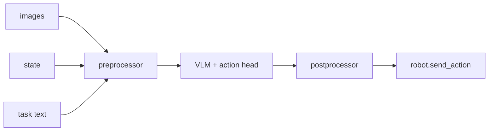
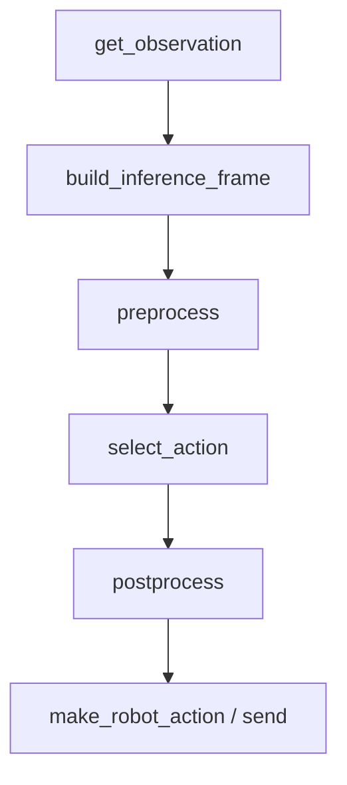

# LeRobot 第 7 阶段：SmolVLA 与 VLA 路线入门

## 1. 本阶段目标

1. 对照 ACT/SmolVLA/π0 三个 using 示例，列出相同骨架与 VLA 增量
2. 精读 `task` 如何进入 `build_inference_frame` / processor
3. 会加载预训练 + device override
4. 会调：显存、指令文本、相机命名、推理设备

---

## 2. 你会用到的材料

| 材料 | 用途 |
|------|------|
| `docs/source/smolvla.mdx` | 使用指南 |
| `docs/source/policy_smolvla_README.md` | 模型入口 |
| `src/lerobot/policies/smolvla/` | config/processor/modeling |
| `tests/processor/test_smolvla_processor.py` | 契约 |
| `examples/tutorial/smolvla/using_smolvla_example.py` | 主示例 |
| `examples/tutorial/pi0/using_pi0_example.py` | 对照 |

---

## 3. 可运行示例

### 3.1 依赖

```bash
uv sync --locked --extra smolvla --extra training
```

### 3.2 只加载权重做「空转形状」检查（可无机器人）

```bash
uv run python - <<'PY'
import torch
from lerobot.policies.smolvla import SmolVLAPolicy
from lerobot.policies import make_pre_post_processors

device = torch.device("cpu")  # 或 mps/cuda
model_id = "lerobot/smolvla_base"
model = SmolVLAPolicy.from_pretrained(model_id)
pre, post = make_pre_post_processors(
    model.config,
    model_id,
    preprocessor_overrides={"device_processor": {"device": str(device)}},
)
print("policy", type(model).__name__)
print("pre steps", len(getattr(pre, "steps", getattr(pre, "_steps", []))) )
PY
```

**预期：** 能下载/加载；打印类型。显存不够用 CPU。
**降级：** 网络或磁盘不足时，精读示例 + processor 测试即可。

### 3.3 实机（有硬件）

按 `using_smolvla_example.py`：填 port/id、**相机 key 对齐 model card**、写好 `task` 字符串。

---

## 4. 主线原理图

### 4.1 VLA 数据流



### 4.2 三示例同构



VLA 增量主要在 **B（task/robot_type）** 与 **C（tokenize等 step）**。

---

## 5. 代码解析

### 5.1 加载 + override

```python
# examples/tutorial/smolvla/using_smolvla_example.py
model = SmolVLAPolicy.from_pretrained(model_id)
preprocess, postprocess = make_pre_post_processors(
    model.config,
    model_id,
    preprocessor_overrides={"device_processor": {"device": str(device)}},
)
```

**解析：** 第二参数 `model_id` 走 pretrained processor 路径（与第 3 阶段工厂分支对应）；override 避免默认 CUDA。

### 5.2 语言与特征对齐

```python
task = ""  # e.g. "pick the red block"
robot_type = ""
action_features = hw_to_dataset_features(robot.action_features, "action")
obs_features = hw_to_dataset_features(robot.observation_features, "observation")
dataset_features = {**action_features, **obs_features}

obs_frame = build_inference_frame(
    observation=obs, ds_features=dataset_features, device=device,
    task=task, robot_type=robot_type,
)
```

**解析：**

- `hw_to_dataset_features`：硬件字典 → 数据集风格键
- `task`：空字符串也能跑通骨架，但**技能表现依赖有意义指令**
- `robot_type`：多具身消歧

### 5.3 控制闭环（与 ACT 同型）

```python
obs = preprocess(obs_frame)
action = model.select_action(obs)
action = postprocess(action)
action = make_robot_action(action, dataset_features)
robot.send_action(action)
```

**解析：** 学 VLA 时先确认这 5 行，再下钻 `smolvlm_with_expert.py`。

### 5.4 Processor 测试优先于 modeling

打开 `tests/processor/test_smolvla_processor.py`：看它对 task/图像的断言。
**解析：** 大模型文件很长；契约测试是更高效的「说明书」。

### 5.5 冻结开关要按实际参数边界理解

SmolVLA 默认 `freeze_vision_encoder=True`、`train_expert_only=True`。当你把
`train_expert_only=False` 用于更广的微调时，源码仍会冻结为 DDP 兼容而保留的
末层/归一化参数，并会检查每个冻结模式确实匹配到了真实 VLM 参数名。若未来
Transformers 改了命名，这里应显式报错，而不是静默把本该冻结的层训练起来。

调参时先记录可训练参数数量；不要只看一个布尔开关就假设“整个 VLM 全量解冻”。

---

## 6. 设计思路

1. **语言是一等公民**：与图像/状态一起进 preprocessor，而不是推理脚本临时字符串拼接进模型内部。
2. **预训练 + 微调**：Hub 权重降低从零训练成本。
3. **多具身字段预留**：同一套 VLA 服务多个 robot_type。
4. **阅读顺序强制**：config → processor/测试 → I/O 方法 → 内部 VLM。

---

## 7. 运行时调优

| 场景 | 建议 |
|------|------|
| 显存不足 | CPU/MPS；减图像分辨率；看 smolvla 文档推荐 batch |
| 指令无效 | 使用与训练相近的句式/语言；避免空 task 期望泛化奇迹 |
| 相机 key 错 | 查 Hub `info.json` / config 的 visual features |
| 设备错 | `preprocessor_overrides` + `model.to(device)`（若需要） |
| 推理太慢 | 更小模型/量化（若文档支持）；异步推理见 async-inf 示例 |
| 微调不收敛 | 先确认数据集含语言列；学习率与冻结策略按 smolvla.mdx |
| 解冻后可训练参数数量异常 | Transformers 参数名或冻结模式变化 | 检查 `set_requires_grad()` 与启动日志，不要忽略匹配失败 |
| 对比 π0 | 只换政策类与相机命名，骨架不动，便于定位问题层 |

---

## 8. 动手练习

1. 三表示例 diff：ACT vs SmolVLA vs π0（相机字典、task、overrides）。
2. 跑第 3.2 加载脚本（或精读）。
3. 用一句话写「若 task 分布偏移，失败应先查哪一层」。

---

## 9. 自测问题

1. VLA 相对 ACT 的最小增量输入？
2. `make_pre_post_processors(model.config, model_id)` 第二参含义？
3. 为什么阅读顺序把 modeling 放最后？
4. `build_inference_frame` 解决什么问题？

---

## 10. 常见坑

- 未装 `smolvla` extra
- 相机命名照抄 ACT 教程
- 一上来读满 expert 文件

---

## 11. 下一阶段预告

第 8 阶段：**RL actor/learner** 与 **teleop→record→train** 实机闭环，附安全与调优。
