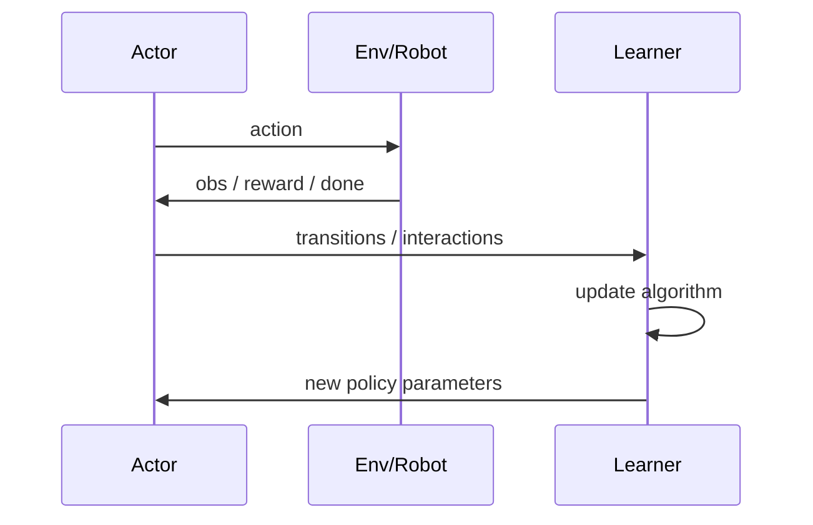
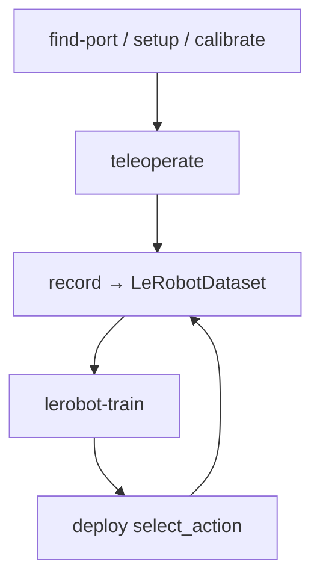

# LeRobot 第 8 阶段：RL 与真实机器人闭环学习

## 1. 本阶段目标

1. 用序列图讲清 actor ↔ learner 传什么
2. 列出 SO 臂从找口到 record 的可复制命令链
3. 对照 IL 主链，指出 RL 多出的复杂度来源
4. 会调：控制频率、相机、标定、RL 通信/缓冲相关症状

---

## 2. 你会用到的材料

| 材料 | 用途 |
|------|------|
| `src/lerobot/rl/learner.py` | learner |
| `src/lerobot/rl/actor.py` | actor |
| `src/lerobot/rl/algorithms/sac/` | HIL-SERL 使用的 SAC 算法实现 |
| `src/lerobot/policies/gaussian_actor/` | actor policy 网络 |
| `src/lerobot/rewards/classifier/` | 视觉奖励分类器 |
| `tests/rl/` | 契约 |
| `docs/source/hilserl.mdx` | HIL-SERL |
| `docs/source/integrate_hardware.mdx` | 硬件抽象 |
| `docs/source/il_robots.mdx` | 实机 IL |
| `src/lerobot/scripts/lerobot_{find_port,setup_motors,calibrate,teleoperate,record}.py` | 实机脚本 |
| `examples/tutorial/rl/`、`async-inf/` | 示例 |
| `AGENT_GUIDE.md` | 命令速查 |

---

## 3. 可运行示例

### 3.1 无硬件：RL 测试 + 读入口

```bash
uv run pytest tests/rl -q --maxfail=5
```

精读符号：

- `learner.train` / `add_actor_information_and_train`
- `actor.actor_cli` / `act_with_policy`

### 3.2 有硬件：冒烟链（**注意安全工作空间**）

```bash
# 1) 找串口
uv run lerobot-find-port

# 2) 电机 ID（一次性，按文档）
# uv run lerobot-setup-motors --robot.type=so101_follower --robot.port=<PORT>

# 3) 标定
# uv run lerobot-calibrate --robot.type=so101_follower --robot.port=<PORT> --robot.id=my_follower

# 4) 遥操作验证（leader/follower 参数见 AGENT_GUIDE）
# uv run lerobot-teleoperate --robot.type=so101_follower ... --teleop.type=so101_leader ...

# 5) 录制
# uv run lerobot-record --robot.type=so101_follower ... --dataset.repo_id=<HF_USER>/demo ...
```

**无硬件：整节标记为阅读练习，画闭环图即可算完成本阶段认知目标。**

### 3.3 异步推理（可选阅读）

`examples/tutorial/async-inf/policy_server.py` + `robot_client.py`：当 `select_action` 太慢赶不上控制频率时拆进程。

---

## 4. 主线原理图

### 4.1 Actor / Learner



### 4.2 实机 IL 闭环



---

## 5. 代码解析

### 5.1 Learner 侧职责（按符号阅读）

在 `learner.py` 定位：

| 符号 | 职责 |
|------|------|
| `train_cli` / `train` | 入口与配置 |
| `start_learner` / `start_learner_threads` | 服务线程模型 |
| `add_actor_information_and_train` | 消化 actor 数据并更新 |
| `initialize_replay_buffer` | 缓冲 |
| `save_training_checkpoint` / `handle_resume_logic` | 续训 |

**解析：** Learner **不**直接拧电机；它消费 transition、产出新参数。

### 5.2 Actor 侧职责

在 `actor.py` 定位：

| 符号 | 职责 |
|------|------|
| `actor_cli` | 启动 |
| `act_with_policy` | 与环境交互主循环 |
| `send_transitions` / `receive_policy` | 传输 |
| `update_policy_parameters` | 本地权重替换 |

**解析：** Actor 靠近实时回路；任何阻塞（大模型同步推理）都会直接打控制频率。

### 5.3 实机脚本与 Robot 契约

应用层应依赖：

```python
robot.connect()
obs = robot.get_observation()
robot.send_action(action)
```

具体实现如 `src/lerobot/robots/so_follower/`。
**解析：** 换臂 ≠ 改 `lerobot_train.py`；换的是 Robot 实现 + 配置 type。

### 5.4 Record 接回 IL

`lerobot-record` 写出的是 LeRobotDataset → 直接进入你在第 1–5 阶段学的训练主链。
这是「硬件课」与「算法课」的接口合同。

---

## 6. 设计思路

1. **Actor-Learner 分离**：实时与重计算解耦，便于远端 GPU learner。
2. **Robot 抽象**：把串口/相机细节关进硬件层。
3. **先 teleop 再 record**：人不能稳定完成的任务，BC 很难救。
4. **HIL-SERL 等专题**：人在回路提高样本效率——中文深度指南见 [`../models/reinforcement-learning/HIL-SERL.md`](../models/reinforcement-learning/HIL-SERL.md)，英文工作流见 `docs/source/hilserl.mdx`。别和离线 ACT 混成一套超参。

---

## 7. 运行时调优

### 7.1 实机 / 数据

| 症状 | 建议 |
|------|------|
| 抖动、无力 | 标定重做；供电；线缆 |
| 相机掉帧 | 降分辨率/fps；USB 带宽；固定曝光 |
| 策略「像盲了」 | 相机 key/外参/色彩与训练不一致 |
| record 不同步 | fps 设置；编码线程；`streaming_encoding` 文档项 |
| 串口权限 | Linux `udev` / chmod；独占占用 |

### 7.2 RL

| 症状 | 建议 |
|------|------|
| actor 频率告警 | 减观测、异步推理、更小网络 |
| learner 空转 | 查队列/连接；transition 是否发送 |
| 不稳定 | 缓冲大小、学习率、离线数据占比（若有） |
| 难复现 | seed、多线程竞态；先单线程模式（若配置支持） |

### 7.3 部署

| 症状 | 建议 |
|------|------|
| 推理超预算 | `async-inf`；减 Diffusion steps；ACT 增 `n_action_steps` 权衡 |
| 安全 | 限速、工作空间、急停；先悬空/低增益 |

---

## 8. 动手练习

1. 画 actor/learner 序列图并标注「传 transition / 传参数」方向。
2. 无硬件者：只跑 `lerobot-find-port`；有硬件者：teleoperate 30 秒冒烟。
3. 写「从 record 到 ACT 训练」的命令草稿（可假端口）。

---

## 9. 自测问题

1. 谁更新权重？谁与环境交互？
2. 为何 teleoperate 在 record 前？
3. IL 与 RL 数据流各一句？
4. 异步推理解决什么矛盾？

---

## 10. 常见坑

- 未标定就大规模 record
- 在 learner 进程里直接操作电机
- 忽视安全边界

---

## 11. 下一阶段预告

主线课到此闭环。后续自选：

- 实现一个小 `ProcessorStep`
- 接入自定义 Robot
- 精读一篇论文并做「论文→配置→损失」映射表
- 回到 [阶段学习地图](./README.md) 做总自测

建议复习路径：用第 4/5 阶段示例各跑一步训练 → 第 6 阶段读完 `rollout` → 第 8 阶段补上你的硬件清单。
