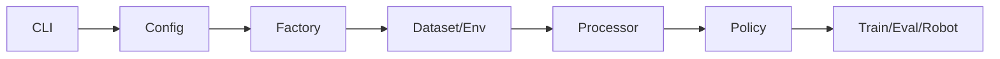

# LeRobot 阶段学习地图

> 总入口与教学法见 [tutorial/README.md](../README.md)。
> 每课固定五件套：**可运行示例 → 图示 → 代码解析 → 设计思路 → 运行时调优**。

## 1. 学习目标

学完后你应能：

1. 把 `lerobot-train` / `lerobot-eval` / record 主链画出来并对着源码指认
2. 解释 dataset 时间窗、processor、policy 三者如何咬合
3. 以 ACT 与 Diffusion 为例，对比「同平台、不同生成范式」
4. 在 OOM、掉帧、成功率崩、指令无效时知道先调哪一层

---

## 2. 平台主线

关键文件速查：

- `src/lerobot/scripts/lerobot_train.py`（`train` / `update_policy`）
- `src/lerobot/configs/train.py`
- `src/lerobot/datasets/factory.py`
- `src/lerobot/processor/pipeline.py`
- `src/lerobot/policies/factory.py`
- `src/lerobot/scripts/lerobot_eval.py`（`rollout`）
- `src/lerobot/common/train_utils.py`

---

## 3. 课程表与示例锚点

| 阶段 | 文档 | 示例锚点 |
|------|------|----------|
| 0 | [预热](./00-项目预热.md) | `uv sync` / `pytest` / `lerobot-info` |
| 1 | [训练主链](./01-训练主链与配置.md) | `lerobot-train` + ACT 迷你脚本 |
| 2 | [数据集](./02-数据集.md) | [数据学习.ipynb](../notebooks/数据学习.ipynb) |
| 3 | [Processor](./03-Processor.md) | `make_pre_post_processors` |
| 4 | [ACT](./04-ACT.md) | `examples/tutorial/act/` |
| 5 | [Diffusion](./05-Diffusion.md) | `examples/tutorial/diffusion/` |
| 6 | [Eval](./06-Env与Eval.md) | `rollout` / `lerobot-eval` |
| 7 | [VLA](./07-SmolVLA与VLA.md) | `examples/tutorial/smolvla/` |
| 8 | [RL/硬件](./08-RL与真实机器人.md) | teleop/record + actor/learner |

---

## 4. 五周节奏（可压缩）

| 周 | 内容 |
|----|------|
| 1 | 0–1：环境 + 训练主链（含一步迷你训练） |
| 2 | 2–3：数据集 notebook + processor 调试打印 |
| 3 | 4–5：ACT / Diffusion 对照 + 调优表 |
| 4 | 6：读通 rollout；能跑仿真更好 |
| 5 | 7 或 8 选一深入，另一份略读 |

---

## 5. 总自测

1. `update_policy` 里算法相关调用是哪一步？
2. `resolve_delta_timestamps` 输入输出是什么？
3. 为什么必须保存 preprocessor/postprocessor？
4. ACT 队列空时发生什么？Diffusion 还多缓存了什么？
5. `rollout` 里 env/policy processor 顺序？
6. SmolVLA 示例为何要 `task` + device override？
7. Actor 与 Learner 谁靠近电机？

答不上来就回到对应阶段的「代码解析 / 调优」节，不要只重读「先抓结论」。

---

## 6. 学习建议

- **先跑后读**：能跑一步就跑一步；不能跑就严格按降级路径精读。
- **改一处测一处**：调 `batch_size` / `n_action_steps` / `num_inference_steps` 时记现象。
- **重视 tests/**：比 modeling 大文件更适合建立契约。
- **最终能力**：`论文概念 → 配置 → 数据窗 → processor → forward/select_action → 调优`。
